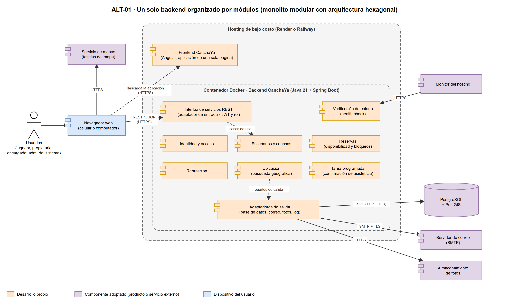

# Alternativa seleccionada (ALT-01)

> Archivo generado por `scripts/exportar_docs.py` a partir de `1. Artefactos proyecto/1.2. Artefactos técnicos/1. Diseño arquitectónico/4. Alternativas de solución/3. Alternativa seleccionada/Alternativa seleccionada - CanchaYa.xlsx`. No lo edites a mano: cambia el Excel y vuelve a ejecutar el script.

## Arquitectura de referencia

- Arquitectura de la alternativa seleccionada: ALT-01 · Un solo backend organizado por módulos (monolito modular con arquitectura hexagonal)
- Fuente editable: 1. Alternativas planteadas/Alternativa 1/ALT-01 Monolito modular hexagonal - CanchaYa.drawio

## AlternativaSoluciónSeleccionada

- Componente · Tipo componente · Descripción · Justificación · ¿Es un bloque de construcción? · Tipo Componente Construcción
- Frontend CanchaYa · Desarrollo propio · Aplicación de una sola página que se ejecuta en el navegador del celular o del computador. Muestra las pantallas, revisa cada dato al escribirlo y llama a los servicios REST del backend. No decide reglas de negocio. · Separar el frontend del backend es la restricción RT-01. Diseñar primero para el celular y revisar los datos al escribirlos son las tácticas AC-03.1 y AC-03.2, que responden a la usabilidad, tercer atributo del Mini QAW (ESC-USA-01 a ESC-USA-04). · SI · Soporte
- Backend CanchaYa · Desarrollo propio · Programa único que se publica en un solo contenedor y expone la interfaz de servicios REST. Por dentro se divide en cinco módulos, uno por contexto del dominio, con arquitectura hexagonal. · Es la alternativa ALT-01, elegida en la evaluación de alternativas por cumplir todas las restricciones y obtener el mayor puntaje ponderado. Cumple RT-02 (hexagonal + DDD) y cabe en RNG-01, RNG-03 y RNG-04. · SI · Core
- Interfaz de servicios REST · Desarrollo propio · Adaptador de entrada del backend: recibe las peticiones, revisa el token y el rol y entrega cada solicitud al módulo que corresponde. · Revisar quién es y qué puede hacer en cada operación es la táctica AC-04.1 (ESC-SEG-01). Concentrarlo en un solo punto evita que un servicio quede sin control. · NO · Soporte
- Módulo Identidad y acceso · Desarrollo propio · Registro, inicio de sesión, perfil, roles y límite de intentos de inicio de sesión. · Implementa RT-06, la táctica AC-04.3 (D28, ESC-SEG-03) y las reglas de registro de D12 y RNG-06. · NO · Soporte
- Módulo Escenarios y canchas · Desarrollo propio · Escenarios, canchas, horarios, tarifas, fotos, bloqueos, encargados de sede, activación por el administrador del sistema y búsqueda de escenarios por radio. · Es el contexto que permite al propietario publicar su oferta sin ayuda (ESC-USA-03, RNG-09). Está en el mismo backend que Reservas, para que los horarios, los bloqueos y las reservas se revisen en la misma transacción. La búsqueda por radio responde al mayor problema del 66,3 % de los jugadores, encontrar disponibilidad cerca, y usa el índice espacial de la táctica AC-05.1 (ESC-REN-01). Bloqueo pertenece a este contexto en el modelo de dominio enriquecido. · NO · Core
- Módulo Reservas · Desarrollo propio · Disponibilidad, reservas de 1 o 2 franjas, cancelaciones, inasistencias y agenda. Al reservar respeta los horarios y los bloqueos que registra Escenarios y canchas. · Es el corazón del producto. Aplica las tácticas AC-01.1 a AC-01.3 (D29) para la meta de cero dobles reservas (ESC-INT-01 a ESC-INT-03) y la táctica AC-05.2 para calcular la disponibilidad en una sola consulta (ESC-REN-02). · NO · Core
- Módulo Reputación · Desarrollo propio · Reseñas y calificación promedio, calculada al consultar. · Cubre las historias del Release 3 y la decisión D05. · NO · Soporte
- Módulo Ubicación · Desarrollo propio · Catálogo de departamentos y ciudades (DANE), de solo lectura, que se carga con datos iniciales. · Cumple RNG-07 (ámbito Antioquia, datos del DANE). Escenarios y canchas lo usa para la ciudad de cada escenario y para buscar por ciudad cuando no hay permiso de ubicación (D11). No depende de ningún otro módulo. · NO · Soporte
- Tarea programada · Desarrollo propio · Pide confirmar asistencia y cancela de forma automática las reservas sin confirmar. · Es idempotente (táctica AC-02.2, ESC-DIS-03) y cambia la reserva solo si sigue en el estado esperado (táctica AC-01.3, ESC-INT-03). · NO · Soporte
- Adaptadores de salida · Desarrollo propio · Conectan los módulos con la base de datos, el correo, el almacenamiento de fotos y el log. · Separar las reglas de la tecnología es la táctica AC-07.2. El correo se envía después de guardar (táctica AC-02.1, RT-11, ESC-DIS-02) y el log es estructurado y sin datos sensibles (táctica AC-06.2, RT-12). · NO · Soporte
- Verificación de estado · Desarrollo propio · Punto de consulta que indica si la aplicación está sana, incluida su conexión con la base de datos. · Es la táctica AC-02.3: el hosting reinicia el contenedor si no responde (ESC-DIS-01, ESC-DIS-04). · NO · Genérico
- Base de datos relacional con extensión geográfica · Componente adoptado · Guarda todos los datos del modelo de dominio enriquecido. Aplica la restricción de exclusión de reservas y la búsqueda por radio con índice espacial. · RT-03 exige que la regla de una sola reserva por franja se garantice en la base de datos. La restricción de exclusión (táctica AC-01.1) y el índice espacial (táctica AC-05.1) son capacidades de PostgreSQL y PostGIS. · SI · Genérico
- Servidor de correo · Componente adoptado · Envía los correos de reserva, cancelación, confirmación de asistencia y activación de escenarios. · RT-11 y D15: correo por SMTP, sin reintentos y sin revertir la operación. · SI · Genérico
- Almacenamiento de fotos · Componente adoptado · Guarda las fotos de los escenarios (máximo 5, JPG o PNG, hasta 2 MB cada una). · D13. El disco del contenedor se borra al reiniciar, por eso las fotos van en un almacenamiento aparte. · SI · Genérico
- Servicio de mapas · Componente adoptado · Dibuja el mapa en la búsqueda y en la ficha del escenario, y permite marcar el punto al registrar el escenario. · D14 y la búsqueda geográfica (D11, D26). Es una de las pocas integraciones de la interoperabilidad del Mini QAW. · SI · Genérico
- Contenedor · Componente adoptado · Empaqueta el backend con todo lo que necesita. · RT-13: el ambiente local y el publicado son iguales y el despliegue no exige pasos manuales (ESC-DIS-04). · SI · Genérico
- Hosting de bajo costo · Componente adoptado · Ejecuta el contenedor, publica el frontend, revisa la verificación de estado y reinicia el contenedor si no responde. · RT-13 y RNG-04: plan gratuito o de bajo costo. · SI · Genérico

## BloquesConstrucciónAdoptados

- Componente · ¿Componente de Pago? · Fabricante · Producto · Versión · Protocolo de comunicación · Justificación · Tipo Bloque Construcción
- Base de datos relacional · NO · PostgreSQL Global Development Group (servicio gestionado por Supabase) · PostgreSQL · 16 o superior (la del plan gratuito elegido) · SQL sobre TCP con TLS · Restricción de exclusión para cero dobles reservas (RT-03, táctica AC-01.1), transacciones y bloqueo por fila (AC-01.2). Código abierto y disponible como servicio gestionado gratuito (RNG-04). · Genérico
- Extensión geográfica · NO · PostGIS Project · PostGIS · 3.x · No aplica (se ejecuta dentro de la base de datos) · Índice espacial y búsqueda por radio de 1 a 30 km ordenada por distancia (táctica AC-05.1, ESC-REN-01, D26). · Genérico
- Contenedor · NO · Docker Inc. · Docker Engine · Última estable · No aplica · RT-13 y Project Canvas: mismo ambiente en local y en el hosting. · Genérico
- Hosting de bajo costo · NO (plan gratuito) · Render · Render Web Service Free (backend) y Render Static Site (frontend) · Servicio en la nube · HTTPS · RT-13 y RNG-04. Elegido en 6. Plataforma tecnológica (D31): plan gratuito que no vence; un monitor externo lo mantiene encendido para que corra la tarea programada. · Genérico
- Servidor de correo · NO (plan gratuito) · Brevo · Brevo SMTP relay, plan Free · Servicio en la nube (300 correos al día) · SMTP con STARTTLS por el puerto 2525 · RT-11 y D15. Elegido en 6. Plataforma tecnológica (D31): el plan gratuito de Render bloquea los puertos 25, 465 y 587, y Brevo atiende el 2525. · Genérico
- Almacenamiento de fotos · NO (plan gratuito) · Supabase · Supabase Storage, plan Free (1 GB) · Servicio en la nube · HTTPS · D13. Elegido en 6. Plataforma tecnológica (D31): misma cuenta de la base de datos. · Genérico
- Servicio de mapas · NO (plan gratuito) · Leaflet (código abierto) y Fundación OpenStreetMap · Leaflet con los mapas de OpenStreetMap · Leaflet: línea estable vigente al iniciar el Sprint 1 · HTTPS · D11, D14 y D26. Elegido en 6. Plataforma tecnológica (D31): no exige cuenta, clave ni tarjeta. · Genérico

## BloquesConstrucciónDesarrollado

- Componente · ¿Componente de Pago? · Tipo · Fabricante · Producto · Versión · Descripción · Justificación
- Backend CanchaYa · NO · Lenguaje de desarrollo · OpenJDK · Java · 21 (LTS) · Lenguaje del backend. · Stack del Project Canvas, confirmado en esta alternativa. Versión con soporte de largo plazo.
- Backend CanchaYa · NO · Framework de desarrollo · Spring (Broadcom) · Spring Boot · Línea estable vigente al iniciar el Sprint 1 · Base del servicio REST, la configuración externalizada y la tarea programada. · Configuración externalizada (RT-10, táctica AC-07.1) y tareas programadas (AC-02.2) incluidas.
- Backend CanchaYa · NO · Seguridad · Spring (Broadcom) · Spring Security · La incluida en Spring Boot · Autenticación con JWT, contraseñas con bcrypt y revisión del rol en cada operación. · RT-06, táctica AC-04.1 (ESC-SEG-01).
- Backend CanchaYa · NO · Acceso a datos · Spring (Broadcom) / Hibernate · Spring Data JPA + Hibernate Spatial · La incluida en Spring Boot · Acceso parametrizado a la base de datos y a los tipos geográficos de PostGIS. · RT-05 (sentencias parametrizadas) y búsqueda por radio (AC-05.1).
- Backend CanchaYa · NO · Migraciones de base de datos · Redgate · Flyway · La incluida en Spring Boot · Aplica los cambios del esquema como migraciones versionadas al arrancar. · RT-04 y ESC-DIS-04.
- Backend CanchaYa · NO · Verificación de estado · Spring (Broadcom) · Spring Boot Actuator · La incluida en Spring Boot · Punto de consulta del estado de la aplicación y de la base de datos. · Táctica AC-02.3.
- Backend CanchaYa · NO · Pruebas · JUnit / AtomicJar · JUnit 5 + Testcontainers · Últimas estables · Pruebas del dominio sin base de datos y pruebas de concurrencia contra un PostgreSQL real en contenedor. · RT-15 y spike de concurrencia (ESC-INT-01 a ESC-INT-03).
- Frontend CanchaYa · NO · Lenguaje de desarrollo · Microsoft · TypeScript · El que exija Angular · Lenguaje del frontend. · Stack del Project Canvas.
- Frontend CanchaYa · NO · Framework de desarrollo · Google · Angular · Línea estable vigente al iniciar el Sprint 1 · Aplicación de una sola página, adaptable al celular, con formularios reactivos para revisar cada dato al escribirlo. · RT-01, RT-07 y tácticas AC-03.1 y AC-03.2.

## Notas

**Notas sobre la alternativa seleccionada**

- • La alternativa ALT-01 se eligió en 2. Evaluación alternativas: es la única que cumple todas las restricciones obligatorias y la de mayor puntaje ponderado con los pesos del Mini QAW.
- • El stack (Java 21 + Spring Boot, Angular, PostgreSQL + PostGIS y Docker) es el propuesto en el Project Canvas y quedó confirmado el 30-oct-2026 (D30).
- • Los productos que estaban en amarillo (hosting, servidor de correo, almacenamiento de fotos y servicio de mapas) se eligieron el 2-nov-2026 en 6. Plataforma tecnológica (D31): Render, Brevo, Supabase Storage y Leaflet con OpenStreetMap. La base de datos quedó en Supabase. El detalle y la comparación están en Plataforma tecnológica - CanchaYa.xlsx.
- • Las versiones de Spring Boot y de Angular se fijan al crear el proyecto, con la línea estable vigente al iniciar el Sprint 1 (3-nov-2026). La versión exacta de cada dependencia queda en el archivo de bloqueo de paquetes.
- • Tipo de bloque: Core es lo que diferencia al producto (reservas, escenarios y búsqueda); Soporte es lo que lo acompaña sin diferenciarlo; Genérico es lo que se puede tomar del mercado.
- • Las tácticas se citan con su código y número dentro del atributo (por ejemplo, AC-01.1 es la táctica 1 de AC-01 en Tácticas y estrategias - CanchaYa.xlsx).
- • No se usa una puerta de enlace (API Gateway). Con un solo backend no hay peticiones que repartir entre servicios; esa pieza solo hace falta en ALT-02, donde reparte las peticiones entre seis servicios. Sus funciones de seguridad ya las cumple el adaptador de entrada del backend: revisa el token JWT y el rol en cada operación (AC-04.1), limita los intentos de inicio de sesión (D28, AC-04.3) y solo acepta llamadas desde el frontend publicado (CORS). Render pone el certificado HTTPS delante de la aplicación (RT-08). Agregarla sumaría otro servicio que publicar y mantener despierto, sin presupuesto (RNG-04). Decisión D32 (3-nov-2026).
