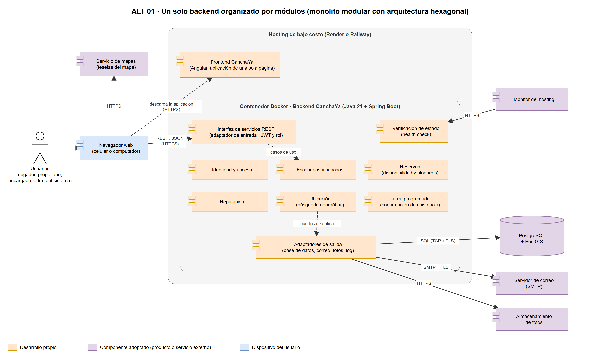

# Plataforma tecnológica

> Archivo generado por `scripts/exportar_docs.py` a partir de `1. Artefactos proyecto/1.2. Artefactos técnicos/1. Diseño arquitectónico/6. Plataforma tecnológica/Plataforma tecnológica - CanchaYa.xlsx`. No lo edites a mano: cambia el Excel y vuelve a ejecutar el script.

## Arquitectura de referencia

- Arquitectura de la alternativa seleccionada: ALT-01 · Un solo backend organizado por módulos (monolito modular con arquitectura hexagonal)
- Fuente editable: 1. Alternativas planteadas/Alternativa 1/ALT-01 Monolito modular hexagonal - CanchaYa.drawio

## AlternativaSoluciónSeleccionada

- Componente · Tipo componente · Descripción · Justificación · ¿Es un bloque de construcción? · Tipo Componente Construcción
- Frontend CanchaYa · Desarrollo propio · Aplicación de una sola página que se ejecuta en el navegador del celular o del computador. Muestra las pantallas, revisa cada dato al escribirlo y llama a los servicios REST del backend. No decide reglas de negocio. · Separar el frontend del backend es la restricción RT-01. Diseñar primero para el celular y revisar los datos al escribirlos son las tácticas AC-03.1 y AC-03.2, que responden a la usabilidad, tercer atributo del Mini QAW (ESC-USA-01 a ESC-USA-04). · SI · Soporte
- Backend CanchaYa · Desarrollo propio · Programa único que se publica en un solo contenedor y expone la interfaz de servicios REST. Por dentro se divide en cinco módulos, uno por contexto del dominio, con arquitectura hexagonal. · Es la alternativa ALT-01, elegida en la evaluación de alternativas por cumplir todas las restricciones y obtener el mayor puntaje ponderado. Cumple RT-02 (hexagonal + DDD) y cabe en RNG-01, RNG-03 y RNG-04. · SI · Core
- Interfaz de servicios REST · Desarrollo propio · Adaptador de entrada del backend: recibe las peticiones, revisa el token y el rol y entrega cada solicitud al módulo que corresponde. · Revisar quién es y qué puede hacer en cada operación es la táctica AC-04.1 (ESC-SEG-01). Concentrarlo en un solo punto evita que un servicio quede sin control. · NO · Soporte
- Módulo Identidad y acceso · Desarrollo propio · Registro, inicio de sesión, perfil, roles y límite de intentos de inicio de sesión. · Implementa RT-06, la táctica AC-04.3 (D28, ESC-SEG-03) y las reglas de registro de D12 y RNG-06. · NO · Soporte
- Módulo Escenarios y canchas · Desarrollo propio · Escenarios, canchas, horarios, tarifas, fotos, bloqueos, encargados de sede, activación por el administrador del sistema y búsqueda de escenarios por radio. · Es el contexto que permite al propietario publicar su oferta sin ayuda (ESC-USA-03, RNG-09). Está en el mismo backend que Reservas, para que los horarios, los bloqueos y las reservas se revisen en la misma transacción. La búsqueda por radio responde al mayor problema del 66,3 % de los jugadores, encontrar disponibilidad cerca, y usa el índice espacial de la táctica AC-05.1 (ESC-REN-01). Bloqueo pertenece a este contexto en el modelo de dominio enriquecido. · NO · Core
- Módulo Reservas · Desarrollo propio · Disponibilidad, reservas de 1 o 2 franjas, cancelaciones, inasistencias y agenda. Al reservar respeta los horarios y los bloqueos que registra Escenarios y canchas. · Es el corazón del producto. Aplica las tácticas AC-01.1 a AC-01.3 (D29) para la meta de cero dobles reservas (ESC-INT-01 a ESC-INT-03) y la táctica AC-05.2 para calcular la disponibilidad en una sola consulta (ESC-REN-02). · NO · Core
- Módulo Reputación · Desarrollo propio · Reseñas y calificación promedio, calculada al consultar. · Cubre las historias del Release 3 y la decisión D05. · NO · Soporte
- Módulo Ubicación · Desarrollo propio · Catálogo de departamentos y ciudades (DANE), de solo lectura, que se carga con datos iniciales. · Cumple RNG-07 (ámbito Antioquia, datos del DANE). Escenarios y canchas lo usa para la ciudad de cada escenario y para buscar por ciudad cuando no hay permiso de ubicación (D11). No depende de ningún otro módulo. · NO · Soporte
- Tarea programada · Desarrollo propio · Pide confirmar asistencia y cancela de forma automática las reservas sin confirmar. · Es idempotente (táctica AC-02.2, ESC-DIS-03) y cambia la reserva solo si sigue en el estado esperado (táctica AC-01.3, ESC-INT-03). · NO · Soporte
- Adaptadores de salida · Desarrollo propio · Conectan los módulos con la base de datos, el correo, el almacenamiento de fotos y el log. · Separar las reglas de la tecnología es la táctica AC-07.2. El correo se envía después de guardar (táctica AC-02.1, RT-11, ESC-DIS-02) y el log es estructurado y sin datos sensibles (táctica AC-06.2, RT-12). · NO · Soporte
- Verificación de estado · Desarrollo propio · Punto de consulta que indica si la aplicación está sana, incluida su conexión con la base de datos. · Es la táctica AC-02.3: el hosting reinicia el contenedor si no responde (ESC-DIS-01, ESC-DIS-04). · NO · Genérico
- Base de datos relacional con extensión geográfica · Componente adoptado · Guarda todos los datos del modelo de dominio enriquecido. Aplica la restricción de exclusión de reservas y la búsqueda por radio con índice espacial. · RT-03 exige que la regla de una sola reserva por franja se garantice en la base de datos. La restricción de exclusión (táctica AC-01.1) y el índice espacial (táctica AC-05.1) son capacidades de PostgreSQL y PostGIS. · SI · Genérico
- Servidor de correo · Componente adoptado · Envía los correos de reserva, cancelación, confirmación de asistencia y activación de escenarios. · RT-11 y D15: correo por SMTP, sin reintentos y sin revertir la operación. · SI · Genérico
- Almacenamiento de fotos · Componente adoptado · Guarda las fotos de los escenarios (máximo 5, JPG o PNG, hasta 2 MB cada una). · D13. El disco del contenedor se borra al reiniciar, por eso las fotos van en un almacenamiento aparte. · SI · Genérico
- Servicio de mapas · Componente adoptado · Dibuja el mapa en la búsqueda y en la ficha del escenario, y permite marcar el punto al registrar el escenario. · D14 y la búsqueda geográfica (D11, D26). Es una de las pocas integraciones de la interoperabilidad del Mini QAW. · SI · Genérico
- Contenedor · Componente adoptado · Empaqueta el backend con todo lo que necesita. · RT-13: el ambiente local y el publicado son iguales y el despliegue no exige pasos manuales (ESC-DIS-04). · SI · Genérico
- Hosting de bajo costo · Componente adoptado · Ejecuta el contenedor del backend, publica el frontend, revisa la verificación de estado y reinicia el contenedor si no responde. La base de datos y las fotos quedan en Supabase. · RT-13 y RNG-04: plan gratuito. Se eligió Render (ver hoja Comparación de proveedores). · SI · Genérico
- Monitor externo de disponibilidad · Componente adoptado · Servicio externo que consulta la verificación de estado cada 5 minutos, avisa por correo si la aplicación no responde y lleva el porcentaje de disponibilidad del mes. · El plan gratuito de Render apaga la aplicación tras 15 minutos sin visitas; mientras está apagada no corre la tarea programada (D06). Las consultas cada 5 minutos la mantienen encendida, que es la salida elegida para el riesgo aceptado en la Evaluación de alternativas, y dejan medida la meta del 99 % (ESC-DIS-01, ESC-DIS-03). · SI · Genérico

## BloquesConstrucciónAdoptados

- Componente · ¿Componente de Pago? · Fabricante · Producto · Versión · Protocolo de comunicación · Justificación · Tipo Bloque Construcción
- Base de datos relacional · NO (plan gratuito) · PostgreSQL Global Development Group (servicio gestionado por Supabase) · PostgreSQL en Supabase, plan Free · La que asigne Supabase al crear el proyecto (16 o superior) · SQL sobre TCP con TLS, por el agrupador de conexiones de Supabase en modo sesión · Restricción de exclusión para cero dobles reservas (RT-03, táctica AC-01.1), transacciones y bloqueo por fila (AC-01.2). De Supabase solo se usa la base de datos y el almacenamiento: no se usan su autenticación ni sus servicios automáticos (eso era ALT-03), de modo que el backend sigue siendo el único que decide las reglas. El plan Free no vence y no cobra por horas de uso (RNG-04). · Genérico
- Extensión geográfica · NO · PostGIS Project · PostGIS (disponible en Supabase) · 3.x · No aplica (se ejecuta dentro de la base de datos) · Índice espacial y búsqueda por radio de 1 a 30 km ordenada por distancia (táctica AC-05.1, ESC-REN-01, D26). Se activa con una migración (RT-04). · Genérico
- Extensión para la regla de exclusión · NO · PostgreSQL Global Development Group · btree_gist (incluida en PostgreSQL y disponible en Supabase) · La de la versión de PostgreSQL · No aplica (se ejecuta dentro de la base de datos) · Permite que la restricción de exclusión compare en la misma regla la cancha (que sea la misma) y el horario (que se cruce), que es como D29 impide dos reservas confirmadas en la misma franja. Se activa con una migración (RT-04). · Genérico
- Contenedor · NO · Docker Inc. · Docker Engine · Última estable · No aplica · RT-13 y Project Canvas: mismo ambiente en local y en el hosting. Render construye y ejecuta la imagen a partir del Dockerfile del repositorio. · Genérico
- Hosting del backend · NO (plan gratuito) · Render · Render Web Service, instancia Free, con Docker · Servicio en la nube (región Virginia, US East) · HTTPS · RT-13 y RNG-04. Ejecuta el contenedor, revisa la verificación de estado y lo reinicia si no responde (AC-02.3). Sus 750 horas al mes alcanzan para tener una instancia encendida todo el mes (744 horas en un mes de 31 días). No vence. Lo apaga tras 15 minutos sin visitas (se resuelve con el monitor externo) y bloquea los puertos 25, 465 y 587 de correo (se resuelve con el puerto 2525 de Brevo). Ver hojas Comparación de proveedores y Riesgos de la plataforma. · Genérico
- Hosting del frontend · NO (plan gratuito) · Render · Render Static Site · Servicio en la nube · HTTPS · Publica la aplicación Angular ya compilada desde una red de distribución de contenido (CDN). No se apaga ni gasta horas de instancia. Es el mismo proveedor y la misma cuenta del backend, con despliegue separado (RT-01, RNG-01). · Genérico
- Servidor de correo · NO (plan gratuito) · Brevo · Brevo SMTP relay, plan Free · Servicio en la nube (300 correos al día) · SMTP con STARTTLS por el puerto 2525 · RT-11 (correo por SMTP) y D15. Render Free bloquea los puertos 25, 465 y 587; Brevo también atiende el 2525, que no está bloqueado. 300 correos al día alcanzan para la validación (unos 3 correos por reserva). No exige dominio propio: basta verificar el correo remitente. · Genérico
- Almacenamiento de fotos · NO (plan gratuito) · Supabase · Supabase Storage, plan Free (1 GB) · Servicio en la nube · HTTPS (interfaz compatible con S3) · D13. 1 GB alcanza para unas 500 fotos de 2 MB (100 escenarios con 5 fotos), más que el volumen de la validación en Rionegro y Marinilla (D16). Es la misma cuenta de la base de datos (RNG-01). Las fotos se pueden ver sin sesión, pero solo el backend puede subirlas o borrarlas, con una clave que está en la configuración (RT-10). · Genérico
- Servicio de mapas · NO · Leaflet (código abierto) y Fundación OpenStreetMap · Leaflet con los mapas de OpenStreetMap · Leaflet: línea estable vigente al iniciar el Sprint 1 · HTTPS · D11, D14 y D26. No exige cuenta, clave ni tarjeta (RNG-04). Leaflet dibuja el mapa y permite marcar el punto del escenario (D14). La búsqueda por radio la hace PostGIS, no el mapa, así que no hace falta un servicio de búsqueda de direcciones. Exige mostrar el crédito de OpenStreetMap y un uso moderado. · Genérico
- Monitor externo de disponibilidad · NO (plan gratuito) · UptimeRobot · UptimeRobot, plan Free · Servicio en la nube (revisión cada 5 minutos) · HTTPS · Consulta la verificación de estado cada 5 minutos: mantiene encendida la aplicación para que la tarea programada corra a tiempo (D06, ESC-DIS-03), avisa por correo si no responde y mide la disponibilidad del mes (meta del 99 %, ESC-DIS-01). El plan gratuito es para uso no comercial, como este trabajo de grado. · Genérico

## BloquesConstrucciónDesarrollado

- Componente · ¿Componente de Pago? · Tipo · Fabricante · Producto · Versión · Descripción · Justificación
- Backend CanchaYa · NO · Lenguaje de desarrollo · OpenJDK · Java · 21 (LTS) · Lenguaje del backend. · Stack del Project Canvas, confirmado en esta alternativa. Versión con soporte de largo plazo.
- Backend CanchaYa · NO · Framework de desarrollo · Spring (Broadcom) · Spring Boot · Línea estable vigente al iniciar el Sprint 1 · Base del servicio REST, la configuración externalizada y la tarea programada. · Configuración externalizada (RT-10, táctica AC-07.1) y tareas programadas (AC-02.2) incluidas.
- Backend CanchaYa · NO · Seguridad · Spring (Broadcom) · Spring Security · La incluida en Spring Boot · Autenticación con JWT, contraseñas con bcrypt y revisión del rol en cada operación. · RT-06, táctica AC-04.1 (ESC-SEG-01).
- Backend CanchaYa · NO · Acceso a datos · Spring (Broadcom) / Hibernate · Spring Data JPA + Hibernate Spatial · La incluida en Spring Boot · Acceso parametrizado a la base de datos y a los tipos geográficos de PostGIS. · RT-05 (sentencias parametrizadas) y búsqueda por radio (AC-05.1).
- Backend CanchaYa · NO · Migraciones de base de datos · Redgate · Flyway · La incluida en Spring Boot · Aplica los cambios del esquema como migraciones versionadas al arrancar. · RT-04 y ESC-DIS-04.
- Backend CanchaYa · NO · Verificación de estado · Spring (Broadcom) · Spring Boot Actuator · La incluida en Spring Boot · Punto de consulta del estado de la aplicación y de la base de datos. · Táctica AC-02.3.
- Backend CanchaYa · NO · Pruebas · JUnit / AtomicJar · JUnit 5 + Testcontainers · Últimas estables · Pruebas del dominio sin base de datos y pruebas de concurrencia contra un PostgreSQL real en contenedor. · RT-15 y spike de concurrencia (ESC-INT-01 a ESC-INT-03).
- Frontend CanchaYa · NO · Lenguaje de desarrollo · Microsoft · TypeScript · El que exija Angular · Lenguaje del frontend. · Stack del Project Canvas.
- Frontend CanchaYa · NO · Framework de desarrollo · Google · Angular · Línea estable vigente al iniciar el Sprint 1 · Aplicación de una sola página, adaptable al celular, con formularios reactivos para revisar cada dato al escribirlo. · RT-01, RT-07 y tácticas AC-03.1 y AC-03.2.

## Comparación de proveedores

- Necesidad · Opción · Costo · Lo que importa para CanchaYa · Resultado
- Hosting del backend · Render, Web Service Free · US$ 0 · No vence. 750 horas al mes, suficientes para una instancia todo el mes. 512 MB de memoria. Apaga la aplicación tras 15 minutos sin visitas (se resuelve con el monitor externo). Bloquea los puertos de correo 25, 465 y 587 (se resuelve con Brevo por el puerto 2525). · Elegida
- Hosting del backend · Railway, plan Free · US$ 0 (US$ 1 de crédito al mes) · El crédito y la memoria (0,5 GB) no alcanzan para tener Java y la base de datos encendidos todo el mes. · Descartada
- Hosting del backend · Railway, plan Hobby · US$ 5 al mes · No apaga la aplicación, pero cobra cada mes hasta la sustentación (RNG-04) y tampoco permite correo por SMTP: Railway solo lo habilita en el plan Pro (unos US$ 20 al mes). · Descartada
- Base de datos · Supabase, plan Free · US$ 0 · PostgreSQL con PostGIS y btree_gist. 500 MB, de sobra para el alcance. No vence y no cobra por horas. Solo se pausa tras una semana sin actividad, y la aplicación la consulta cada pocos minutos. Incluye el almacenamiento de fotos. · Elegida
- Base de datos · Render Postgres Free · US$ 0 · Vence a los 30 días de creada y, tras 14 días de gracia, se borra con sus datos: no llega a la validación del 23 al 27 de noviembre con margen ni a la sustentación de febrero. No tiene copias de seguridad. · Descartada
- Base de datos · Neon, plan Free · US$ 0 · Tiene PostGIS, pero da 100 horas de cómputo al mes. La tarea programada y el monitor la usan cada pocos minutos, así que nunca se suspende: encendida todo el mes gasta unas 186 horas y quedaría suspendida a mitad de mes. · Descartada
- Servidor de correo · Brevo, plan Free · US$ 0 · 300 correos al día por SMTP. Atiende el puerto 2525, que Render Free no bloquea. No exige dominio propio. · Elegida
- Servidor de correo · Gmail con contraseña de aplicación · US$ 0 · Solo atiende los puertos 465 y 587, que Render Free bloquea. · Descartada
- Servidor de correo · Resend, plan Free · US$ 0 · Para enviar a cualquier destinatario exige un dominio propio, que el proyecto no tiene. 100 correos al día. · Descartada
- Almacenamiento de fotos · Supabase Storage, plan Free · US$ 0 · 1 GB. Es la misma cuenta de la base de datos: un servicio menos que administrar (RNG-01). · Elegida
- Almacenamiento de fotos · Cloudinary, plan Free · US$ 0 · Generoso y ajusta el tamaño de las imágenes, pero suma otra cuenta y otra librería. Su ventaja no hace falta: las fotos ya llegan limitadas a 2 MB (D13). · Respaldo si Supabase Storage falla
- Almacenamiento de fotos · Disco del contenedor · US$ 0 · Se borra cada vez que el contenedor se reinicia o se despliega. · Descartada
- Servicio de mapas · Leaflet con mapas de OpenStreetMap · US$ 0 · Código abierto. No exige cuenta, clave ni tarjeta. Permite marcar el punto del escenario (D14). · Elegida
- Servicio de mapas · Google Maps Platform · Uso gratuito mensual · Exige una cuenta de facturación con tarjeta de crédito (RNG-04). · Descartada
- Servicio de mapas · Mapbox · Plan gratuito con límite mensual · Exige cuenta y una clave de acceso en el frontend, sin ganar nada para el alcance. · Descartada
- Mantener encendida la aplicación · UptimeRobot, plan Free · US$ 0 · Consulta cada 5 minutos, avisa por correo si la aplicación no responde y mide la disponibilidad del mes (ESC-DIS-01). · Elegida
- Mantener encendida la aplicación · cron-job.org · US$ 0 · Mantiene encendida la aplicación, pero no mide la disponibilidad. · Respaldo
- Mantener encendida la aplicación · Tarea programada de GitHub Actions · US$ 0 · Puede ejecutarse con retraso y se desactiva sola tras 60 días sin cambios en el repositorio (entre diciembre y la sustentación). · Descartada

## Riesgos de la plataforma

- Riesgo · Qué puede pasar · Cómo se responde · Relación
- El hosting apaga la aplicación sin visitas · Tras 15 minutos sin visitas, Render apaga el backend. Mientras está apagado no corre la tarea programada (D06) y la primera visita tarda cerca de un minuto. · El monitor externo la consulta cada 5 minutos y la mantiene encendida. Si aun así se apaga, al volver la tarea procesa lo que quedó pendiente, sin correos repetidos (táctica AC-02.2), pero no cancela las reservas a las que no alcanzó a enviar la solicitud: esas pasan a NO_REQUERIDA (D34). · ESC-DIS-01, ESC-DIS-03, D06
- Se agotan las 750 horas del mes · Si en la misma cuenta se crea otro Web Service Free, entre los dos superan las horas y Render suspende ambos hasta el mes siguiente. · Un solo Web Service Free en la cuenta (el backend). El frontend va como Static Site, que no gasta horas. · RT-13, ESC-DIS-01
- El correo por el puerto 2525 no funciona desde Render · Los correos no salen. · Se prueba en el Sprint 1 con un correo real enviado desde Render. Mientras tanto, una falla de correo no revierte la operación (D15). Si el puerto no sirve, se cambia solo el adaptador de correo a la interfaz HTTPS de Brevo; eso modifica RT-11 y se registraría como una decisión nueva. · RT-11, D15, AC-07.2
- Pocos recursos en el plan gratuito · Con 512 MB de memoria y poca CPU, Java arranca lento y la búsqueda o la reserva pueden responder despacio. · Se limita la memoria que usa Java, se usa un grupo pequeño de conexiones (AC-05.3) y se mide el tiempo de respuesta en el Sprint 2. Si no se cumplen las metas, pasar a la instancia paga más pequeña de Render es una decisión que se consulta con el asesor. · ESC-REN-01 a ESC-REN-03, RNG-04
- No hay copias de seguridad automáticas · Se podrían perder los datos de prueba de la validación. · Copia manual de la base de datos (pg_dump) antes de la validación (23-nov) y antes de la sustentación. La estructura se recrea sola con las migraciones (RT-04). · ESC-DIS-04, RT-04
- La base de datos se pausa sin actividad · Supabase pausa los proyectos gratuitos tras una semana sin actividad, por ejemplo entre diciembre y la sustentación. · La verificación de estado incluye la base de datos y el monitor la consulta cada 5 minutos, así que siempre hay actividad. Se revisa en enero, antes de la sustentación. · ESC-DIS-01
- Los datos quedan en servidores de Estados Unidos · Guardar datos personales fuera de Colombia es una transferencia internacional de datos (Ley 1581 de 2012). · La Superintendencia de Industria y Comercio reconoce a Estados Unidos con un nivel adecuado de protección (Circular Externa 005 de 2017). La política de tratamiento de datos lo informa al usuario. · RNG-05
- Cambian las condiciones de un plan gratuito · Un proveedor puede quitar o limitar su plan gratuito, como hizo Render con el correo en septiembre de 2025. · Cada servicio externo entra por un adaptador (AC-07.2) y sus datos de conexión están en la configuración (RT-10): cambiar de proveedor toca un adaptador y la configuración, no las reglas. Se revisan las condiciones antes de la validación y antes de la sustentación. · RT-10, AC-07.2
- Uso excesivo de los mapas de OpenStreetMap · Su política no permite un uso intensivo: podría bloquear la descarga de mapas. · El volumen de la validación es bajo. Se muestra el crédito de OpenStreetMap y la dirección de los mapas va en la configuración del frontend, para cambiar de proveedor si el uso crece. · D11, D14
- La base de datos se puede consultar desde Internet · Supabase deja activa por defecto su API de datos, que permite leer o cambiar las tablas con la clave pública del proyecto si no tienen políticas por fila. Además, la base recibe conexiones desde Internet con usuario y contraseña. No usar esa API no la desactiva. · En el Sprint 1, al crear el proyecto: se desactiva la API de datos (Data API) en la configuración de Supabase y se activan las políticas por fila (RLS), sin reglas, en todas las tablas, para que ninguna clave pública pueda leerlas. El backend se conecta como dueño de las tablas y no se ve afectado. La contraseña de la base solo está en las variables secretas de Render y la conexión exige TLS (D35). · ESC-SEG-02, RT-08, RT-10, D35

## Configuración del entorno

- Ajuste · Valor · Para qué
- Zona horaria · Variable TZ=America/Bogota en Render y la misma zona en Java · D27 y RT-09: todos los plazos se calculan con la hora del servidor en Colombia.
- Región · Render: Virginia (US East). Supabase: us-east-1 (Virginia) · Backend y base de datos quedan en la misma zona, lo que reduce el tiempo de cada consulta (ESC-REN-01, ESC-REN-02).
- Conexión a la base de datos · Agrupador de conexiones de Supabase en modo sesión, con TLS obligatorio · Render no se conecta a la dirección directa de Supabase (solo IPv6). El modo sesión mantiene la transacción completa, que necesita el bloqueo por cancha (D29).
- Grupo de conexiones (HikariCP) · Máximo 5 conexiones · Táctica AC-05.3: no se agotan las conexiones que permite el plan gratuito.
- Servidor de correo · Servidor smtp-relay.brevo.com, puerto 2525, STARTTLS; usuario y clave SMTP como variables secretas · RT-10 y RT-11: credenciales fuera del código y correo cifrado.
- Almacenamiento de fotos · Dirección del proyecto de Supabase, carpeta (bucket) de fotos de escenarios y clave de servicio solo en el backend · D13 y RT-10: el navegador puede ver las fotos, pero solo el backend las sube o las borra.
- Mapas · Dirección de los mapas de OpenStreetMap y texto del crédito en la configuración del frontend · Permite cambiar de proveedor de mapas sin tocar el código de las pantallas.
- Verificación de estado · Ruta /actuator/health, revisada por Render y por UptimeRobot cada 5 minutos · Táctica AC-02.3: reinicio automático si la aplicación o la base de datos no responden.
- Memoria de Java · Limitar Java al 75 % de la memoria del contenedor · Evita que el plan de 512 MB reinicie el contenedor por falta de memoria.
- Despliegue · Render despliega solo al subir cambios a la rama principal de GitHub; las migraciones corren al arrancar · ESC-DIS-04 y RT-04: sin pasos manuales sobre la base de datos.
- Rutas del frontend · Regla de reescritura en el Static Site: toda ruta responde con index.html · Angular maneja las rutas en el navegador; sin esta regla, recargar una pantalla daría error 404.
- Orígenes permitidos (CORS) · El backend solo acepta llamadas del navegador desde la dirección del frontend publicado · Reduce el uso de los servicios desde otras páginas (ESC-SEG-02).
- API de datos de Supabase · Desactivada (Data API apagada) y políticas por fila (RLS) activas, sin reglas, en todas las tablas · Solo el backend, con sus credenciales, lee y escribe la base de datos; nadie puede usar la clave pública del proyecto para consultar las tablas (ESC-SEG-02, D35).

## Notas

**Notas sobre la plataforma tecnológica**

- • Este documento parte de la alternativa seleccionada (ALT-01, D30) y concreta los productos que allí quedaron por definir: hosting, servidor de correo, almacenamiento de fotos y servicio de mapas. La decisión quedó registrada como D31 (2-nov-2026).
- • La arquitectura no cambia: un solo backend en un contenedor, un frontend separado y una base de datos PostgreSQL con PostGIS. Solo se nombra quién presta cada servicio.
- • Todos los servicios elegidos tienen plan gratuito sin fecha de vencimiento (RNG-04). La hoja Comparación de proveedores muestra qué se comparó y por qué se eligió cada uno; la hoja Riesgos de la plataforma, qué puede fallar y cómo se responde.
- • La condición que más pesó: el proyecto debe seguir publicado hasta la sustentación (febrero de 2027). Por eso se descartó todo plan que vence (la base de datos gratuita de Render se borra a los 30 días) o que cobra cada mes.
- • Las condiciones de los planes gratuitos se revisaron el 2-nov-2026 y pueden cambiar. Como cada servicio externo se conecta por un adaptador (táctica AC-07.2) y sus datos de conexión están en la configuración (RT-10), cambiar de proveedor no toca las reglas del negocio.
- • Las versiones de Spring Boot, Angular y Leaflet se fijan al crear el proyecto, con la línea estable vigente al iniciar el Sprint 1 (3-nov-2026).
- • Tipo de bloque: Core es lo que diferencia al producto (reservas, escenarios y búsqueda); Soporte es lo que lo acompaña sin diferenciarlo; Genérico es lo que se puede tomar del mercado.
- • Las tácticas se citan con su código y número dentro del atributo (por ejemplo, AC-01.1 es la táctica 1 de AC-01 en Tácticas y estrategias - CanchaYa.xlsx).
