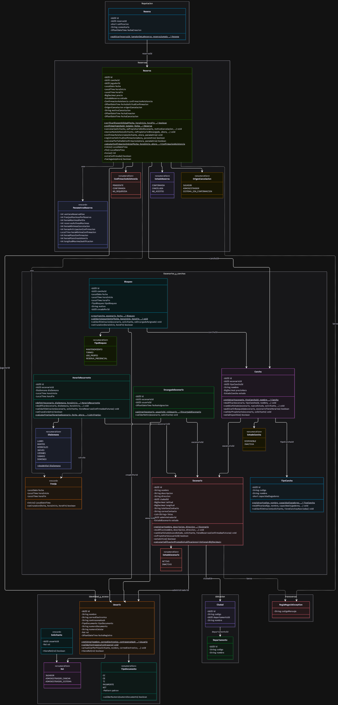

# Diagrama de clases

> Archivo generado por `scripts/exportar_docs.py` a partir de `1. Artefactos proyecto/1.2. Artefactos técnicos/2. Diseño detallado/1. Diagrama de clases/Diagrama de clases - CanchaYa.xlsx`. No lo edites a mano: cambia el Excel y vuelve a ejecutar el script.

## Diagrama de clases

- Diagrama de clases del dominio de CanchaYa (Release 1), agrupado por módulo del backend (D30, arquetipo). Atributos privados (−), métodos públicos (+), métodos de clase subrayados ($). Las relaciones entre módulos van por identificador (UUID) y no por objeto, para respetar los límites que revisa ArchUnit. Fuente editable: Diagrama de clases - CanchaYa.mmd.

## Clases

- Clase · Estereotipo · Desripción
- ReglaNegocioException · class · [Transversal] Excepción que lanzan las clases del dominio cuando una operación incumple una política del modelo de dominio enriquecido. Lleva el código del catálogo de mensajes (por ejemplo, ERR-RES-08); el adaptador REST lo convierte en la respuesta con el texto del catálogo. Extiende RuntimeException.
- Rol · enum · [Identidad y acceso] Roles técnicos de un usuario (D07). El encargado de sede usa ADMINISTRADOR_CANCHA, limitado por EncargadoEscenario.
- TipoDocumento · enum · [Identidad y acceso] Tipos de documento admitidos con su formato (D12, PAR-USU-03 a PAR-USU-08).
- Usuario · class · [Identidad y acceso] Persona registrada en la plataforma: jugador, administrador de cancha (propietario o encargado de sede) o administrador del sistema. Objeto de dominio Usuario del enriquecido.
- Solicitante · record · [Identidad y acceso] Quién ejecuta una operación: identificador y rol del usuario autenticado, tomados del token JWT. Es lo que el módulo Identidad y acceso ofrece a los demás módulos para revisar permisos sin que conozcan la clase Usuario.
- Departamento · class · [Ubicación] Departamento de Colombia (catálogo del DANE). En el Release 1 es de solo lectura: se carga con la migración V2 (Antioquia, D16). Registrar, modificar y eliminar son trabajo futuro.
- Ciudad · class · [Ubicación] Municipio de un departamento, donde se ubican los escenarios. De solo lectura en el Release 1 (municipios de Antioquia cargados con la migración V2).
- EstadoEscenario · enum · [Escenarios y canchas] Estados de un escenario (RN-16).
- EstadoCancha · enum · [Escenarios y canchas] Estados de una cancha.
- DiaSemana · enum · [Escenarios y canchas] Días de la semana de un horario recurrente, con los valores que guarda la base de datos.
- TipoBloqueo · enum · [Escenarios y canchas] Motivos de un bloqueo (RN-12).
- TipoCancha · class · [Escenarios y canchas] Modalidad de fútbol de una cancha (F5, F7, F11). En el Release 1 es de solo lectura y se carga con la migración V2; registrar, modificar y eliminar son del Release 2 (D04).
- Escenario · class · [Escenarios y canchas] Complejo deportivo (conjunto de canchas) con su ubicación y datos públicos de contacto. La calificación promedio no es atributo: se calcula al consultar (D05).
- Cancha · class · [Escenarios y canchas] Cancha sintética de un escenario que los jugadores reservan.
- HorarioRecurrente · class · [Escenarios y canchas] Disponibilidad semanal de un escenario. Las franjas de una hora se calculan a partir de él en cada consulta; no se guardan (PAR-HOR-01).
- Franja · record · [Escenarios y canchas] Bloque de una hora en punto de una fecha, calculado a partir de los horarios recurrentes (PAR-HOR-01). No se guarda en la base de datos. Es valor (inmutable).
- Bloqueo · class · [Escenarios y canchas] Bloque de horas de una cancha que el propietario o un encargado inhabilita (mantenimiento, torneo, uso propio o reserva presencial).
- EncargadoEscenario · class · [Escenarios y canchas] Asignación de un usuario como encargado de sede de un escenario, con permisos de operación diaria (D03, D07). El propietario no se registra aquí (D22).
- EstadoReserva · enum · [Reservas] Estados de una reserva.
- ConfirmacionAsistencia · enum · [Reservas] Estado de la confirmación de asistencia (RN-13).
- OrigenCancelacion · enum · [Reservas] Quién canceló una reserva (AC-06.1).
- ParametrosReserva · record · [Reservas] Valores del catálogo de parámetros que usan las reglas de Reserva. Se leen de la configuración (RT-10, táctica AC-07.1), así un cambio de valor no exige tocar el código.
- Reserva · class · [Reservas] Reserva de un jugador sobre una cancha para una fecha y 1 o 2 franjas seguidas. Es el corazón del producto: cero dobles reservas (D29), plazos de cancelación y confirmación (D06) e inasistencia (D20). SerieReserva es trabajo futuro (D24).
- Resena · class · [Reputación] Calificación y comentario de un jugador sobre un escenario, a partir de una reserva que ya jugó (objeto Reseña del enriquecido; en el código sin ñ). No se edita ni se borra (D21).

## ReglaNegocioException

- Clase · ReglaNegocioException
- Estereotipo · class
- Desripción · Excepción que lanzan las clases del dominio cuando una operación incumple una política del modelo de dominio enriquecido. Lleva el código del catálogo de mensajes (por ejemplo, ERR-RES-08); el adaptador REST lo convierte en la respuesta con el texto del catálogo. Extiende RuntimeException.
- Modificador acceso: · public
- Tipo clase: · final
- Paquete: · co.edu.uco.canchaya.transversal.domain
- Módulo: · Transversal

**Relaciones**

- Relación · Tipo relación · Estructura
- Es usada por · Dependencia · Bloqueo (excepción que lanza)
- Es usada por · Dependencia · Cancha (excepción que lanza)
- Es usada por · Dependencia · EncargadoEscenario (excepción que lanza)
- Es usada por · Dependencia · Escenario (excepción que lanza)
- Es usada por · Dependencia · HorarioRecurrente (excepción que lanza)
- Es usada por · Dependencia · Resena (excepción que lanza)
- Es usada por · Dependencia · Reserva (excepción que lanza)
- Es usada por · Dependencia · TipoCancha (excepción que lanza)
- Es usada por · Dependencia · Usuario (excepción que lanza)

**Atributos**

- Modificador de aceso · Nombre · Tipo de dato · Tipo modificación atributo · Tipo acceso atributo · Valor por defecto · Descripción atributo
- Tipo de dato · ¿Cuál?
- private · codigoMensaje · String · final · no static · Código del mensaje en el catálogo de mensajes (ERR-<OBJ>-nn).

**Constructores**

- Modificador de aceso · Nombre · Tipo constructor · Descripción · Parámetros · Excepciones
- Nombre · Tipo de dato · ¿Cuál? · Tipo parámetro · Tipo modificación atributo · Descripción
- public · ReglaNegocioException · Parametrizado · Crea la excepción con el código del mensaje del catálogo. · codigoMensaje · String · Por referencia · final · Código del catálogo de mensajes. · IllegalArgumentException si el código viene vacío.

**Métodos accesores**

- Modificador de aceso · Nombre · Tipo método accesor · Tipo modificación método · Descripción · Parámetros · Tipo dato de retorno · Excepciones
- Nombre · Tipo de dato · ¿Cuál? · Tipo parámetro · Tipo modificación atributo · Descripción · Tipo de dato · ¿Cuál?
- public · getCodigoMensaje · getter · final · Devuelve el valor del atributo codigoMensaje. · String

**Métodos**

- Modificador de aceso · Nombre · Tipo acceso método · Tipo modificación método · Descripción · Parámetros · Tipo dato de retorno · Excepciones
- Nombre · Tipo de dato · ¿Cuál? · Tipo parámetro · Tipo modificación atributo · Descripción · Tipo de dato · ¿Cuál?

**No aplica**

## Rol

- Clase · Rol
- Estereotipo · enum
- Desripción · Roles técnicos de un usuario (D07). El encargado de sede usa ADMINISTRADOR_CANCHA, limitado por EncargadoEscenario.
- Modificador acceso: · public
- Tipo clase: · no aplica (enum)
- Paquete: · co.edu.uco.canchaya.identidad.domain
- Módulo: · Identidad y acceso

**Relaciones**

- Relación · Tipo relación · Estructura
- Es usada por · Dependencia · EncargadoEscenario (parámetro de asignar)
- Es usada por · Asociación · Solicitante (atributo rol)
- Es usada por · Asociación · Usuario (atributo rol)

**Atributos**

- Modificador de aceso · Nombre · Tipo de dato · Tipo modificación atributo · Tipo acceso atributo · Valor por defecto · Descripción atributo
- Tipo de dato · ¿Cuál?
- public · JUGADOR · Otro · Rol · final · static · Reserva canchas, cancela, confirma asistencia y publica reseñas.
- public · ADMINISTRADOR_CANCHA · Otro · Rol · final · static · Propietario de escenarios o encargado de sede (D07).
- public · ADMINISTRADOR_SISTEMA · Otro · Rol · final · static · Activa escenarios y administra los catálogos. No se elige al registrarse.

**Constructores**

- Modificador de aceso · Nombre · Tipo constructor · Descripción · Parámetros · Excepciones
- Nombre · Tipo de dato · ¿Cuál? · Tipo parámetro · Tipo modificación atributo · Descripción
- private · Rol · Defecto · Constructor por defecto (no se declara).

**Métodos accesores**

- Modificador de aceso · Nombre · Tipo método accesor · Tipo modificación método · Descripción · Parámetros · Tipo dato de retorno · Excepciones
- Nombre · Tipo de dato · ¿Cuál? · Tipo parámetro · Tipo modificación atributo · Descripción · Tipo de dato · ¿Cuál?

**No aplica**

**Métodos**

- Modificador de aceso · Nombre · Tipo acceso método · Tipo modificación método · Descripción · Parámetros · Tipo dato de retorno · Excepciones
- Nombre · Tipo de dato · ¿Cuál? · Tipo parámetro · Tipo modificación atributo · Descripción · Tipo de dato · ¿Cuál?

**No aplica**

## TipoDocumento

- Clase · TipoDocumento
- Estereotipo · enum
- Desripción · Tipos de documento admitidos con su formato (D12, PAR-USU-03 a PAR-USU-08).
- Modificador acceso: · public
- Tipo clase: · no aplica (enum)
- Paquete: · co.edu.uco.canchaya.identidad.domain
- Módulo: · Identidad y acceso

**Relaciones**

- Relación · Tipo relación · Estructura
- Es usada por · Asociación · Usuario (atributo tipoDocumento)

**Atributos**

- Modificador de aceso · Nombre · Tipo de dato · Tipo modificación atributo · Tipo acceso atributo · Valor por defecto · Descripción atributo
- Tipo de dato · ¿Cuál?
- public · CC · Otro · TipoDocumento · final · static · Cédula de ciudadanía: de 6 a 10 dígitos.
- public · CE · Otro · TipoDocumento · final · static · Cédula de extranjería: de 6 a 10 caracteres alfanuméricos.
- public · TI · Otro · TipoDocumento · final · static · Tarjeta de identidad: 10 u 11 dígitos. Solo con rol JUGADOR.
- public · PASAPORTE · Otro · TipoDocumento · final · static · De 6 a 12 caracteres alfanuméricos.
- public · NIT · Otro · TipoDocumento · final · static · 9 dígitos, guion y dígito de verificación (por ejemplo, 900123456-7).
- private · patron · Otro · Pattern · final · no static · Expresión regular del formato del número de documento de cada tipo.

**Constructores**

- Modificador de aceso · Nombre · Tipo constructor · Descripción · Parámetros · Excepciones
- Nombre · Tipo de dato · ¿Cuál? · Tipo parámetro · Tipo modificación atributo · Descripción
- private · TipoDocumento · Parametrizado · Asocia a cada constante su expresión regular. · patron · String · Por referencia · final · Expresión regular del formato (por ejemplo, ^[0-9]{6,10}$ para CC).

**Métodos accesores**

- Modificador de aceso · Nombre · Tipo método accesor · Tipo modificación método · Descripción · Parámetros · Tipo dato de retorno · Excepciones
- Nombre · Tipo de dato · ¿Cuál? · Tipo parámetro · Tipo modificación atributo · Descripción · Tipo de dato · ¿Cuál?
- public · getPatron · getter · no final · Devuelve el valor del atributo patron. · Otro · Pattern

**Métodos**

- Modificador de aceso · Nombre · Tipo acceso método · Tipo modificación método · Descripción · Parámetros · Tipo dato de retorno · Excepciones
- Nombre · Tipo de dato · ¿Cuál? · Tipo parámetro · Tipo modificación atributo · Descripción · Tipo de dato · ¿Cuál?
- public · validarNumero · no static · final · Indica si el número de documento cumple el formato del tipo (D12). · numeroDocumento · String · Por referencia · final · Número de documento escrito por el usuario. · boolean/Boolean

## Usuario

- Clase · Usuario
- Estereotipo · class
- Desripción · Persona registrada en la plataforma: jugador, administrador de cancha (propietario o encargado de sede) o administrador del sistema. Objeto de dominio Usuario del enriquecido.
- Modificador acceso: · public
- Tipo clase: · final
- Paquete: · co.edu.uco.canchaya.identidad.domain
- Módulo: · Identidad y acceso

**Relaciones**

- Relación · Tipo relación · Estructura
- Necesita de · Dependencia · ReglaNegocioException (excepción que lanza)
- Necesita de · Asociación · Rol (atributo rol)
- Necesita de · Dependencia · Solicitante (parámetro de actualizarPerfil)
- Necesita de · Asociación · TipoDocumento (atributo tipoDocumento)
- Es usada por · Asociación · Bloqueo (por identificador: creadoPorId)
- Es usada por · Asociación · EncargadoEscenario (por identificador: usuarioId)
- Es usada por · Asociación · Escenario (por identificador: administradorId)
- Es usada por · Asociación · Reserva (por identificador: jugadorId)

**Atributos**

- Modificador de aceso · Nombre · Tipo de dato · Tipo modificación atributo · Tipo acceso atributo · Valor por defecto · Descripción atributo
- Tipo de dato · ¿Cuál?
- private · id · Otro · UUID · final · no static · Identificador único del usuario (lo genera el backend, RT-09).
- private · nombre · String · no final · no static · Nombre completo (1 a 100 caracteres).
- private · correoElectronico · String · no final · no static · Correo para iniciar sesión y recibir notificaciones; se guarda en minúscula. Único.
- private · contrasenaHash · String · no final · no static · Contraseña cifrada con bcrypt (60 caracteres). Nunca se guarda en texto plano.
- private · tipoDocumento · Otro · TipoDocumento · final · no static · Tipo de documento. No se modifica desde el perfil.
- private · numeroDocumento · String · final · no static · Número de documento con el formato del tipo. No se modifica desde el perfil.
- private · numeroCelular · String · no final · no static · Número de celular (hasta 15 caracteres).
- private · rol · Otro · Rol · final · no static · Rol técnico del usuario. No se modifica desde el perfil.
- private · fechaRegistro · Otro · OffsetDateTime · final · no static · Instante en que se creó la cuenta.

**Constructores**

- Modificador de aceso · Nombre · Tipo constructor · Descripción · Parámetros · Excepciones
- Nombre · Tipo de dato · ¿Cuál? · Tipo parámetro · Tipo modificación atributo · Descripción
- private · Usuario · Parametrizado · Constructor privado con todos los atributos. Solo lo usan los métodos de fábrica de la clase (Usuario no se crea con new desde afuera, así ningún objeto queda a medio validar). · id · Otro · UUID · Por referencia · final · Identificador único del usuario (lo genera el backend, RT-09).
- nombre · String · Por referencia · final · Nombre completo (1 a 100 caracteres).
- correoElectronico · String · Por referencia · final · Correo para iniciar sesión y recibir notificaciones; se guarda en minúscula. Único.
- contrasenaHash · String · Por referencia · final · Contraseña cifrada con bcrypt (60 caracteres). Nunca se guarda en texto plano.
- tipoDocumento · Otro · TipoDocumento · Por referencia · final · Tipo de documento. No se modifica desde el perfil.
- numeroDocumento · String · Por referencia · final · Número de documento con el formato del tipo. No se modifica desde el perfil.
- numeroCelular · String · Por referencia · final · Número de celular (hasta 15 caracteres).
- rol · Otro · Rol · Por referencia · final · Rol técnico del usuario. No se modifica desde el perfil.
- fechaRegistro · Otro · OffsetDateTime · Por referencia · final · Instante en que se creó la cuenta.

**Métodos accesores**

- Modificador de aceso · Nombre · Tipo método accesor · Tipo modificación método · Descripción · Parámetros · Tipo dato de retorno · Excepciones
- Nombre · Tipo de dato · ¿Cuál? · Tipo parámetro · Tipo modificación atributo · Descripción · Tipo de dato · ¿Cuál?
- public · getId · getter · final · Devuelve el valor del atributo id. · Otro · UUID
- public · getNombre · getter · final · Devuelve el valor del atributo nombre. · String
- public · getCorreoElectronico · getter · final · Devuelve el valor del atributo correoElectronico. · String
- public · getContrasenaHash · getter · final · Devuelve el valor del atributo contrasenaHash. · String
- public · getTipoDocumento · getter · final · Devuelve el valor del atributo tipoDocumento. · Otro · TipoDocumento
- public · getNumeroDocumento · getter · final · Devuelve el valor del atributo numeroDocumento. · String
- public · getNumeroCelular · getter · final · Devuelve el valor del atributo numeroCelular. · String
- public · getRol · getter · final · Devuelve el valor del atributo rol. · Otro · Rol
- public · getFechaRegistro · getter · final · Devuelve el valor del atributo fechaRegistro. · Otro · OffsetDateTime

**Métodos**

- Modificador de aceso · Nombre · Tipo acceso método · Tipo modificación método · Descripción · Parámetros · Tipo dato de retorno · Excepciones
- Nombre · Tipo de dato · ¿Cuál? · Tipo parámetro · Tipo modificación atributo · Descripción · Tipo de dato · ¿Cuál?
- public · registrar · static · no final · Crea una cuenta nueva con el rol elegido (JUGADOR o ADMINISTRADOR_CANCHA). Pasa el correo a minúscula y deja la fecha de registro. Responsabilidad «registrarse» del objeto Usuario en el modelo de dominio enriquecido. Antes de llamarlo, el caso de uso revisa: ERR-USU-01 (Existe un usuario con el mismo correo electrónico); ERR-USU-02 (Existe un usuario con el mismo tipo y número de documento); ERR-USU-04 (Existe un usuario con el mismo identificador); ERR-USU-12 (La contraseña no cumple la longitud o la composición exigidas). La política 5 se cumple por diseño: el método recibe la contraseña ya cifrada. La política 12 se revisa con validarContrasena antes de cifrar. · nombre · String · Por referencia · final · Nombre completo. · Otro · Usuario · ReglaNegocioException: • ERR-USU-03: El rol enviado no es JUGADOR ni ADMINISTRADOR_CANCHA. • ERR-USU-13: El tipo de documento no es CC, CE, TI, PASAPORTE ni NIT, o el número no cumple el formato del tipo. • ERR-USU-14: Se envía el tipo de documento TI con un rol distinto de JUGADOR. • ERR-USU-15: Se registra un usuario con TI sin aceptar la declaración de autorización del acudiente.
- correoElectronico · String · Por referencia · final · Correo electrónico.
- contrasenaHash · String · Por referencia · final · Contraseña ya cifrada por el puerto CifradorContrasena (bcrypt).
- tipoDocumento · Otro · TipoDocumento · Por referencia · final · Tipo de documento.
- numeroDocumento · String · Por referencia · final · Número de documento.
- numeroCelular · String · Por referencia · final · Número de celular.
- rol · Otro · Rol · Por referencia · final · Rol elegido en el registro.
- autorizacionAcudiente · boolean/Boolean · Por valor · final · Declaración de autorización del padre, madre o acudiente (obligatoria con TI, D12).
- ahora · Otro · OffsetDateTime · Por referencia · final · Instante actual, en la zona America/Bogota (D27).
- public · validarContrasena · static · no final · Revisa que la contraseña escrita tenga mínimo 8 caracteres, al menos una letra y un número (D12, PAR-USU-01 y PAR-USU-02). El caso de uso la llama antes de cifrarla. Responsabilidad «registrarse / actualizarPerfil» del objeto Usuario en el modelo de dominio enriquecido. · contrasena · String · Por referencia · final · Contraseña en texto plano; no se guarda. · void · ReglaNegocioException: • ERR-USU-12: La contraseña no cumple la longitud o la composición exigidas.
- public · actualizarPerfil · no static · final · Cambia nombre, correo, celular y, si se envía, la contraseña del propio usuario. Responsabilidad «actualizarPerfil» del objeto Usuario en el modelo de dominio enriquecido. Antes de llamarlo, el caso de uso revisa, en este orden: ERR-USU-08 (No existe un usuario con el identificador enviado); ERR-USU-09 con validarQueEsElMismoUsuario (El usuario autenticado es diferente al usuario que se quiere modificar); ERR-USU-11 (Se envía un tipo de documento, un número de documento o un rol diferente al registrado: se compara lo enviado con lo guardado, y va después de la política 9 para no revelar el documento de otro usuario); ERR-USU-12 (La contraseña no cumple la longitud o la composición exigidas); ERR-USU-10 (Existe otro usuario con diferente identificador y con el mismo correo electrónico que se quiere asignar). La política 11 también se cumple por diseño: el método no recibe tipo ni número de documento ni rol. · solicitante · Otro · Solicitante · Por referencia · final · Usuario autenticado que ejecuta la acción (identificador y rol), tomado del token JWT. · void · ReglaNegocioException: • ERR-USU-09: El usuario autenticado es diferente al usuario que se quiere modificar.
- nombre · String · Por referencia · final · Nuevo nombre.
- correoElectronico · String · Por referencia · final · Nuevo correo.
- numeroCelular · String · Por referencia · final · Nuevo celular.
- nuevaContrasenaHash · String · Por referencia · final · Nueva contraseña ya cifrada; null si no se cambia.
- public · validarQueEsElMismoUsuario · no static · final · Revisa que el usuario autenticado sea el dueño del perfil: un usuario solo puede ver y modificar su propio perfil. La usan actualizarPerfil y la consulta del perfil que llena el formulario «Mi perfil» (HU3). Responsabilidad «actualizarPerfil» del objeto Usuario en el modelo de dominio enriquecido (política 9). · solicitante · Otro · Solicitante · Por referencia · final · Usuario autenticado que ejecuta la acción (identificador y rol), tomado del token JWT. · void · ReglaNegocioException: • ERR-USU-09: El usuario autenticado es diferente al usuario que se quiere modificar.
- public · tieneRol · no static · final · Indica si el usuario tiene el rol indicado. · rol · Otro · Rol · Por referencia · final · Rol que se pregunta. · boolean/Boolean
- public · reconstruir · static · no final · Arma un Usuario con datos ya guardados en la base de datos. Lo usa solo el adaptador de acceso a datos del módulo Identidad y acceso; no revisa reglas porque los datos ya las cumplieron al guardarse. · id · Otro · UUID · Por referencia · final · Identificador único del usuario (lo genera el backend, RT-09). · Otro · Usuario
- nombre · String · Por referencia · final · Nombre completo (1 a 100 caracteres).
- correoElectronico · String · Por referencia · final · Correo para iniciar sesión y recibir notificaciones; se guarda en minúscula. Único.
- contrasenaHash · String · Por referencia · final · Contraseña cifrada con bcrypt (60 caracteres). Nunca se guarda en texto plano.
- tipoDocumento · Otro · TipoDocumento · Por referencia · final · Tipo de documento. No se modifica desde el perfil.
- numeroDocumento · String · Por referencia · final · Número de documento con el formato del tipo. No se modifica desde el perfil.
- numeroCelular · String · Por referencia · final · Número de celular (hasta 15 caracteres).
- rol · Otro · Rol · Por referencia · final · Rol técnico del usuario. No se modifica desde el perfil.
- fechaRegistro · Otro · OffsetDateTime · Por referencia · final · Instante en que se creó la cuenta.

## Solicitante

- Clase · Solicitante
- Estereotipo · record
- Desripción · Quién ejecuta una operación: identificador y rol del usuario autenticado, tomados del token JWT. Es lo que el módulo Identidad y acceso ofrece a los demás módulos para revisar permisos sin que conozcan la clase Usuario.
- Modificador acceso: · public
- Tipo clase: · final
- Paquete: · co.edu.uco.canchaya.identidad.domain
- Módulo: · Identidad y acceso

**Relaciones**

- Relación · Tipo relación · Estructura
- Necesita de · Asociación · Rol (atributo rol)
- Es usada por · Dependencia · Bloqueo (parámetro de crear)
- Es usada por · Dependencia · Cancha (parámetro de registrar)
- Es usada por · Dependencia · EncargadoEscenario (parámetro de asignar)
- Es usada por · Dependencia · Escenario (parámetro de registrar)
- Es usada por · Dependencia · HorarioRecurrente (parámetro de definir)
- Es usada por · Dependencia · Resena (parámetro de publicar)
- Es usada por · Dependencia · Reserva (parámetro de confirmar)
- Es usada por · Dependencia · TipoCancha (parámetro de registrar)
- Es usada por · Dependencia · Usuario (parámetro de actualizarPerfil)

**Atributos**

- Modificador de aceso · Nombre · Tipo de dato · Tipo modificación atributo · Tipo acceso atributo · Valor por defecto · Descripción atributo
- Tipo de dato · ¿Cuál?
- private · usuarioId · Otro · UUID · final · no static · Identificador del usuario autenticado.
- private · rol · Otro · Rol · final · no static · Rol del usuario autenticado.

**Constructores**

- Modificador de aceso · Nombre · Tipo constructor · Descripción · Parámetros · Excepciones
- Nombre · Tipo de dato · ¿Cuál? · Tipo parámetro · Tipo modificación atributo · Descripción
- public · Solicitante · Parametrizado · Constructor canónico del record. · usuarioId · Otro · UUID · Por referencia · final · Identificador del usuario.
- rol · Otro · Rol · Por referencia · final · Rol del usuario.

**Métodos accesores**

- Modificador de aceso · Nombre · Tipo método accesor · Tipo modificación método · Descripción · Parámetros · Tipo dato de retorno · Excepciones
- Nombre · Tipo de dato · ¿Cuál? · Tipo parámetro · Tipo modificación atributo · Descripción · Tipo de dato · ¿Cuál?
- public · usuarioId · getter · no final · Devuelve el valor del atributo usuarioId. · Otro · UUID
- public · rol · getter · no final · Devuelve el valor del atributo rol. · Otro · Rol

**Métodos**

- Modificador de aceso · Nombre · Tipo acceso método · Tipo modificación método · Descripción · Parámetros · Tipo dato de retorno · Excepciones
- Nombre · Tipo de dato · ¿Cuál? · Tipo parámetro · Tipo modificación atributo · Descripción · Tipo de dato · ¿Cuál?
- public · tieneRol · no static · final · Indica si el solicitante tiene el rol indicado. · rol · Otro · Rol · Por referencia · final · Rol que se pregunta. · boolean/Boolean

## Departamento

- Clase · Departamento
- Estereotipo · class
- Desripción · Departamento de Colombia (catálogo del DANE). En el Release 1 es de solo lectura: se carga con la migración V2 (Antioquia, D16). Registrar, modificar y eliminar son trabajo futuro.
- Modificador acceso: · public
- Tipo clase: · final
- Paquete: · co.edu.uco.canchaya.ubicacion.domain
- Módulo: · Ubicación

**Relaciones**

- Relación · Tipo relación · Estructura
- Es usada por · Asociación · Ciudad (por identificador: departamentoId)

**Atributos**

- Modificador de aceso · Nombre · Tipo de dato · Tipo modificación atributo · Tipo acceso atributo · Valor por defecto · Descripción atributo
- Tipo de dato · ¿Cuál?
- private · id · Otro · UUID · final · no static · Identificador único.
- private · codigo · String · final · no static · Código DANE de 2 dígitos. Único.
- private · nombre · String · final · no static · Nombre del departamento. Único.

**Constructores**

- Modificador de aceso · Nombre · Tipo constructor · Descripción · Parámetros · Excepciones
- Nombre · Tipo de dato · ¿Cuál? · Tipo parámetro · Tipo modificación atributo · Descripción
- private · Departamento · Parametrizado · Constructor privado con todos los atributos. Solo lo usan los métodos de fábrica de la clase (Departamento no se crea con new desde afuera, así ningún objeto queda a medio validar). · id · Otro · UUID · Por referencia · final · Identificador único.
- codigo · String · Por referencia · final · Código DANE de 2 dígitos. Único.
- nombre · String · Por referencia · final · Nombre del departamento. Único.

**Métodos accesores**

- Modificador de aceso · Nombre · Tipo método accesor · Tipo modificación método · Descripción · Parámetros · Tipo dato de retorno · Excepciones
- Nombre · Tipo de dato · ¿Cuál? · Tipo parámetro · Tipo modificación atributo · Descripción · Tipo de dato · ¿Cuál?
- public · getId · getter · final · Devuelve el valor del atributo id. · Otro · UUID
- public · getCodigo · getter · final · Devuelve el valor del atributo codigo. · String
- public · getNombre · getter · final · Devuelve el valor del atributo nombre. · String

**Métodos**

- Modificador de aceso · Nombre · Tipo acceso método · Tipo modificación método · Descripción · Parámetros · Tipo dato de retorno · Excepciones
- Nombre · Tipo de dato · ¿Cuál? · Tipo parámetro · Tipo modificación atributo · Descripción · Tipo de dato · ¿Cuál?
- public · reconstruir · static · no final · Arma un Departamento con datos ya guardados en la base de datos. Lo usa solo el adaptador de acceso a datos del módulo Ubicación; no revisa reglas porque los datos ya las cumplieron al guardarse. · id · Otro · UUID · Por referencia · final · Identificador único. · Otro · Departamento
- codigo · String · Por referencia · final · Código DANE de 2 dígitos. Único.
- nombre · String · Por referencia · final · Nombre del departamento. Único.

## Ciudad

- Clase · Ciudad
- Estereotipo · class
- Desripción · Municipio de un departamento, donde se ubican los escenarios. De solo lectura en el Release 1 (municipios de Antioquia cargados con la migración V2).
- Modificador acceso: · public
- Tipo clase: · final
- Paquete: · co.edu.uco.canchaya.ubicacion.domain
- Módulo: · Ubicación

**Relaciones**

- Relación · Tipo relación · Estructura
- Necesita de · Asociación · Departamento (por identificador: departamentoId)
- Es usada por · Asociación · Escenario (por identificador: ciudadId)

**Atributos**

- Modificador de aceso · Nombre · Tipo de dato · Tipo modificación atributo · Tipo acceso atributo · Valor por defecto · Descripción atributo
- Tipo de dato · ¿Cuál?
- private · id · Otro · UUID · final · no static · Identificador único.
- private · codigo · String · final · no static · Código DANE de 5 dígitos. Único.
- private · departamentoId · Otro · UUID · final · no static · Departamento al que pertenece (atributo departamento del enriquecido, referenciado por su identificador).
- private · nombre · String · final · no static · Nombre del municipio. Único dentro del departamento.

**Constructores**

- Modificador de aceso · Nombre · Tipo constructor · Descripción · Parámetros · Excepciones
- Nombre · Tipo de dato · ¿Cuál? · Tipo parámetro · Tipo modificación atributo · Descripción
- private · Ciudad · Parametrizado · Constructor privado con todos los atributos. Solo lo usan los métodos de fábrica de la clase (Ciudad no se crea con new desde afuera, así ningún objeto queda a medio validar). · id · Otro · UUID · Por referencia · final · Identificador único.
- codigo · String · Por referencia · final · Código DANE de 5 dígitos. Único.
- departamentoId · Otro · UUID · Por referencia · final · Departamento al que pertenece (atributo departamento del enriquecido, referenciado por su identificador).
- nombre · String · Por referencia · final · Nombre del municipio. Único dentro del departamento.

**Métodos accesores**

- Modificador de aceso · Nombre · Tipo método accesor · Tipo modificación método · Descripción · Parámetros · Tipo dato de retorno · Excepciones
- Nombre · Tipo de dato · ¿Cuál? · Tipo parámetro · Tipo modificación atributo · Descripción · Tipo de dato · ¿Cuál?
- public · getId · getter · final · Devuelve el valor del atributo id. · Otro · UUID
- public · getCodigo · getter · final · Devuelve el valor del atributo codigo. · String
- public · getDepartamentoId · getter · final · Devuelve el valor del atributo departamentoId. · Otro · UUID
- public · getNombre · getter · final · Devuelve el valor del atributo nombre. · String

**Métodos**

- Modificador de aceso · Nombre · Tipo acceso método · Tipo modificación método · Descripción · Parámetros · Tipo dato de retorno · Excepciones
- Nombre · Tipo de dato · ¿Cuál? · Tipo parámetro · Tipo modificación atributo · Descripción · Tipo de dato · ¿Cuál?
- public · reconstruir · static · no final · Arma un Ciudad con datos ya guardados en la base de datos. Lo usa solo el adaptador de acceso a datos del módulo Ubicación; no revisa reglas porque los datos ya las cumplieron al guardarse. · id · Otro · UUID · Por referencia · final · Identificador único. · Otro · Ciudad
- codigo · String · Por referencia · final · Código DANE de 5 dígitos. Único.
- departamentoId · Otro · UUID · Por referencia · final · Departamento al que pertenece (atributo departamento del enriquecido, referenciado por su identificador).
- nombre · String · Por referencia · final · Nombre del municipio. Único dentro del departamento.

## EstadoEscenario

- Clase · EstadoEscenario
- Estereotipo · enum
- Desripción · Estados de un escenario (RN-16).
- Modificador acceso: · public
- Tipo clase: · no aplica (enum)
- Paquete: · co.edu.uco.canchaya.escenarios.domain
- Módulo: · Escenarios y canchas

**Relaciones**

- Relación · Tipo relación · Estructura
- Es usada por · Asociación · Escenario (atributo estado)

**Atributos**

- Modificador de aceso · Nombre · Tipo de dato · Tipo modificación atributo · Tipo acceso atributo · Valor por defecto · Descripción atributo
- Tipo de dato · ¿Cuál?
- public · ACTIVO · Otro · EstadoEscenario · final · static · Visible en la búsqueda (RN-04).
- public · INACTIVO · Otro · EstadoEscenario · final · static · Estado inicial; no se muestra a los jugadores hasta que el administrador del sistema lo activa.

**Constructores**

- Modificador de aceso · Nombre · Tipo constructor · Descripción · Parámetros · Excepciones
- Nombre · Tipo de dato · ¿Cuál? · Tipo parámetro · Tipo modificación atributo · Descripción
- private · EstadoEscenario · Defecto · Constructor por defecto (no se declara).

**Métodos accesores**

- Modificador de aceso · Nombre · Tipo método accesor · Tipo modificación método · Descripción · Parámetros · Tipo dato de retorno · Excepciones
- Nombre · Tipo de dato · ¿Cuál? · Tipo parámetro · Tipo modificación atributo · Descripción · Tipo de dato · ¿Cuál?

**No aplica**

**Métodos**

- Modificador de aceso · Nombre · Tipo acceso método · Tipo modificación método · Descripción · Parámetros · Tipo dato de retorno · Excepciones
- Nombre · Tipo de dato · ¿Cuál? · Tipo parámetro · Tipo modificación atributo · Descripción · Tipo de dato · ¿Cuál?

**No aplica**

## EstadoCancha

- Clase · EstadoCancha
- Estereotipo · enum
- Desripción · Estados de una cancha.
- Modificador acceso: · public
- Tipo clase: · no aplica (enum)
- Paquete: · co.edu.uco.canchaya.escenarios.domain
- Módulo: · Escenarios y canchas

**Relaciones**

- Relación · Tipo relación · Estructura
- Es usada por · Asociación · Cancha (atributo estado)

**Atributos**

- Modificador de aceso · Nombre · Tipo de dato · Tipo modificación atributo · Tipo acceso atributo · Valor por defecto · Descripción atributo
- Tipo de dato · ¿Cuál?
- public · DISPONIBLE · Otro · EstadoCancha · final · static · Se puede reservar (estado inicial).
- public · INACTIVA · Otro · EstadoCancha · final · static · No recibe reservas.

**Constructores**

- Modificador de aceso · Nombre · Tipo constructor · Descripción · Parámetros · Excepciones
- Nombre · Tipo de dato · ¿Cuál? · Tipo parámetro · Tipo modificación atributo · Descripción
- private · EstadoCancha · Defecto · Constructor por defecto (no se declara).

**Métodos accesores**

- Modificador de aceso · Nombre · Tipo método accesor · Tipo modificación método · Descripción · Parámetros · Tipo dato de retorno · Excepciones
- Nombre · Tipo de dato · ¿Cuál? · Tipo parámetro · Tipo modificación atributo · Descripción · Tipo de dato · ¿Cuál?

**No aplica**

**Métodos**

- Modificador de aceso · Nombre · Tipo acceso método · Tipo modificación método · Descripción · Parámetros · Tipo dato de retorno · Excepciones
- Nombre · Tipo de dato · ¿Cuál? · Tipo parámetro · Tipo modificación atributo · Descripción · Tipo de dato · ¿Cuál?

**No aplica**

## DiaSemana

- Clase · DiaSemana
- Estereotipo · enum
- Desripción · Días de la semana de un horario recurrente, con los valores que guarda la base de datos.
- Modificador acceso: · public
- Tipo clase: · no aplica (enum)
- Paquete: · co.edu.uco.canchaya.escenarios.domain
- Módulo: · Escenarios y canchas

**Relaciones**

- Relación · Tipo relación · Estructura
- Es usada por · Asociación · HorarioRecurrente (atributo diaSemana)

**Atributos**

- Modificador de aceso · Nombre · Tipo de dato · Tipo modificación atributo · Tipo acceso atributo · Valor por defecto · Descripción atributo
- Tipo de dato · ¿Cuál?
- public · LUNES · Otro · DiaSemana · final · static · Lunes.
- public · MARTES · Otro · DiaSemana · final · static · Martes.
- public · MIERCOLES · Otro · DiaSemana · final · static · Miercoles.
- public · JUEVES · Otro · DiaSemana · final · static · Jueves.
- public · VIERNES · Otro · DiaSemana · final · static · Viernes.
- public · SABADO · Otro · DiaSemana · final · static · Sabado.
- public · DOMINGO · Otro · DiaSemana · final · static · Domingo.

**Constructores**

- Modificador de aceso · Nombre · Tipo constructor · Descripción · Parámetros · Excepciones
- Nombre · Tipo de dato · ¿Cuál? · Tipo parámetro · Tipo modificación atributo · Descripción
- private · DiaSemana · Defecto · Constructor por defecto (no se declara).

**Métodos accesores**

- Modificador de aceso · Nombre · Tipo método accesor · Tipo modificación método · Descripción · Parámetros · Tipo dato de retorno · Excepciones
- Nombre · Tipo de dato · ¿Cuál? · Tipo parámetro · Tipo modificación atributo · Descripción · Tipo de dato · ¿Cuál?

**No aplica**

**Métodos**

- Modificador de aceso · Nombre · Tipo acceso método · Tipo modificación método · Descripción · Parámetros · Tipo dato de retorno · Excepciones
- Nombre · Tipo de dato · ¿Cuál? · Tipo parámetro · Tipo modificación atributo · Descripción · Tipo de dato · ¿Cuál?
- public · desde · static · no final · Convierte el día de una fecha (java.time.DayOfWeek) al día del horario. · dia · Otro · DayOfWeek · Por referencia · final · Día de la semana de una fecha. · Otro · DiaSemana

## TipoBloqueo

- Clase · TipoBloqueo
- Estereotipo · enum
- Desripción · Motivos de un bloqueo (RN-12).
- Modificador acceso: · public
- Tipo clase: · no aplica (enum)
- Paquete: · co.edu.uco.canchaya.escenarios.domain
- Módulo: · Escenarios y canchas

**Relaciones**

- Relación · Tipo relación · Estructura
- Es usada por · Asociación · Bloqueo (atributo tipoBloqueo)

**Atributos**

- Modificador de aceso · Nombre · Tipo de dato · Tipo modificación atributo · Tipo acceso atributo · Valor por defecto · Descripción atributo
- Tipo de dato · ¿Cuál?
- public · MANTENIMIENTO · Otro · TipoBloqueo · final · static · Arreglos de la cancha.
- public · TORNEO · Otro · TipoBloqueo · final · static · Torneo o evento.
- public · USO_PROPIO · Otro · TipoBloqueo · final · static · Uso del propietario.
- public · RESERVA_PRESENCIAL · Otro · TipoBloqueo · final · static · Reserva hecha en la sede, sin la plataforma.

**Constructores**

- Modificador de aceso · Nombre · Tipo constructor · Descripción · Parámetros · Excepciones
- Nombre · Tipo de dato · ¿Cuál? · Tipo parámetro · Tipo modificación atributo · Descripción
- private · TipoBloqueo · Defecto · Constructor por defecto (no se declara).

**Métodos accesores**

- Modificador de aceso · Nombre · Tipo método accesor · Tipo modificación método · Descripción · Parámetros · Tipo dato de retorno · Excepciones
- Nombre · Tipo de dato · ¿Cuál? · Tipo parámetro · Tipo modificación atributo · Descripción · Tipo de dato · ¿Cuál?

**No aplica**

**Métodos**

- Modificador de aceso · Nombre · Tipo acceso método · Tipo modificación método · Descripción · Parámetros · Tipo dato de retorno · Excepciones
- Nombre · Tipo de dato · ¿Cuál? · Tipo parámetro · Tipo modificación atributo · Descripción · Tipo de dato · ¿Cuál?

**No aplica**

## TipoCancha

- Clase · TipoCancha
- Estereotipo · class
- Desripción · Modalidad de fútbol de una cancha (F5, F7, F11). En el Release 1 es de solo lectura y se carga con la migración V2; registrar, modificar y eliminar son del Release 2 (D04).
- Modificador acceso: · public
- Tipo clase: · final
- Paquete: · co.edu.uco.canchaya.escenarios.domain
- Módulo: · Escenarios y canchas

**Relaciones**

- Relación · Tipo relación · Estructura
- Necesita de · Dependencia · ReglaNegocioException (excepción que lanza)
- Necesita de · Dependencia · Solicitante (parámetro de registrar)
- Es usada por · Asociación · Cancha (por identificador: tipoCanchaId)

**Atributos**

- Modificador de aceso · Nombre · Tipo de dato · Tipo modificación atributo · Tipo acceso atributo · Valor por defecto · Descripción atributo
- Tipo de dato · ¿Cuál?
- private · id · Otro · UUID · final · no static · Identificador único.
- private · codigo · String · no final · no static · Código de la modalidad (F5, F7, F11). Único.
- private · nombre · String · no final · no static · Nombre de la modalidad.
- private · capacidadJugadores · short/Short · no final · no static · Jugadores de la modalidad, de 2 a 22 (PAR-TCA-01).

**Constructores**

- Modificador de aceso · Nombre · Tipo constructor · Descripción · Parámetros · Excepciones
- Nombre · Tipo de dato · ¿Cuál? · Tipo parámetro · Tipo modificación atributo · Descripción
- private · TipoCancha · Parametrizado · Constructor privado con todos los atributos. Solo lo usan los métodos de fábrica de la clase (TipoCancha no se crea con new desde afuera, así ningún objeto queda a medio validar). · id · Otro · UUID · Por referencia · final · Identificador único.
- codigo · String · Por referencia · final · Código de la modalidad (F5, F7, F11). Único.
- nombre · String · Por referencia · final · Nombre de la modalidad.
- capacidadJugadores · short/Short · Por valor · final · Jugadores de la modalidad, de 2 a 22 (PAR-TCA-01).

**Métodos accesores**

- Modificador de aceso · Nombre · Tipo método accesor · Tipo modificación método · Descripción · Parámetros · Tipo dato de retorno · Excepciones
- Nombre · Tipo de dato · ¿Cuál? · Tipo parámetro · Tipo modificación atributo · Descripción · Tipo de dato · ¿Cuál?
- public · getId · getter · final · Devuelve el valor del atributo id. · Otro · UUID
- public · getCodigo · getter · final · Devuelve el valor del atributo codigo. · String
- public · getNombre · getter · final · Devuelve el valor del atributo nombre. · String
- public · getCapacidadJugadores · getter · final · Devuelve el valor del atributo capacidadJugadores. · short/Short

**Métodos**

- Modificador de aceso · Nombre · Tipo acceso método · Tipo modificación método · Descripción · Parámetros · Tipo dato de retorno · Excepciones
- Nombre · Tipo de dato · ¿Cuál? · Tipo parámetro · Tipo modificación atributo · Descripción · Tipo de dato · ¿Cuál?
- public · registrar · static · no final · Crea un tipo de cancha nuevo (Release 2, HU15). Responsabilidad «registrar» del objeto TipoCancha en el modelo de dominio enriquecido. Antes de llamarlo, el caso de uso revisa: ERR-TCA-02 (Existe un tipo de cancha con el mismo código); ERR-TCA-04 (Existe un tipo de cancha con el mismo identificador). · codigo · String · Por referencia · final · Código de la modalidad. · Otro · TipoCancha · ReglaNegocioException: • ERR-TCA-01: El solicitante no tiene rol ADMINISTRADOR_SISTEMA. • ERR-TCA-03: La capacidad de jugadores está por fuera del rango permitido.
- nombre · String · Por referencia · final · Nombre.
- capacidadJugadores · short/Short · Por valor · final · Capacidad de jugadores.
- solicitante · Otro · Solicitante · Por referencia · final · Usuario autenticado que ejecuta la acción (identificador y rol), tomado del token JWT.
- public · modificar · no static · final · Cambia código, nombre o capacidad (Release 2, HU16). Responsabilidad «modificar» del objeto TipoCancha en el modelo de dominio enriquecido. Antes de llamarlo, el caso de uso revisa: ERR-TCA-05 (No existe un tipo de cancha con el identificador enviado); ERR-TCA-06 (Existe otro tipo de cancha con diferente identificador y con el mismo código que se quiere asignar). · codigo · String · Por referencia · final · Nuevo código. · void · ReglaNegocioException: • ERR-TCA-01: El solicitante no tiene rol ADMINISTRADOR_SISTEMA. • ERR-TCA-03: La capacidad de jugadores está por fuera del rango permitido.
- nombre · String · Por referencia · final · Nuevo nombre.
- capacidadJugadores · short/Short · Por valor · final · Nueva capacidad.
- solicitante · Otro · Solicitante · Por referencia · final · Usuario autenticado que ejecuta la acción (identificador y rol), tomado del token JWT.
- public · validarEliminacion · no static · final · Revisa si el tipo de cancha se puede eliminar (Release 2, HU17). El borrado lo hace el caso de uso. Responsabilidad «eliminar» del objeto TipoCancha en el modelo de dominio enriquecido. Antes de llamarlo, el caso de uso revisa: ERR-TCA-05 (No existe un tipo de cancha con el identificador enviado). · solicitante · Otro · Solicitante · Por referencia · final · Usuario autenticado que ejecuta la acción (identificador y rol), tomado del token JWT. · void · ReglaNegocioException: • ERR-TCA-01: El solicitante no tiene rol ADMINISTRADOR_SISTEMA. • ERR-TCA-07: Existe al menos una cancha asociada al tipo de cancha.
- tieneCanchasAsociadas · boolean/Boolean · Por valor · final · Si alguna cancha usa este tipo (lo consulta el caso de uso).
- public · reconstruir · static · no final · Arma un TipoCancha con datos ya guardados en la base de datos. Lo usa solo el adaptador de acceso a datos del módulo Escenarios y canchas; no revisa reglas porque los datos ya las cumplieron al guardarse. · id · Otro · UUID · Por referencia · final · Identificador único. · Otro · TipoCancha
- codigo · String · Por referencia · final · Código de la modalidad (F5, F7, F11). Único.
- nombre · String · Por referencia · final · Nombre de la modalidad.
- capacidadJugadores · short/Short · Por valor · final · Jugadores de la modalidad, de 2 a 22 (PAR-TCA-01).

## Escenario

- Clase · Escenario
- Estereotipo · class
- Desripción · Complejo deportivo (conjunto de canchas) con su ubicación y datos públicos de contacto. La calificación promedio no es atributo: se calcula al consultar (D05).
- Modificador acceso: · public
- Tipo clase: · final
- Paquete: · co.edu.uco.canchaya.escenarios.domain
- Módulo: · Escenarios y canchas

**Relaciones**

- Relación · Tipo relación · Estructura
- Necesita de · Asociación · Ciudad (por identificador: ciudadId)
- Necesita de · Asociación · EstadoEscenario (atributo estado)
- Necesita de · Dependencia · ReglaNegocioException (excepción que lanza)
- Necesita de · Dependencia · Solicitante (parámetro de registrar)
- Necesita de · Asociación · Usuario (por identificador: administradorId)
- Es usada por · Dependencia · Bloqueo (parámetro de crear)
- Es usada por · Asociación · Cancha (por identificador: escenarioId)
- Es usada por · Asociación · EncargadoEscenario (por identificador: escenarioId)
- Es usada por · Asociación · HorarioRecurrente (por identificador: escenarioId)

**Atributos**

- Modificador de aceso · Nombre · Tipo de dato · Tipo modificación atributo · Tipo acceso atributo · Valor por defecto · Descripción atributo
- Tipo de dato · ¿Cuál?
- private · id · Otro · UUID · final · no static · Identificador único.
- private · nombre · String · no final · no static · Nombre del escenario (1 a 100 caracteres).
- private · descripcion · String · no final · no static · Descripción opcional (hasta 500 caracteres).
- private · direccion · String · no final · no static · Dirección (1 a 200 caracteres).
- private · ciudadId · Otro · UUID · no final · no static · Ciudad donde queda (atributo ciudad del enriquecido; módulo Ubicación, referenciada por su identificador).
- private · latitud · Otro · BigDecimal · no final · no static · Latitud de -90 a 90 con 6 decimales; se marca en el mapa (D14).
- private · longitud · Otro · BigDecimal · no final · no static · Longitud de -180 a 180 con 6 decimales.
- private · telefonoContacto · String · no final · no static · Teléfono público de contacto.
- private · correoContacto · String · no final · no static · Correo público de contacto (opcional).
- private · fotos · Otro · List<String> · no final · no static · new ArrayList<>() · Direcciones (URL) de las fotos en Supabase Storage, de 0 a 5 (D13). Se guardan en la tabla foto_escenario.
- private · administradorId · Otro · UUID · final · no static · Administrador propietario (atributo administrador del enriquecido; usuario con rol ADMINISTRADOR_CANCHA).
- private · estado · Otro · EstadoEscenario · no final · no static · EstadoEscenario.INACTIVO · ACTIVO o INACTIVO.

**Constructores**

- Modificador de aceso · Nombre · Tipo constructor · Descripción · Parámetros · Excepciones
- Nombre · Tipo de dato · ¿Cuál? · Tipo parámetro · Tipo modificación atributo · Descripción
- private · Escenario · Parametrizado · Constructor privado con todos los atributos. Solo lo usan los métodos de fábrica de la clase (Escenario no se crea con new desde afuera, así ningún objeto queda a medio validar). · id · Otro · UUID · Por referencia · final · Identificador único.
- nombre · String · Por referencia · final · Nombre del escenario (1 a 100 caracteres).
- descripcion · String · Por referencia · final · Descripción opcional (hasta 500 caracteres).
- direccion · String · Por referencia · final · Dirección (1 a 200 caracteres).
- ciudadId · Otro · UUID · Por referencia · final · Ciudad donde queda (atributo ciudad del enriquecido; módulo Ubicación, referenciada por su identificador).
- latitud · Otro · BigDecimal · Por referencia · final · Latitud de -90 a 90 con 6 decimales; se marca en el mapa (D14).
- longitud · Otro · BigDecimal · Por referencia · final · Longitud de -180 a 180 con 6 decimales.
- telefonoContacto · String · Por referencia · final · Teléfono público de contacto.
- correoContacto · String · Por referencia · final · Correo público de contacto (opcional).
- fotos · Otro · List<String> · Por referencia · final · Direcciones (URL) de las fotos en Supabase Storage, de 0 a 5 (D13). Se guardan en la tabla foto_escenario.
- administradorId · Otro · UUID · Por referencia · final · Administrador propietario (atributo administrador del enriquecido; usuario con rol ADMINISTRADOR_CANCHA).
- estado · Otro · EstadoEscenario · Por referencia · final · ACTIVO o INACTIVO.

**Métodos accesores**

- Modificador de aceso · Nombre · Tipo método accesor · Tipo modificación método · Descripción · Parámetros · Tipo dato de retorno · Excepciones
- Nombre · Tipo de dato · ¿Cuál? · Tipo parámetro · Tipo modificación atributo · Descripción · Tipo de dato · ¿Cuál?
- public · getId · getter · final · Devuelve el valor del atributo id. · Otro · UUID
- public · getNombre · getter · final · Devuelve el valor del atributo nombre. · String
- public · getDescripcion · getter · final · Devuelve el valor del atributo descripcion. · String
- public · getDireccion · getter · final · Devuelve el valor del atributo direccion. · String
- public · getCiudadId · getter · final · Devuelve el valor del atributo ciudadId. · Otro · UUID
- public · getLatitud · getter · final · Devuelve el valor del atributo latitud. · Otro · BigDecimal
- public · getLongitud · getter · final · Devuelve el valor del atributo longitud. · Otro · BigDecimal
- public · getTelefonoContacto · getter · final · Devuelve el valor del atributo telefonoContacto. · String
- public · getCorreoContacto · getter · final · Devuelve el valor del atributo correoContacto. · String
- public · getFotos · getter · final · Devuelve el valor del atributo fotos. Devuelve una copia que no se puede modificar. · Otro · List<String>
- public · getAdministradorId · getter · final · Devuelve el valor del atributo administradorId. · Otro · UUID
- public · getEstado · getter · final · Devuelve el valor del atributo estado. · Otro · EstadoEscenario

**Métodos**

- Modificador de aceso · Nombre · Tipo acceso método · Tipo modificación método · Descripción · Parámetros · Tipo dato de retorno · Excepciones
- Nombre · Tipo de dato · ¿Cuál? · Tipo parámetro · Tipo modificación atributo · Descripción · Tipo de dato · ¿Cuál?
- public · registrar · static · no final · Da de alta un escenario del propietario que lo registra, en estado INACTIVO (HU5). Responsabilidad «registrar» del objeto Escenario en el modelo de dominio enriquecido. Antes de llamarlo, el caso de uso revisa: ERR-ESC-02 (No existe una ciudad con el identificador enviado); ERR-ESC-04 (Existe un escenario con el mismo identificador). La política 5 se cumple por diseño: el escenario nace INACTIVO. El formato (JPG o PNG) y el tamaño (2 MB) de cada foto los revisa el caso de uso antes de subirla (PAR-ESC-02 y PAR-ESC-03). · nombre · String · Por referencia · final · Nombre. · Otro · Escenario · ReglaNegocioException: • ERR-ESC-01: El usuario que registra el escenario no tiene rol ADMINISTRADOR_CANCHA. • ERR-ESC-03: La latitud o la longitud están por fuera del rango permitido. • ERR-ESC-13: Se envían más de 5 fotos, o alguna no es JPG ni PNG o supera 2 MB.
- descripcion · String · Por referencia · final · Descripción (opcional).
- direccion · String · Por referencia · final · Dirección.
- ciudadId · Otro · UUID · Por referencia · final · Ciudad del catálogo.
- latitud · Otro · BigDecimal · Por referencia · final · Latitud marcada en el mapa.
- longitud · Otro · BigDecimal · Por referencia · final · Longitud marcada en el mapa.
- telefonoContacto · String · Por referencia · final · Teléfono de contacto.
- correoContacto · String · Por referencia · final · Correo de contacto (opcional).
- fotos · Otro · List<String> · Por referencia · final · Direcciones de las fotos ya subidas por el adaptador de almacenamiento.
- solicitante · Otro · Solicitante · Por referencia · final · Usuario autenticado que ejecuta la acción (identificador y rol), tomado del token JWT.
- maximoFotos · int/Integer · Por valor · final · Fotos máximas por escenario (PAR-ESC-01).
- public · modificar · no static · final · Cambia los datos del escenario (HU8). Responsabilidad «modificar» del objeto Escenario en el modelo de dominio enriquecido. Antes de llamarlo, el caso de uso revisa: ERR-ESC-06 (No existe un escenario con el identificador enviado); ERR-ESC-02 (No existe una ciudad con el identificador enviado). · nombre · String · Por referencia · final · Nombre. · void · ReglaNegocioException: • ERR-ESC-07: El solicitante no es el administrador propietario del escenario. • ERR-ESC-03: La latitud o la longitud están por fuera del rango permitido. • ERR-ESC-13: Se envían más de 5 fotos, o alguna no es JPG ni PNG o supera 2 MB.
- descripcion · String · Por referencia · final · Descripción (opcional).
- direccion · String · Por referencia · final · Dirección.
- ciudadId · Otro · UUID · Por referencia · final · Ciudad del catálogo.
- latitud · Otro · BigDecimal · Por referencia · final · Latitud marcada en el mapa.
- longitud · Otro · BigDecimal · Por referencia · final · Longitud marcada en el mapa.
- telefonoContacto · String · Por referencia · final · Teléfono de contacto.
- correoContacto · String · Por referencia · final · Correo de contacto (opcional).
- fotos · Otro · List<String> · Por referencia · final · Direcciones de las fotos ya subidas por el adaptador de almacenamiento.
- solicitante · Otro · Solicitante · Por referencia · final · Usuario autenticado que ejecuta la acción (identificador y rol), tomado del token JWT.
- maximoFotos · int/Integer · Por valor · final · Fotos máximas por escenario (PAR-ESC-01).
- public · cambiarEstado · no static · final · Activa o inactiva el escenario (HU13). Responsabilidad «cambiarEstado» del objeto Escenario en el modelo de dominio enriquecido. Antes de llamarlo, el caso de uso revisa: ERR-ESC-06 (No existe un escenario con el identificador enviado); Política 15 (No aplica). El correo al propietario (política 15, D19) lo envía el caso de uso después de guardar. · nuevoEstado · Otro · EstadoEscenario · Por referencia · final · Estado al que se quiere pasar. · void · ReglaNegocioException: • ERR-ESC-08: El solicitante no tiene rol ADMINISTRADOR_SISTEMA. • ERR-ESC-09: El estado enviado es igual al que el escenario posee actualmente. • ERR-ESC-14: Se intenta inactivar el escenario y tiene reservas confirmadas futuras.
- solicitante · Otro · Solicitante · Por referencia · final · Usuario autenticado que ejecuta la acción (identificador y rol), tomado del token JWT.
- tieneReservasConfirmadasFuturas · boolean/Boolean · Por valor · final · Si alguna cancha tiene reservas confirmadas futuras; lo responde el módulo Reservas por un puerto (D08).
- public · esPropietario · no static · final · Indica si el usuario es el administrador propietario del escenario (RN-05). La usan Cancha, HorarioRecurrente, Bloqueo y EncargadoEscenario. · usuarioId · Otro · UUID · Por referencia · final · Usuario que se compara con el propietario. · boolean/Boolean
- public · estaActivo · no static · final · Indica si el escenario está ACTIVO (RN-04). · boolean/Boolean
- public · calcularCalificacionPromedio · static · no final · Calcula el promedio de las calificaciones, con un decimal. Si no hay reseñas devuelve vacío y no se muestra calificación (D05). Responsabilidad «calcularCalificacionPromedio» del objeto Escenario en el modelo de dominio enriquecido. Antes de llamarlo, el caso de uso revisa: ERR-ESC-06 (No existe un escenario con el identificador enviado). Políticas 11 y 12: solo cuentan reseñas válidas y sin reseñas no hay promedio. · calificaciones · Otro · List<Short> · Por referencia · final · Calificaciones (1 a 5) de las reseñas del escenario; las entrega el módulo Reputación. · Otro · Optional<BigDecimal>
- public · reconstruir · static · no final · Arma un Escenario con datos ya guardados en la base de datos. Lo usa solo el adaptador de acceso a datos del módulo Escenarios y canchas; no revisa reglas porque los datos ya las cumplieron al guardarse. · id · Otro · UUID · Por referencia · final · Identificador único. · Otro · Escenario
- nombre · String · Por referencia · final · Nombre del escenario (1 a 100 caracteres).
- descripcion · String · Por referencia · final · Descripción opcional (hasta 500 caracteres).
- direccion · String · Por referencia · final · Dirección (1 a 200 caracteres).
- ciudadId · Otro · UUID · Por referencia · final · Ciudad donde queda (atributo ciudad del enriquecido; módulo Ubicación, referenciada por su identificador).
- latitud · Otro · BigDecimal · Por referencia · final · Latitud de -90 a 90 con 6 decimales; se marca en el mapa (D14).
- longitud · Otro · BigDecimal · Por referencia · final · Longitud de -180 a 180 con 6 decimales.
- telefonoContacto · String · Por referencia · final · Teléfono público de contacto.
- correoContacto · String · Por referencia · final · Correo público de contacto (opcional).
- fotos · Otro · List<String> · Por referencia · final · Direcciones (URL) de las fotos en Supabase Storage, de 0 a 5 (D13). Se guardan en la tabla foto_escenario.
- administradorId · Otro · UUID · Por referencia · final · Administrador propietario (atributo administrador del enriquecido; usuario con rol ADMINISTRADOR_CANCHA).
- estado · Otro · EstadoEscenario · Por referencia · final · ACTIVO o INACTIVO.

## Cancha

- Clase · Cancha
- Estereotipo · class
- Desripción · Cancha sintética de un escenario que los jugadores reservan.
- Modificador acceso: · public
- Tipo clase: · final
- Paquete: · co.edu.uco.canchaya.escenarios.domain
- Módulo: · Escenarios y canchas

**Relaciones**

- Relación · Tipo relación · Estructura
- Necesita de · Asociación · Escenario (por identificador: escenarioId)
- Necesita de · Asociación · EstadoCancha (atributo estado)
- Necesita de · Dependencia · ReglaNegocioException (excepción que lanza)
- Necesita de · Dependencia · Solicitante (parámetro de registrar)
- Necesita de · Asociación · TipoCancha (por identificador: tipoCanchaId)
- Es usada por · Asociación · Bloqueo (por identificador: canchaId)
- Es usada por · Asociación · Reserva (por identificador: canchaId)

**Atributos**

- Modificador de aceso · Nombre · Tipo de dato · Tipo modificación atributo · Tipo acceso atributo · Valor por defecto · Descripción atributo
- Tipo de dato · ¿Cuál?
- private · id · Otro · UUID · final · no static · Identificador único.
- private · escenarioId · Otro · UUID · final · no static · Escenario al que pertenece (atributo escenario del enriquecido).
- private · tipoCanchaId · Otro · UUID · no final · no static · Modalidad de la cancha (atributo tipoCancha del enriquecido).
- private · nombre · String · no final · no static · Nombre, único dentro del escenario (1 a 50 caracteres).
- private · precioHora · Otro · BigDecimal · no final · no static · Precio por hora, mayor que cero, con 2 decimales.
- private · estado · Otro · EstadoCancha · no final · no static · EstadoCancha.DISPONIBLE · DISPONIBLE o INACTIVA.

**Constructores**

- Modificador de aceso · Nombre · Tipo constructor · Descripción · Parámetros · Excepciones
- Nombre · Tipo de dato · ¿Cuál? · Tipo parámetro · Tipo modificación atributo · Descripción
- private · Cancha · Parametrizado · Constructor privado con todos los atributos. Solo lo usan los métodos de fábrica de la clase (Cancha no se crea con new desde afuera, así ningún objeto queda a medio validar). · id · Otro · UUID · Por referencia · final · Identificador único.
- escenarioId · Otro · UUID · Por referencia · final · Escenario al que pertenece (atributo escenario del enriquecido).
- tipoCanchaId · Otro · UUID · Por referencia · final · Modalidad de la cancha (atributo tipoCancha del enriquecido).
- nombre · String · Por referencia · final · Nombre, único dentro del escenario (1 a 50 caracteres).
- precioHora · Otro · BigDecimal · Por referencia · final · Precio por hora, mayor que cero, con 2 decimales.
- estado · Otro · EstadoCancha · Por referencia · final · DISPONIBLE o INACTIVA.

**Métodos accesores**

- Modificador de aceso · Nombre · Tipo método accesor · Tipo modificación método · Descripción · Parámetros · Tipo dato de retorno · Excepciones
- Nombre · Tipo de dato · ¿Cuál? · Tipo parámetro · Tipo modificación atributo · Descripción · Tipo de dato · ¿Cuál?
- public · getId · getter · final · Devuelve el valor del atributo id. · Otro · UUID
- public · getEscenarioId · getter · final · Devuelve el valor del atributo escenarioId. · Otro · UUID
- public · getTipoCanchaId · getter · final · Devuelve el valor del atributo tipoCanchaId. · Otro · UUID
- public · getNombre · getter · final · Devuelve el valor del atributo nombre. · String
- public · getPrecioHora · getter · final · Devuelve el valor del atributo precioHora. · Otro · BigDecimal
- public · getEstado · getter · final · Devuelve el valor del atributo estado. · Otro · EstadoCancha

**Métodos**

- Modificador de aceso · Nombre · Tipo acceso método · Tipo modificación método · Descripción · Parámetros · Tipo dato de retorno · Excepciones
- Nombre · Tipo de dato · ¿Cuál? · Tipo parámetro · Tipo modificación atributo · Descripción · Tipo de dato · ¿Cuál?
- public · registrar · static · no final · Agrega una cancha al escenario, en estado DISPONIBLE (HU6). Responsabilidad «registrar» del objeto Cancha en el modelo de dominio enriquecido. Antes de llamarlo, el caso de uso revisa: ERR-CAN-01 (No existe un escenario con el identificador enviado); ERR-CAN-03 (Existe una cancha con el mismo nombre en el escenario); ERR-CAN-04 (No existe un tipo de cancha con el identificador enviado); ERR-CAN-06 (Existe una cancha con el mismo identificador). · escenario · Otro · Escenario · Por referencia · final · Escenario de la cancha, para revisar quién es el propietario. · Otro · Cancha · ReglaNegocioException: • ERR-CAN-02: El solicitante no es el administrador propietario del escenario de la cancha. • ERR-CAN-05: El precio por hora es menor o igual a cero.
- tipoCanchaId · Otro · UUID · Por referencia · final · Tipo de cancha del catálogo.
- nombre · String · Por referencia · final · Nombre.
- precioHora · Otro · BigDecimal · Por referencia · final · Precio por hora.
- solicitante · Otro · Solicitante · Por referencia · final · Usuario autenticado que ejecuta la acción (identificador y rol), tomado del token JWT.
- public · modificar · no static · final · Cambia nombre, tipo o precio por hora (HU9). Responsabilidad «modificar» del objeto Cancha en el modelo de dominio enriquecido. Antes de llamarlo, el caso de uso revisa: ERR-CAN-07 (No existe una cancha con el identificador enviado); ERR-CAN-08 (Existe otra cancha con diferente identificador y con el mismo nombre en el escenario); ERR-CAN-04 (No existe un tipo de cancha con el identificador enviado). La política 9 se cumple por diseño: la reserva guarda su propio precio. · escenario · Otro · Escenario · Por referencia · final · Escenario de la cancha, para revisar quién es el propietario. · void · ReglaNegocioException: • ERR-CAN-02: El solicitante no es el administrador propietario del escenario de la cancha. • ERR-CAN-05: El precio por hora es menor o igual a cero.
- tipoCanchaId · Otro · UUID · Por referencia · final · Tipo de cancha.
- nombre · String · Por referencia · final · Nombre.
- precioHora · Otro · BigDecimal · Por referencia · final · Precio por hora.
- solicitante · Otro · Solicitante · Por referencia · final · Usuario autenticado que ejecuta la acción (identificador y rol), tomado del token JWT.
- public · cambiarEstado · no static · final · Pone la cancha DISPONIBLE o INACTIVA (HU10). Responsabilidad «cambiarEstado» del objeto Cancha en el modelo de dominio enriquecido. Antes de llamarlo, el caso de uso revisa: ERR-CAN-07 (No existe una cancha con el identificador enviado). · escenario · Otro · Escenario · Por referencia · final · Escenario de la cancha, para revisar quién es el propietario. · void · ReglaNegocioException: • ERR-CAN-02: El solicitante no es el administrador propietario del escenario de la cancha. • ERR-CAN-10: El estado enviado es igual al que la cancha posee actualmente. • ERR-CAN-12: Se intenta inactivar la cancha y tiene reservas confirmadas futuras.
- nuevoEstado · Otro · EstadoCancha · Por referencia · final · Estado al que se quiere pasar.
- solicitante · Otro · Solicitante · Por referencia · final · Usuario autenticado que ejecuta la acción (identificador y rol), tomado del token JWT.
- tieneReservasConfirmadasFuturas · boolean/Boolean · Por valor · final · Si la cancha tiene reservas confirmadas futuras (puerto hacia Reservas, D08).
- public · publicarEnBusqueda · no static · final · Indica si la cancha aparece en la búsqueda: DISPONIBLE, escenario ACTIVO y con horarios (RN-04). Responsabilidad «publicarEnBusqueda» del objeto Cancha en el modelo de dominio enriquecido. Antes de llamarlo, el caso de uso revisa: ERR-CAN-07 (No existe una cancha con el identificador enviado). Política 11 (RN-04). · escenario · Otro · Escenario · Por referencia · final · Escenario de la cancha, para revisar quién es el propietario. · boolean/Boolean
- escenarioTieneHorarios · boolean/Boolean · Por valor · final · Si el escenario tiene al menos un horario recurrente.
- public · validarPropietario · no static · final · Revisa que el solicitante sea el propietario del escenario de la cancha. Responsabilidad «validarPropietario» del objeto Cancha en el modelo de dominio enriquecido. Antes de llamarlo, el caso de uso revisa: ERR-CAN-07 (No existe una cancha con el identificador enviado). · escenario · Otro · Escenario · Por referencia · final · Escenario de la cancha, para revisar quién es el propietario. · void · ReglaNegocioException: • ERR-CAN-02: El solicitante no es el administrador propietario del escenario de la cancha.
- solicitante · Otro · Solicitante · Por referencia · final · Usuario autenticado que ejecuta la acción (identificador y rol), tomado del token JWT.
- public · estaDisponible · no static · final · Indica si la cancha está DISPONIBLE. · boolean/Boolean
- public · reconstruir · static · no final · Arma un Cancha con datos ya guardados en la base de datos. Lo usa solo el adaptador de acceso a datos del módulo Escenarios y canchas; no revisa reglas porque los datos ya las cumplieron al guardarse. · id · Otro · UUID · Por referencia · final · Identificador único. · Otro · Cancha
- escenarioId · Otro · UUID · Por referencia · final · Escenario al que pertenece (atributo escenario del enriquecido).
- tipoCanchaId · Otro · UUID · Por referencia · final · Modalidad de la cancha (atributo tipoCancha del enriquecido).
- nombre · String · Por referencia · final · Nombre, único dentro del escenario (1 a 50 caracteres).
- precioHora · Otro · BigDecimal · Por referencia · final · Precio por hora, mayor que cero, con 2 decimales.
- estado · Otro · EstadoCancha · Por referencia · final · DISPONIBLE o INACTIVA.

## HorarioRecurrente

- Clase · HorarioRecurrente
- Estereotipo · class
- Desripción · Disponibilidad semanal de un escenario. Las franjas de una hora se calculan a partir de él en cada consulta; no se guardan (PAR-HOR-01).
- Modificador acceso: · public
- Tipo clase: · final
- Paquete: · co.edu.uco.canchaya.escenarios.domain
- Módulo: · Escenarios y canchas

**Relaciones**

- Relación · Tipo relación · Estructura
- Necesita de · Asociación · DiaSemana (atributo diaSemana)
- Necesita de · Asociación · Escenario (por identificador: escenarioId)
- Necesita de · Dependencia · Franja (retorno de calcularFranjas)
- Necesita de · Dependencia · ReglaNegocioException (excepción que lanza)
- Necesita de · Dependencia · Solicitante (parámetro de definir)

**Atributos**

- Modificador de aceso · Nombre · Tipo de dato · Tipo modificación atributo · Tipo acceso atributo · Valor por defecto · Descripción atributo
- Tipo de dato · ¿Cuál?
- private · id · Otro · UUID · final · no static · Identificador único.
- private · escenarioId · Otro · UUID · final · no static · Escenario al que aplica; rige para todas sus canchas.
- private · diaSemana · Otro · DiaSemana · no final · no static · Día de la semana.
- private · horaInicio · Otro · LocalTime · no final · no static · Hora de inicio, en punto (RN-18).
- private · horaFin · Otro · LocalTime · no final · no static · Hora de fin, en punto y mayor que la de inicio.

**Constructores**

- Modificador de aceso · Nombre · Tipo constructor · Descripción · Parámetros · Excepciones
- Nombre · Tipo de dato · ¿Cuál? · Tipo parámetro · Tipo modificación atributo · Descripción
- private · HorarioRecurrente · Parametrizado · Constructor privado con todos los atributos. Solo lo usan los métodos de fábrica de la clase (HorarioRecurrente no se crea con new desde afuera, así ningún objeto queda a medio validar). · id · Otro · UUID · Por referencia · final · Identificador único.
- escenarioId · Otro · UUID · Por referencia · final · Escenario al que aplica; rige para todas sus canchas.
- diaSemana · Otro · DiaSemana · Por referencia · final · Día de la semana.
- horaInicio · Otro · LocalTime · Por referencia · final · Hora de inicio, en punto (RN-18).
- horaFin · Otro · LocalTime · Por referencia · final · Hora de fin, en punto y mayor que la de inicio.

**Métodos accesores**

- Modificador de aceso · Nombre · Tipo método accesor · Tipo modificación método · Descripción · Parámetros · Tipo dato de retorno · Excepciones
- Nombre · Tipo de dato · ¿Cuál? · Tipo parámetro · Tipo modificación atributo · Descripción · Tipo de dato · ¿Cuál?
- public · getId · getter · final · Devuelve el valor del atributo id. · Otro · UUID
- public · getEscenarioId · getter · final · Devuelve el valor del atributo escenarioId. · Otro · UUID
- public · getDiaSemana · getter · final · Devuelve el valor del atributo diaSemana. · Otro · DiaSemana
- public · getHoraInicio · getter · final · Devuelve el valor del atributo horaInicio. · Otro · LocalTime
- public · getHoraFin · getter · final · Devuelve el valor del atributo horaFin. · Otro · LocalTime

**Métodos**

- Modificador de aceso · Nombre · Tipo acceso método · Tipo modificación método · Descripción · Parámetros · Tipo dato de retorno · Excepciones
- Nombre · Tipo de dato · ¿Cuál? · Tipo parámetro · Tipo modificación atributo · Descripción · Tipo de dato · ¿Cuál?
- public · definir · static · no final · Crea un horario de atención del escenario (HU7). Responsabilidad «definir» del objeto HorarioRecurrente en el modelo de dominio enriquecido. Antes de llamarlo, el caso de uso revisa: ERR-HOR-01 (No existe un escenario con el identificador enviado); ERR-HOR-05 (Existe un horario recurrente con el mismo identificador). · escenario · Otro · Escenario · Por referencia · final · Escenario de la cancha, para revisar quién es el propietario. · Otro · HorarioRecurrente · ReglaNegocioException: • ERR-HOR-02: El solicitante no es el administrador propietario del escenario. • ERR-HOR-03: La hora de fin es igual o anterior a la hora de inicio. • ERR-HOR-04: Existe otro horario del escenario que se cruza con el horario enviado en el mismo día. • ERR-HOR-13: La hora de inicio o la hora de fin tiene minutos distintos de 00.
- diaSemana · Otro · DiaSemana · Por referencia · final · Día de la semana.
- horaInicio · Otro · LocalTime · Por referencia · final · Hora de inicio.
- horaFin · Otro · LocalTime · Por referencia · final · Hora de fin.
- otrosHorariosDelDia · Otro · List<HorarioRecurrente> · Por referencia · final · Horarios del mismo escenario y día, para revisar que no se crucen.
- solicitante · Otro · Solicitante · Por referencia · final · Usuario autenticado que ejecuta la acción (identificador y rol), tomado del token JWT.
- public · modificar · no static · final · Cambia el día o las horas del horario (HU11). Responsabilidad «modificar» del objeto HorarioRecurrente en el modelo de dominio enriquecido. Antes de llamarlo, el caso de uso revisa: ERR-HOR-06 (No existe un horario recurrente con el identificador enviado). La política 14 se cumple por diseño: el cambio aplica hacia adelante y no toca reservas ya hechas (D09). · escenario · Otro · Escenario · Por referencia · final · Escenario de la cancha, para revisar quién es el propietario. · void · ReglaNegocioException: • ERR-HOR-02: El solicitante no es el administrador propietario del escenario. • ERR-HOR-03: La hora de fin es igual o anterior a la hora de inicio. • ERR-HOR-07: Existe otro horario con diferente identificador que se cruza con el horario enviado en el mismo día. • ERR-HOR-13: La hora de inicio o la hora de fin tiene minutos distintos de 00.
- diaSemana · Otro · DiaSemana · Por referencia · final · Día de la semana.
- horaInicio · Otro · LocalTime · Por referencia · final · Hora de inicio.
- horaFin · Otro · LocalTime · Por referencia · final · Hora de fin.
- otrosHorariosDelDia · Otro · List<HorarioRecurrente> · Por referencia · final · Horarios del mismo escenario y día, para revisar que no se crucen.
- solicitante · Otro · Solicitante · Por referencia · final · Usuario autenticado que ejecuta la acción (identificador y rol), tomado del token JWT.
- public · validarEliminacion · no static · final · Revisa si el horario se puede eliminar (HU12). El borrado lo hace el caso de uso. Responsabilidad «eliminar» del objeto HorarioRecurrente en el modelo de dominio enriquecido. Antes de llamarlo, el caso de uso revisa: ERR-HOR-06 (No existe un horario recurrente con el identificador enviado). · escenario · Otro · Escenario · Por referencia · final · Escenario de la cancha, para revisar quién es el propietario. · void · ReglaNegocioException: • ERR-HOR-02: El solicitante no es el administrador propietario del escenario. • ERR-HOR-15: Existen reservas confirmadas futuras dentro del horario que se quiere eliminar.
- solicitante · Otro · Solicitante · Por referencia · final · Usuario autenticado que ejecuta la acción (identificador y rol), tomado del token JWT.
- tieneReservasConfirmadasFuturas · boolean/Boolean · Por valor · final · Si hay reservas confirmadas futuras en ese día y rango de horas (D08).
- public · seCruzaCon · no static · final · Indica si este horario se cruza con otro del mismo día. · otro · Otro · HorarioRecurrente · Por referencia · final · Horario con el que se compara. · boolean/Boolean
- public · calcularFranjas · static · no final · Calcula las franjas de una hora de una fecha a partir de los horarios del escenario, sin las que ya empezaron. La disponibilidad (quitar reservas y bloqueos) se hace después en Reserva.verificarDisponibilidad. Responsabilidad «calcularFranjas» del objeto HorarioRecurrente en el modelo de dominio enriquecido. Antes de llamarlo, el caso de uso revisa: ERR-HOR-09 (No existe una cancha con el identificador enviado). Políticas 11 y 12: franjas de una hora en punto y sin las que ya empezaron. · horariosEscenario · Otro · List<HorarioRecurrente> · Por referencia · final · Horarios del escenario de la cancha. · Otro · List<Franja> · ReglaNegocioException: • ERR-HOR-10: La fecha consultada es anterior a hoy o supera los 30 días calendario siguientes.
- fecha · Otro · LocalDate · Por referencia · final · Fecha consultada.
- ahora · Otro · LocalDateTime · Por referencia · final · Fecha y hora actual en America/Bogota (D27). Se recibe como parámetro para poder probar la regla sin depender del reloj (RT-15).
- ventanaReservaDias · int/Integer · Por valor · final · Días hacia adelante en que se puede reservar (PAR-RES-01).
- public · reconstruir · static · no final · Arma un HorarioRecurrente con datos ya guardados en la base de datos. Lo usa solo el adaptador de acceso a datos del módulo Escenarios y canchas; no revisa reglas porque los datos ya las cumplieron al guardarse. · id · Otro · UUID · Por referencia · final · Identificador único. · Otro · HorarioRecurrente
- escenarioId · Otro · UUID · Por referencia · final · Escenario al que aplica; rige para todas sus canchas.
- diaSemana · Otro · DiaSemana · Por referencia · final · Día de la semana.
- horaInicio · Otro · LocalTime · Por referencia · final · Hora de inicio, en punto (RN-18).
- horaFin · Otro · LocalTime · Por referencia · final · Hora de fin, en punto y mayor que la de inicio.

## Franja

- Clase · Franja
- Estereotipo · record
- Desripción · Bloque de una hora en punto de una fecha, calculado a partir de los horarios recurrentes (PAR-HOR-01). No se guarda en la base de datos. Es valor (inmutable).
- Modificador acceso: · public
- Tipo clase: · final
- Paquete: · co.edu.uco.canchaya.escenarios.domain
- Módulo: · Escenarios y canchas

**Relaciones**

- Relación · Tipo relación · Estructura
- Es usada por · Dependencia · HorarioRecurrente (retorno de calcularFranjas)
- Es usada por · Dependencia · Reserva (parámetro de verificarDisponibilidad)

**Atributos**

- Modificador de aceso · Nombre · Tipo de dato · Tipo modificación atributo · Tipo acceso atributo · Valor por defecto · Descripción atributo
- Tipo de dato · ¿Cuál?
- private · fecha · Otro · LocalDate · final · no static · Fecha de la franja.
- private · horaInicio · Otro · LocalTime · final · no static · Hora de inicio (en punto).
- private · horaFin · Otro · LocalTime · final · no static · Hora de fin (una hora después).

**Constructores**

- Modificador de aceso · Nombre · Tipo constructor · Descripción · Parámetros · Excepciones
- Nombre · Tipo de dato · ¿Cuál? · Tipo parámetro · Tipo modificación atributo · Descripción
- public · Franja · Parametrizado · Constructor canónico del record; rechaza franjas que no sean de una hora en punto. · fecha · Otro · LocalDate · Por referencia · final · Fecha. · IllegalArgumentException si la franja no es de una hora en punto.
- horaInicio · Otro · LocalTime · Por referencia · final · Hora de inicio.
- horaFin · Otro · LocalTime · Por referencia · final · Hora de fin.

**Métodos accesores**

- Modificador de aceso · Nombre · Tipo método accesor · Tipo modificación método · Descripción · Parámetros · Tipo dato de retorno · Excepciones
- Nombre · Tipo de dato · ¿Cuál? · Tipo parámetro · Tipo modificación atributo · Descripción · Tipo de dato · ¿Cuál?
- public · fecha · getter · no final · Devuelve el valor del atributo fecha. · Otro · LocalDate
- public · horaInicio · getter · no final · Devuelve el valor del atributo horaInicio. · Otro · LocalTime
- public · horaFin · getter · no final · Devuelve el valor del atributo horaFin. · Otro · LocalTime

**Métodos**

- Modificador de aceso · Nombre · Tipo acceso método · Tipo modificación método · Descripción · Parámetros · Tipo dato de retorno · Excepciones
- Nombre · Tipo de dato · ¿Cuál? · Tipo parámetro · Tipo modificación atributo · Descripción · Tipo de dato · ¿Cuál?
- public · inicio · no static · final · Fecha y hora de inicio de la franja. · Otro · LocalDateTime
- public · seCruzaCon · no static · final · Indica si la franja se cruza con un rango de horas de la misma fecha. · fecha · Otro · LocalDate · Por referencia · final · Fecha del rango. · boolean/Boolean
- horaInicio · Otro · LocalTime · Por referencia · final · Inicio del rango.
- horaFin · Otro · LocalTime · Por referencia · final · Fin del rango.

## Bloqueo

- Clase · Bloqueo
- Estereotipo · class
- Desripción · Bloque de horas de una cancha que el propietario o un encargado inhabilita (mantenimiento, torneo, uso propio o reserva presencial).
- Modificador acceso: · public
- Tipo clase: · final
- Paquete: · co.edu.uco.canchaya.escenarios.domain
- Módulo: · Escenarios y canchas

**Relaciones**

- Relación · Tipo relación · Estructura
- Necesita de · Asociación · Cancha (por identificador: canchaId)
- Necesita de · Dependencia · Escenario (parámetro de crear)
- Necesita de · Dependencia · ReglaNegocioException (excepción que lanza)
- Necesita de · Dependencia · Solicitante (parámetro de crear)
- Necesita de · Asociación · TipoBloqueo (atributo tipoBloqueo)
- Necesita de · Asociación · Usuario (por identificador: creadoPorId)

**Atributos**

- Modificador de aceso · Nombre · Tipo de dato · Tipo modificación atributo · Tipo acceso atributo · Valor por defecto · Descripción atributo
- Tipo de dato · ¿Cuál?
- private · id · Otro · UUID · final · no static · Identificador único.
- private · canchaId · Otro · UUID · final · no static · Cancha bloqueada (atributo cancha del enriquecido).
- private · fecha · Otro · LocalDate · final · no static · Día del bloqueo; un bloqueo es de un solo día (D23).
- private · horaInicio · Otro · LocalTime · final · no static · Hora de inicio, en punto (D18).
- private · horaFin · Otro · LocalTime · final · no static · Hora de fin, en punto y mayor que la de inicio.
- private · tipoBloqueo · Otro · TipoBloqueo · final · no static · Motivo del bloqueo.
- private · motivo · String · final · no static · Detalle opcional (hasta 200 caracteres).
- private · creadoPorId · Otro · UUID · final · no static · Quién lo creó: propietario o encargado (atributo creadoPor del enriquecido; AC-06.1).

**Constructores**

- Modificador de aceso · Nombre · Tipo constructor · Descripción · Parámetros · Excepciones
- Nombre · Tipo de dato · ¿Cuál? · Tipo parámetro · Tipo modificación atributo · Descripción
- private · Bloqueo · Parametrizado · Constructor privado con todos los atributos. Solo lo usan los métodos de fábrica de la clase (Bloqueo no se crea con new desde afuera, así ningún objeto queda a medio validar). · id · Otro · UUID · Por referencia · final · Identificador único.
- canchaId · Otro · UUID · Por referencia · final · Cancha bloqueada (atributo cancha del enriquecido).
- fecha · Otro · LocalDate · Por referencia · final · Día del bloqueo; un bloqueo es de un solo día (D23).
- horaInicio · Otro · LocalTime · Por referencia · final · Hora de inicio, en punto (D18).
- horaFin · Otro · LocalTime · Por referencia · final · Hora de fin, en punto y mayor que la de inicio.
- tipoBloqueo · Otro · TipoBloqueo · Por referencia · final · Motivo del bloqueo.
- motivo · String · Por referencia · final · Detalle opcional (hasta 200 caracteres).
- creadoPorId · Otro · UUID · Por referencia · final · Quién lo creó: propietario o encargado (atributo creadoPor del enriquecido; AC-06.1).

**Métodos accesores**

- Modificador de aceso · Nombre · Tipo método accesor · Tipo modificación método · Descripción · Parámetros · Tipo dato de retorno · Excepciones
- Nombre · Tipo de dato · ¿Cuál? · Tipo parámetro · Tipo modificación atributo · Descripción · Tipo de dato · ¿Cuál?
- public · getId · getter · final · Devuelve el valor del atributo id. · Otro · UUID
- public · getCanchaId · getter · final · Devuelve el valor del atributo canchaId. · Otro · UUID
- public · getFecha · getter · final · Devuelve el valor del atributo fecha. · Otro · LocalDate
- public · getHoraInicio · getter · final · Devuelve el valor del atributo horaInicio. · Otro · LocalTime
- public · getHoraFin · getter · final · Devuelve el valor del atributo horaFin. · Otro · LocalTime
- public · getTipoBloqueo · getter · final · Devuelve el valor del atributo tipoBloqueo. · Otro · TipoBloqueo
- public · getMotivo · getter · final · Devuelve el valor del atributo motivo. · String
- public · getCreadoPorId · getter · final · Devuelve el valor del atributo creadoPorId. · Otro · UUID

**Métodos**

- Modificador de aceso · Nombre · Tipo acceso método · Tipo modificación método · Descripción · Parámetros · Tipo dato de retorno · Excepciones
- Nombre · Tipo de dato · ¿Cuál? · Tipo parámetro · Tipo modificación atributo · Descripción · Tipo de dato · ¿Cuál?
- public · crear · static · no final · Registra un bloqueo de un solo día sobre una cancha (HU30). Responsabilidad «crear» del objeto Bloqueo en el modelo de dominio enriquecido. Antes de llamarlo, el caso de uso revisa: ERR-BLO-01 (No existe una cancha con el identificador enviado); ERR-BLO-07 (Existe un bloqueo con el mismo identificador). Se ejecuta con el turno de la cancha tomado (bloqueo pesimista, D29 punto 2), para que no se cruce con una reserva simultánea. Políticas 8 y 13 por diseño. · cancha · Otro · Cancha · Por referencia · final · Cancha que se bloquea. · Otro · Bloqueo · ReglaNegocioException: • ERR-BLO-02: El usuario que crea el bloqueo no es el propietario ni un encargado asignado al escenario. • ERR-BLO-03: No se envía el tipo de bloqueo o no corresponde a un valor permitido. • ERR-BLO-04: La hora de fin es igual o anterior a la hora de inicio. • ERR-BLO-05: Existe otro bloqueo de la cancha que se cruza con el horario enviado. • ERR-BLO-06: Existe una reserva confirmada de la cancha que se cruza con el horario enviado. • ERR-BLO-12: La hora de inicio o la hora de fin tiene minutos distintos de 00.
- escenario · Otro · Escenario · Por referencia · final · Escenario de la cancha, para revisar quién es el propietario.
- fecha · Otro · LocalDate · Por referencia · final · Día.
- horaInicio · Otro · LocalTime · Por referencia · final · Hora de inicio.
- horaFin · Otro · LocalTime · Por referencia · final · Hora de fin.
- tipoBloqueo · Otro · TipoBloqueo · Por referencia · final · Motivo.
- motivo · String · Por referencia · final · Detalle (opcional).
- solicitante · Otro · Solicitante · Por referencia · final · Usuario autenticado que ejecuta la acción (identificador y rol), tomado del token JWT.
- esEncargadoAsignado · boolean/Boolean · Por valor · final · Si el solicitante es encargado asignado al escenario (lo consulta el caso de uso en EncargadoEscenario).
- bloqueosDelDia · Otro · List<Bloqueo> · Por referencia · final · Otros bloqueos de la cancha en esa fecha.
- hayReservaConfirmadaQueSeCruza · boolean/Boolean · Por valor · final · Si una reserva confirmada ocupa parte del rango (puerto hacia Reservas).
- public · validarSolapamiento · static · no final · Revisa que el rango no se cruce con otro bloqueo ni con una reserva confirmada. Responsabilidad «validarSolapamiento» del objeto Bloqueo en el modelo de dominio enriquecido. · fecha · Otro · LocalDate · Por referencia · final · Día. · void · ReglaNegocioException: • ERR-BLO-05: Existe otro bloqueo de la cancha que se cruza con el horario enviado. • ERR-BLO-06: Existe una reserva confirmada de la cancha que se cruza con el horario enviado.
- horaInicio · Otro · LocalTime · Por referencia · final · Inicio.
- horaFin · Otro · LocalTime · Por referencia · final · Fin.
- bloqueosDelDia · Otro · List<Bloqueo> · Por referencia · final · Otros bloqueos de la cancha en esa fecha.
- hayReservaConfirmadaQueSeCruza · boolean/Boolean · Por valor · final · Si una reserva confirmada ocupa parte del rango.
- public · validarEliminacion · no static · final · Revisa si el solicitante puede eliminar el bloqueo (HU31). Al borrarlo el horario vuelve a ofrecerse. Responsabilidad «eliminar» del objeto Bloqueo en el modelo de dominio enriquecido. Antes de llamarlo, el caso de uso revisa: ERR-BLO-09 (No existe un bloqueo con el identificador enviado). · escenario · Otro · Escenario · Por referencia · final · Escenario de la cancha, para revisar quién es el propietario. · void · ReglaNegocioException: • ERR-BLO-10: El solicitante no es el propietario ni un encargado asignado al escenario.
- solicitante · Otro · Solicitante · Por referencia · final · Usuario autenticado que ejecuta la acción (identificador y rol), tomado del token JWT.
- esEncargadoAsignado · boolean/Boolean · Por valor · final · Si el solicitante es encargado asignado al escenario (lo consulta el caso de uso en EncargadoEscenario).
- public · seCruzaCon · no static · final · Indica si el bloqueo se cruza con un rango de horas de su misma fecha. · horaInicio · Otro · LocalTime · Por referencia · final · Inicio. · boolean/Boolean
- horaFin · Otro · LocalTime · Por referencia · final · Fin.
- public · reconstruir · static · no final · Arma un Bloqueo con datos ya guardados en la base de datos. Lo usa solo el adaptador de acceso a datos del módulo Escenarios y canchas; no revisa reglas porque los datos ya las cumplieron al guardarse. · id · Otro · UUID · Por referencia · final · Identificador único. · Otro · Bloqueo
- canchaId · Otro · UUID · Por referencia · final · Cancha bloqueada (atributo cancha del enriquecido).
- fecha · Otro · LocalDate · Por referencia · final · Día del bloqueo; un bloqueo es de un solo día (D23).
- horaInicio · Otro · LocalTime · Por referencia · final · Hora de inicio, en punto (D18).
- horaFin · Otro · LocalTime · Por referencia · final · Hora de fin, en punto y mayor que la de inicio.
- tipoBloqueo · Otro · TipoBloqueo · Por referencia · final · Motivo del bloqueo.
- motivo · String · Por referencia · final · Detalle opcional (hasta 200 caracteres).
- creadoPorId · Otro · UUID · Por referencia · final · Quién lo creó: propietario o encargado (atributo creadoPor del enriquecido; AC-06.1).

## EncargadoEscenario

- Clase · EncargadoEscenario
- Estereotipo · class
- Desripción · Asignación de un usuario como encargado de sede de un escenario, con permisos de operación diaria (D03, D07). El propietario no se registra aquí (D22).
- Modificador acceso: · public
- Tipo clase: · final
- Paquete: · co.edu.uco.canchaya.escenarios.domain
- Módulo: · Escenarios y canchas

**Relaciones**

- Relación · Tipo relación · Estructura
- Necesita de · Asociación · Escenario (por identificador: escenarioId)
- Necesita de · Dependencia · ReglaNegocioException (excepción que lanza)
- Necesita de · Dependencia · Rol (parámetro de asignar)
- Necesita de · Dependencia · Solicitante (parámetro de asignar)
- Necesita de · Asociación · Usuario (por identificador: usuarioId)

**Atributos**

- Modificador de aceso · Nombre · Tipo de dato · Tipo modificación atributo · Tipo acceso atributo · Valor por defecto · Descripción atributo
- Tipo de dato · ¿Cuál?
- private · id · Otro · UUID · final · no static · Identificador único.
- private · escenarioId · Otro · UUID · final · no static · Escenario asignado.
- private · usuarioId · Otro · UUID · final · no static · Usuario encargado (rol ADMINISTRADOR_CANCHA, D07).
- private · fechaAsignacion · Otro · OffsetDateTime · final · no static · Instante de la asignación.

**Constructores**

- Modificador de aceso · Nombre · Tipo constructor · Descripción · Parámetros · Excepciones
- Nombre · Tipo de dato · ¿Cuál? · Tipo parámetro · Tipo modificación atributo · Descripción
- private · EncargadoEscenario · Parametrizado · Constructor privado con todos los atributos. Solo lo usan los métodos de fábrica de la clase (EncargadoEscenario no se crea con new desde afuera, así ningún objeto queda a medio validar). · id · Otro · UUID · Por referencia · final · Identificador único.
- escenarioId · Otro · UUID · Por referencia · final · Escenario asignado.
- usuarioId · Otro · UUID · Por referencia · final · Usuario encargado (rol ADMINISTRADOR_CANCHA, D07).
- fechaAsignacion · Otro · OffsetDateTime · Por referencia · final · Instante de la asignación.

**Métodos accesores**

- Modificador de aceso · Nombre · Tipo método accesor · Tipo modificación método · Descripción · Parámetros · Tipo dato de retorno · Excepciones
- Nombre · Tipo de dato · ¿Cuál? · Tipo parámetro · Tipo modificación atributo · Descripción · Tipo de dato · ¿Cuál?
- public · getId · getter · final · Devuelve el valor del atributo id. · Otro · UUID
- public · getEscenarioId · getter · final · Devuelve el valor del atributo escenarioId. · Otro · UUID
- public · getUsuarioId · getter · final · Devuelve el valor del atributo usuarioId. · Otro · UUID
- public · getFechaAsignacion · getter · final · Devuelve el valor del atributo fechaAsignacion. · Otro · OffsetDateTime

**Métodos**

- Modificador de aceso · Nombre · Tipo acceso método · Tipo modificación método · Descripción · Parámetros · Tipo dato de retorno · Excepciones
- Nombre · Tipo de dato · ¿Cuál? · Tipo parámetro · Tipo modificación atributo · Descripción · Tipo de dato · ¿Cuál?
- public · asignar · static · no final · Asigna un encargado al escenario (HU34). Responsabilidad «asignar» del objeto EncargadoEscenario en el modelo de dominio enriquecido. Antes de llamarlo, el caso de uso revisa: ERR-ENC-01 (No existe un escenario con el identificador enviado); ERR-ENC-03 (No existe el usuario enviado o no tiene rol ADMINISTRADOR_CANCHA); ERR-ENC-04 (El usuario ya está asignado como encargado del escenario); ERR-ENC-05 (Existe una asignación con el mismo identificador). · escenario · Otro · Escenario · Por referencia · final · Escenario de la cancha, para revisar quién es el propietario. · Otro · EncargadoEscenario · ReglaNegocioException: • ERR-ENC-02: El solicitante no es el administrador propietario del escenario. • ERR-ENC-03: No existe el usuario enviado o no tiene rol ADMINISTRADOR_CANCHA. • ERR-ENC-09: El usuario a asignar es el administrador propietario del escenario.
- usuarioId · Otro · UUID · Por referencia · final · Usuario que se asigna.
- rolUsuario · Otro · Rol · Por referencia · final · Rol del usuario que se asigna (lo entrega el módulo Identidad).
- solicitante · Otro · Solicitante · Por referencia · final · Usuario autenticado que ejecuta la acción (identificador y rol), tomado del token JWT.
- ahora · Otro · OffsetDateTime · Por referencia · final · Instante actual, en la zona America/Bogota (D27).
- public · validarRetiro · no static · final · Revisa que solo el propietario retire al encargado (HU36). Los bloqueos que creó se conservan. Responsabilidad «retirar» del objeto EncargadoEscenario en el modelo de dominio enriquecido. Antes de llamarlo, el caso de uso revisa: ERR-ENC-06 (No existe una asignación con el identificador enviado). · escenario · Otro · Escenario · Por referencia · final · Escenario de la cancha, para revisar quién es el propietario. · void · ReglaNegocioException: • ERR-ENC-02: El solicitante no es el administrador propietario del escenario.
- solicitante · Otro · Solicitante · Por referencia · final · Usuario autenticado que ejecuta la acción (identificador y rol), tomado del token JWT.
- public · reconstruir · static · no final · Arma un EncargadoEscenario con datos ya guardados en la base de datos. Lo usa solo el adaptador de acceso a datos del módulo Escenarios y canchas; no revisa reglas porque los datos ya las cumplieron al guardarse. · id · Otro · UUID · Por referencia · final · Identificador único. · Otro · EncargadoEscenario
- escenarioId · Otro · UUID · Por referencia · final · Escenario asignado.
- usuarioId · Otro · UUID · Por referencia · final · Usuario encargado (rol ADMINISTRADOR_CANCHA, D07).
- fechaAsignacion · Otro · OffsetDateTime · Por referencia · final · Instante de la asignación.

## EstadoReserva

- Clase · EstadoReserva
- Estereotipo · enum
- Desripción · Estados de una reserva.
- Modificador acceso: · public
- Tipo clase: · no aplica (enum)
- Paquete: · co.edu.uco.canchaya.reservas.domain
- Módulo: · Reservas

**Relaciones**

- Relación · Tipo relación · Estructura
- Es usada por · Asociación · Reserva (atributo estado)

**Atributos**

- Modificador de aceso · Nombre · Tipo de dato · Tipo modificación atributo · Tipo acceso atributo · Valor por defecto · Descripción atributo
- Tipo de dato · ¿Cuál?
- public · CONFIRMADA · Otro · EstadoReserva · final · static · Estado inicial: la reserva queda confirmada al crearla.
- public · CANCELADA · Otro · EstadoReserva · final · static · La canceló el jugador, el propietario o el sistema; libera la franja.
- public · NO_ASISTIO · Otro · EstadoReserva · final · static · El jugador no se presentó (RN-09). No se revierte (D20).

**Constructores**

- Modificador de aceso · Nombre · Tipo constructor · Descripción · Parámetros · Excepciones
- Nombre · Tipo de dato · ¿Cuál? · Tipo parámetro · Tipo modificación atributo · Descripción
- private · EstadoReserva · Defecto · Constructor por defecto (no se declara).

**Métodos accesores**

- Modificador de aceso · Nombre · Tipo método accesor · Tipo modificación método · Descripción · Parámetros · Tipo dato de retorno · Excepciones
- Nombre · Tipo de dato · ¿Cuál? · Tipo parámetro · Tipo modificación atributo · Descripción · Tipo de dato · ¿Cuál?

**No aplica**

**Métodos**

- Modificador de aceso · Nombre · Tipo acceso método · Tipo modificación método · Descripción · Parámetros · Tipo dato de retorno · Excepciones
- Nombre · Tipo de dato · ¿Cuál? · Tipo parámetro · Tipo modificación atributo · Descripción · Tipo de dato · ¿Cuál?

**No aplica**

## ConfirmacionAsistencia

- Clase · ConfirmacionAsistencia
- Estereotipo · enum
- Desripción · Estado de la confirmación de asistencia (RN-13).
- Modificador acceso: · public
- Tipo clase: · no aplica (enum)
- Paquete: · co.edu.uco.canchaya.reservas.domain
- Módulo: · Reservas

**Relaciones**

- Relación · Tipo relación · Estructura
- Es usada por · Asociación · Reserva (atributo confirmacionAsistencia)

**Atributos**

- Modificador de aceso · Nombre · Tipo de dato · Tipo modificación atributo · Tipo acceso atributo · Valor por defecto · Descripción atributo
- Tipo de dato · ¿Cuál?
- public · PENDIENTE · Otro · ConfirmacionAsistencia · final · static · Se espera la respuesta del jugador.
- public · CONFIRMADA · Otro · ConfirmacionAsistencia · final · static · El jugador confirmó.
- public · NO_REQUERIDA · Otro · ConfirmacionAsistencia · final · static · Reserva hecha con menos de 5 horas de anticipación o que inicia antes de las 12:00 m.

**Constructores**

- Modificador de aceso · Nombre · Tipo constructor · Descripción · Parámetros · Excepciones
- Nombre · Tipo de dato · ¿Cuál? · Tipo parámetro · Tipo modificación atributo · Descripción
- private · ConfirmacionAsistencia · Defecto · Constructor por defecto (no se declara).

**Métodos accesores**

- Modificador de aceso · Nombre · Tipo método accesor · Tipo modificación método · Descripción · Parámetros · Tipo dato de retorno · Excepciones
- Nombre · Tipo de dato · ¿Cuál? · Tipo parámetro · Tipo modificación atributo · Descripción · Tipo de dato · ¿Cuál?

**No aplica**

**Métodos**

- Modificador de aceso · Nombre · Tipo acceso método · Tipo modificación método · Descripción · Parámetros · Tipo dato de retorno · Excepciones
- Nombre · Tipo de dato · ¿Cuál? · Tipo parámetro · Tipo modificación atributo · Descripción · Tipo de dato · ¿Cuál?

**No aplica**

## OrigenCancelacion

- Clase · OrigenCancelacion
- Estereotipo · enum
- Desripción · Quién canceló una reserva (AC-06.1).
- Modificador acceso: · public
- Tipo clase: · no aplica (enum)
- Paquete: · co.edu.uco.canchaya.reservas.domain
- Módulo: · Reservas

**Relaciones**

- Relación · Tipo relación · Estructura
- Es usada por · Asociación · Reserva (atributo origenCancelacion)

**Atributos**

- Modificador de aceso · Nombre · Tipo de dato · Tipo modificación atributo · Tipo acceso atributo · Valor por defecto · Descripción atributo
- Tipo de dato · ¿Cuál?
- public · JUGADOR · Otro · OrigenCancelacion · final · static · El jugador que hizo la reserva.
- public · ADMINISTRADOR · Otro · OrigenCancelacion · final · static · El propietario, por fuerza mayor y con justificación (RN-07, D02).
- public · SISTEMA_SIN_CONFIRMACION · Otro · OrigenCancelacion · final · static · La tarea programada, porque el jugador no confirmó a tiempo (D06).

**Constructores**

- Modificador de aceso · Nombre · Tipo constructor · Descripción · Parámetros · Excepciones
- Nombre · Tipo de dato · ¿Cuál? · Tipo parámetro · Tipo modificación atributo · Descripción
- private · OrigenCancelacion · Defecto · Constructor por defecto (no se declara).

**Métodos accesores**

- Modificador de aceso · Nombre · Tipo método accesor · Tipo modificación método · Descripción · Parámetros · Tipo dato de retorno · Excepciones
- Nombre · Tipo de dato · ¿Cuál? · Tipo parámetro · Tipo modificación atributo · Descripción · Tipo de dato · ¿Cuál?

**No aplica**

**Métodos**

- Modificador de aceso · Nombre · Tipo acceso método · Tipo modificación método · Descripción · Parámetros · Tipo dato de retorno · Excepciones
- Nombre · Tipo de dato · ¿Cuál? · Tipo parámetro · Tipo modificación atributo · Descripción · Tipo de dato · ¿Cuál?

**No aplica**

## ParametrosReserva

- Clase · ParametrosReserva
- Estereotipo · record
- Desripción · Valores del catálogo de parámetros que usan las reglas de Reserva. Se leen de la configuración (RT-10, táctica AC-07.1), así un cambio de valor no exige tocar el código.
- Modificador acceso: · public
- Tipo clase: · final
- Paquete: · co.edu.uco.canchaya.reservas.domain
- Módulo: · Reservas

**Relaciones**

- Relación · Tipo relación · Estructura
- Es usada por · Dependencia · Reserva (parámetro de verificarDisponibilidad)

**Atributos**

- Modificador de aceso · Nombre · Tipo de dato · Tipo modificación atributo · Tipo acceso atributo · Valor por defecto · Descripción atributo
- Tipo de dato · ¿Cuál?
- private · ventanaReservaDias · int/Integer · final · no static · PAR-RES-01: 30 días calendario.
- private · franjasMaximasPorReserva · int/Integer · final · no static · PAR-RES-02: 2 franjas seguidas.
- private · horasMaximasPorDia · int/Integer · final · no static · PAR-RES-03: 2 horas por jugador en un día.
- private · reservasActivasMaximas · int/Integer · final · no static · PAR-RES-04: 5 reservas activas.
- private · horasMinimasCancelacion · int/Integer · final · no static · PAR-RES-05: más de 3 horas para cancelar.
- private · horasAnticipacionConfirmacion · int/Integer · final · no static · PAR-RES-06: 5 horas.
- private · horaMinimaConfirmacion · Otro · LocalTime · final · no static · PAR-RES-07: 12:00 m.
- private · horasPlazoConfirmacion · int/Integer · final · no static · PAR-RES-08: más de 3 horas.
- private · horasPlazoInasistencia · int/Integer · final · no static · PAR-RES-09: 24 horas.
- private · longitudMaximaJustificacion · int/Integer · final · no static · PAR-RES-10: 250 caracteres.

**Constructores**

- Modificador de aceso · Nombre · Tipo constructor · Descripción · Parámetros · Excepciones
- Nombre · Tipo de dato · ¿Cuál? · Tipo parámetro · Tipo modificación atributo · Descripción
- public · ParametrosReserva · Parametrizado · Constructor canónico del record; lo llena la configuración al arrancar. · ventanaReservaDias · int/Integer · Por valor · final · PAR-RES-01: 30 días calendario.
- franjasMaximasPorReserva · int/Integer · Por valor · final · PAR-RES-02: 2 franjas seguidas.
- horasMaximasPorDia · int/Integer · Por valor · final · PAR-RES-03: 2 horas por jugador en un día.
- reservasActivasMaximas · int/Integer · Por valor · final · PAR-RES-04: 5 reservas activas.
- horasMinimasCancelacion · int/Integer · Por valor · final · PAR-RES-05: más de 3 horas para cancelar.
- horasAnticipacionConfirmacion · int/Integer · Por valor · final · PAR-RES-06: 5 horas.
- horaMinimaConfirmacion · Otro · LocalTime · Por referencia · final · PAR-RES-07: 12:00 m.
- horasPlazoConfirmacion · int/Integer · Por valor · final · PAR-RES-08: más de 3 horas.
- horasPlazoInasistencia · int/Integer · Por valor · final · PAR-RES-09: 24 horas.
- longitudMaximaJustificacion · int/Integer · Por valor · final · PAR-RES-10: 250 caracteres.

**Métodos accesores**

- Modificador de aceso · Nombre · Tipo método accesor · Tipo modificación método · Descripción · Parámetros · Tipo dato de retorno · Excepciones
- Nombre · Tipo de dato · ¿Cuál? · Tipo parámetro · Tipo modificación atributo · Descripción · Tipo de dato · ¿Cuál?
- public · ventanaReservaDias · getter · no final · Devuelve el valor del atributo ventanaReservaDias. · int/Integer
- public · franjasMaximasPorReserva · getter · no final · Devuelve el valor del atributo franjasMaximasPorReserva. · int/Integer
- public · horasMaximasPorDia · getter · no final · Devuelve el valor del atributo horasMaximasPorDia. · int/Integer
- public · reservasActivasMaximas · getter · no final · Devuelve el valor del atributo reservasActivasMaximas. · int/Integer
- public · horasMinimasCancelacion · getter · no final · Devuelve el valor del atributo horasMinimasCancelacion. · int/Integer
- public · horasAnticipacionConfirmacion · getter · no final · Devuelve el valor del atributo horasAnticipacionConfirmacion. · int/Integer
- public · horaMinimaConfirmacion · getter · no final · Devuelve el valor del atributo horaMinimaConfirmacion. · Otro · LocalTime
- public · horasPlazoConfirmacion · getter · no final · Devuelve el valor del atributo horasPlazoConfirmacion. · int/Integer
- public · horasPlazoInasistencia · getter · no final · Devuelve el valor del atributo horasPlazoInasistencia. · int/Integer
- public · longitudMaximaJustificacion · getter · no final · Devuelve el valor del atributo longitudMaximaJustificacion. · int/Integer

**Métodos**

- Modificador de aceso · Nombre · Tipo acceso método · Tipo modificación método · Descripción · Parámetros · Tipo dato de retorno · Excepciones
- Nombre · Tipo de dato · ¿Cuál? · Tipo parámetro · Tipo modificación atributo · Descripción · Tipo de dato · ¿Cuál?

**No aplica**

## Reserva

- Clase · Reserva
- Estereotipo · class
- Desripción · Reserva de un jugador sobre una cancha para una fecha y 1 o 2 franjas seguidas. Es el corazón del producto: cero dobles reservas (D29), plazos de cancelación y confirmación (D06) e inasistencia (D20). SerieReserva es trabajo futuro (D24).
- Modificador acceso: · public
- Tipo clase: · final
- Paquete: · co.edu.uco.canchaya.reservas.domain
- Módulo: · Reservas

**Relaciones**

- Relación · Tipo relación · Estructura
- Necesita de · Asociación · Cancha (por identificador: canchaId)
- Necesita de · Asociación · ConfirmacionAsistencia (atributo confirmacionAsistencia)
- Necesita de · Asociación · EstadoReserva (atributo estado)
- Necesita de · Dependencia · Franja (parámetro de verificarDisponibilidad)
- Necesita de · Asociación · OrigenCancelacion (atributo origenCancelacion)
- Necesita de · Dependencia · ParametrosReserva (parámetro de verificarDisponibilidad)
- Necesita de · Dependencia · ReglaNegocioException (excepción que lanza)
- Necesita de · Dependencia · Solicitante (parámetro de confirmar)
- Necesita de · Asociación · Usuario (por identificador: jugadorId)
- Es usada por · Asociación · Resena (por identificador: reservaId)

**Atributos**

- Modificador de aceso · Nombre · Tipo de dato · Tipo modificación atributo · Tipo acceso atributo · Valor por defecto · Descripción atributo
- Tipo de dato · ¿Cuál?
- private · id · Otro · UUID · final · no static · Identificador único.
- private · canchaId · Otro · UUID · final · no static · Cancha reservada (atributo cancha del enriquecido; módulo Escenarios y canchas).
- private · jugadorId · Otro · UUID · final · no static · Jugador que reserva (atributo jugador del enriquecido; rol JUGADOR).
- private · fecha · Otro · LocalDate · final · no static · Fecha del partido, dentro de los 30 días siguientes (RN-11).
- private · horaInicio · Otro · LocalTime · final · no static · Hora de inicio, en punto.
- private · horaFin · Otro · LocalTime · final · no static · Hora de fin: 1 o 2 franjas seguidas (D10).
- private · precio · Otro · BigDecimal · final · no static · Suma de las franjas al crearla; no cambia después.
- private · estado · Otro · EstadoReserva · no final · no static · EstadoReserva.CONFIRMADA · Estado de la reserva.
- private · confirmacionAsistencia · Otro · ConfirmacionAsistencia · no final · no static · ConfirmacionAsistencia.PENDIENTE · Estado de la confirmación de asistencia.
- private · fechaSolicitudConfirmacion · Otro · OffsetDateTime · no final · no static · Instante en que se envió la solicitud de confirmación de asistencia; vacío si no se ha enviado (HU26, D34).
- private · origenCancelacion · Otro · OrigenCancelacion · no final · no static · Quién canceló; solo si está CANCELADA.
- private · motivoCancelacion · String · no final · no static · Justificación (hasta 250 caracteres); obligatoria si cancela el propietario.
- private · fechaCreacion · Otro · OffsetDateTime · final · no static · Instante de la reserva.
- private · fechaCancelacion · Otro · OffsetDateTime · no final · no static · Instante de la cancelación.

**Constructores**

- Modificador de aceso · Nombre · Tipo constructor · Descripción · Parámetros · Excepciones
- Nombre · Tipo de dato · ¿Cuál? · Tipo parámetro · Tipo modificación atributo · Descripción
- private · Reserva · Parametrizado · Constructor privado con todos los atributos. Solo lo usan los métodos de fábrica de la clase (Reserva no se crea con new desde afuera, así ningún objeto queda a medio validar). · id · Otro · UUID · Por referencia · final · Identificador único.
- canchaId · Otro · UUID · Por referencia · final · Cancha reservada (atributo cancha del enriquecido; módulo Escenarios y canchas).
- jugadorId · Otro · UUID · Por referencia · final · Jugador que reserva (atributo jugador del enriquecido; rol JUGADOR).
- fecha · Otro · LocalDate · Por referencia · final · Fecha del partido, dentro de los 30 días siguientes (RN-11).
- horaInicio · Otro · LocalTime · Por referencia · final · Hora de inicio, en punto.
- horaFin · Otro · LocalTime · Por referencia · final · Hora de fin: 1 o 2 franjas seguidas (D10).
- precio · Otro · BigDecimal · Por referencia · final · Suma de las franjas al crearla; no cambia después.
- estado · Otro · EstadoReserva · Por referencia · final · Estado de la reserva.
- confirmacionAsistencia · Otro · ConfirmacionAsistencia · Por referencia · final · Estado de la confirmación de asistencia.
- fechaSolicitudConfirmacion · Otro · OffsetDateTime · Por referencia · final · Instante en que se envió la solicitud de confirmación de asistencia; vacío si no se ha enviado (HU26, D34).
- origenCancelacion · Otro · OrigenCancelacion · Por referencia · final · Quién canceló; solo si está CANCELADA.
- motivoCancelacion · String · Por referencia · final · Justificación (hasta 250 caracteres); obligatoria si cancela el propietario.
- fechaCreacion · Otro · OffsetDateTime · Por referencia · final · Instante de la reserva.
- fechaCancelacion · Otro · OffsetDateTime · Por referencia · final · Instante de la cancelación.

**Métodos accesores**

- Modificador de aceso · Nombre · Tipo método accesor · Tipo modificación método · Descripción · Parámetros · Tipo dato de retorno · Excepciones
- Nombre · Tipo de dato · ¿Cuál? · Tipo parámetro · Tipo modificación atributo · Descripción · Tipo de dato · ¿Cuál?
- public · getId · getter · final · Devuelve el valor del atributo id. · Otro · UUID
- public · getCanchaId · getter · final · Devuelve el valor del atributo canchaId. · Otro · UUID
- public · getJugadorId · getter · final · Devuelve el valor del atributo jugadorId. · Otro · UUID
- public · getFecha · getter · final · Devuelve el valor del atributo fecha. · Otro · LocalDate
- public · getHoraInicio · getter · final · Devuelve el valor del atributo horaInicio. · Otro · LocalTime
- public · getHoraFin · getter · final · Devuelve el valor del atributo horaFin. · Otro · LocalTime
- public · getPrecio · getter · final · Devuelve el valor del atributo precio. · Otro · BigDecimal
- public · getEstado · getter · final · Devuelve el valor del atributo estado. · Otro · EstadoReserva
- public · getConfirmacionAsistencia · getter · final · Devuelve el valor del atributo confirmacionAsistencia. · Otro · ConfirmacionAsistencia
- public · getFechaSolicitudConfirmacion · getter · final · Devuelve el valor del atributo fechaSolicitudConfirmacion. · Otro · OffsetDateTime
- public · getOrigenCancelacion · getter · final · Devuelve el valor del atributo origenCancelacion. · Otro · OrigenCancelacion
- public · getMotivoCancelacion · getter · final · Devuelve el valor del atributo motivoCancelacion. · String
- public · getFechaCreacion · getter · final · Devuelve el valor del atributo fechaCreacion. · Otro · OffsetDateTime
- public · getFechaCancelacion · getter · final · Devuelve el valor del atributo fechaCancelacion. · Otro · OffsetDateTime

**Métodos**

- Modificador de aceso · Nombre · Tipo acceso método · Tipo modificación método · Descripción · Parámetros · Tipo dato de retorno · Excepciones
- Nombre · Tipo de dato · ¿Cuál? · Tipo parámetro · Tipo modificación atributo · Descripción · Tipo de dato · ¿Cuál?
- public · verificarDisponibilidad · static · no final · Indica si todas las franjas del rango están libres: dentro del horario, sin reserva confirmada ni bloqueo, y sin haber empezado (HU20). Responsabilidad «verificarDisponibilidad» del objeto Reserva en el modelo de dominio enriquecido. Políticas 3 y 4: la lista de franjas libres ya refleja el estado real y quita las que empezaron. · fecha · Otro · LocalDate · Por referencia · final · Fecha. · boolean/Boolean · ReglaNegocioException: • ERR-RES-01: No existe la cancha enviada o no está en estado DISPONIBLE. • ERR-RES-02: La fecha es anterior a hoy o supera los 30 días calendario siguientes.
- horaInicio · Otro · LocalTime · Por referencia · final · Hora de inicio.
- horaFin · Otro · LocalTime · Por referencia · final · Hora de fin (1 o 2 franjas).
- canchaDisponible · boolean/Boolean · Por valor · final · Si la cancha existe y está DISPONIBLE (puerto hacia Escenarios y canchas).
- franjasLibres · Otro · List<Franja> · Por referencia · final · Franjas de la fecha calculadas con HorarioRecurrente.calcularFranjas, sin las ocupadas por reservas confirmadas ni bloqueos.
- ahora · Otro · LocalDateTime · Por referencia · final · Fecha y hora actual en America/Bogota (D27). Se recibe como parámetro para poder probar la regla sin depender del reloj (RT-15).
- parametros · Otro · ParametrosReserva · Por referencia · final · Valores del catálogo de parámetros (PAR-RES-01 a PAR-RES-10) leídos de la configuración.
- public · confirmar · static · no final · Crea la reserva en estado CONFIRMADA, con su precio y su confirmación de asistencia inicial (HU21). Responsabilidad «confirmar» del objeto Reserva en el modelo de dominio enriquecido. Antes de llamarlo, el caso de uso revisa: ERR-RES-10 (Existe una reserva con el mismo identificador). Concurrencia (D29): el caso de uso toma el turno de la cancha (bloqueo pesimista) antes de consultar las franjas, y la restricción de exclusión de la base de datos rechaza un cruce que se escape (ERR-RES-06). Políticas 11 y 12 dentro del método; el correo (política 13) lo pide el caso de uso después de guardar. · canchaId · Otro · UUID · Por referencia · final · Cancha. · Otro · Reserva · ReglaNegocioException: • ERR-RES-05: El usuario que reserva no tiene rol JUGADOR. • ERR-RES-01: No existe la cancha enviada o no está en estado DISPONIBLE. • ERR-RES-02: La fecha es anterior a hoy o supera los 30 días calendario siguientes. • ERR-RES-31: La reserva abarca más de 2 franjas, o la hora de fin no corresponde a una o dos franjas seguidas desde la hora de inicio. • ERR-RES-06: Alguna franja de la reserva ya fue tomada por otra reserva confirmada o está por fuera del horario del escenario. • ERR-RES-07: Existe un bloqueo de la cancha que cubre alguna franja de la reserva. • ERR-RES-08: El jugador ya tiene 5 reservas confirmadas activas. • ERR-RES-09: Las horas de la nueva reserva, sumadas a las que el jugador ya tiene reservadas para esa fecha, superan 2 horas.
- jugador · Otro · Solicitante · Por referencia · final · Jugador autenticado.
- fecha · Otro · LocalDate · Por referencia · final · Fecha.
- horaInicio · Otro · LocalTime · Por referencia · final · Hora de inicio.
- horaFin · Otro · LocalTime · Por referencia · final · Hora de fin (1 o 2 franjas).
- precioHora · Otro · BigDecimal · Por referencia · final · Precio por hora vigente de la cancha.
- canchaDisponible · boolean/Boolean · Por valor · final · Si la cancha existe y está DISPONIBLE.
- franjasLibres · Otro · List<Franja> · Por referencia · final · Franjas libres de la fecha (sin reservas confirmadas).
- cubiertaPorBloqueo · boolean/Boolean · Por valor · final · Si algún bloqueo cubre el rango.
- reservasActivasJugador · int/Integer · Por valor · final · Reservas confirmadas activas del jugador (una de 2 horas cuenta como una).
- horasReservadasEnElDia · int/Integer · Por valor · final · Horas que el jugador ya tiene reservadas en esa fecha.
- ahora · Otro · LocalDateTime · Por referencia · final · Fecha y hora actual en America/Bogota (D27). Se recibe como parámetro para poder probar la regla sin depender del reloj (RT-15).
- parametros · Otro · ParametrosReserva · Por referencia · final · Valores del catálogo de parámetros (PAR-RES-01 a PAR-RES-10) leídos de la configuración.
- public · cancelar · no static · final · Cancela la reserva y libera la franja. Si cancela el jugador, deben faltar más de 3 horas; si cancela el propietario, por fuerza mayor, con justificación y antes de iniciar (HU24, HU32). Responsabilidad «cancelar» del objeto Reserva en el modelo de dominio enriquecido. Antes de llamarlo, el caso de uso revisa: ERR-RES-14 (No existe una reserva con el identificador enviado o no está en estado CONFIRMADA). Políticas 19 y 20: guarda el origen y la fecha, y la reserva CANCELADA deja libre la franja. El correo (política 21) lo pide el caso de uso. · solicitante · Otro · Solicitante · Por referencia · final · Usuario autenticado que ejecuta la acción (identificador y rol), tomado del token JWT. · void · ReglaNegocioException: • ERR-RES-14: No existe una reserva con el identificador enviado o no está en estado CONFIRMADA. • ERR-RES-15: El solicitante no es el jugador de la reserva ni el propietario del escenario. • ERR-RES-16: Cancela el jugador y faltan 3 horas o menos para el inicio de la reserva. • ERR-RES-17: Cancela el administrador y la reserva ya inició. • ERR-RES-18: Cancela el administrador y no se envía la justificación.
- esPropietarioDelEscenario · boolean/Boolean · Por valor · final · Si el solicitante es el propietario del escenario de la cancha (el encargado no puede, D02).
- motivoCancelacion · String · Por referencia · final · Justificación; obligatoria si cancela el propietario.
- ahora · Otro · LocalDateTime · Por referencia · final · Fecha y hora actual en America/Bogota (D27). Se recibe como parámetro para poder probar la regla sin depender del reloj (RT-15).
- parametros · Otro · ParametrosReserva · Por referencia · final · Valores del catálogo de parámetros (PAR-RES-01 a PAR-RES-10) leídos de la configuración.
- public · marcarNoAsistio · no static · final · Marca que el jugador no se presentó, entre el fin de la reserva y 24 horas después (HU33, D20). Responsabilidad «marcarNoAsistio» del objeto Reserva en el modelo de dominio enriquecido. Antes de llamarlo, el caso de uso revisa: ERR-RES-14 (No existe una reserva con el identificador enviado o no está en estado CONFIRMADA). Políticas 24 y 33: queda NO_ASISTIO y no hay método para revertirla. · solicitante · Otro · Solicitante · Por referencia · final · Usuario autenticado que ejecuta la acción (identificador y rol), tomado del token JWT. · void · ReglaNegocioException: • ERR-RES-14: No existe una reserva con el identificador enviado o no está en estado CONFIRMADA. • ERR-RES-22: La hora de fin de la reserva aún no ha pasado. • ERR-RES-23: El solicitante no es el propietario ni un encargado asignado al escenario. • ERR-RES-32: Pasaron más de 24 horas desde la hora de fin de la reserva.
- esPropietarioOEncargado · boolean/Boolean · Por valor · final · Si el solicitante es el propietario o un encargado asignado al escenario.
- ahora · Otro · LocalDateTime · Por referencia · final · Fecha y hora actual en America/Bogota (D27). Se recibe como parámetro para poder probar la regla sin depender del reloj (RT-15).
- parametros · Otro · ParametrosReserva · Por referencia · final · Valores del catálogo de parámetros (PAR-RES-01 a PAR-RES-10) leídos de la configuración.
- public · confirmarAsistencia · no static · final · El jugador confirma, desde el enlace del correo, que asistirá; debe faltar más de 3 horas (HU27). Responsabilidad «confirmarAsistencia» del objeto Reserva en el modelo de dominio enriquecido. Antes de llamarlo, el caso de uso revisa: ERR-RES-14 (No existe una reserva con el identificador enviado o no está en estado CONFIRMADA). Se guarda con actualización condicional (solo si sigue CONFIRMADA y PENDIENTE, D29 punto 3). · solicitante · Otro · Solicitante · Por referencia · final · Usuario autenticado que ejecuta la acción (identificador y rol), tomado del token JWT. · void · ReglaNegocioException: • ERR-RES-14: No existe una reserva con el identificador enviado o no está en estado CONFIRMADA. • ERR-RES-25: El solicitante no es el jugador de la reserva. • ERR-RES-26: La confirmación de asistencia ya fue respondida o no se requiere. • ERR-RES-27: Faltan 3 horas o menos para el inicio de la reserva.
- ahora · Otro · LocalDateTime · Por referencia · final · Fecha y hora actual en America/Bogota (D27). Se recibe como parámetro para poder probar la regla sin depender del reloj (RT-15).
- parametros · Otro · ParametrosReserva · Por referencia · final · Valores del catálogo de parámetros (PAR-RES-01 a PAR-RES-10) leídos de la configuración.
- public · registrarSolicitudConfirmacion · no static · final · Lo llama la tarea programada cuando faltan 5 horas para el inicio (HU26). Si la confirmación sigue PENDIENTE, la solicitud no se ha enviado y faltan más de 3 horas, guarda fechaSolicitudConfirmacion y devuelve verdadero para que se envíe el correo COR-RES-06 una sola vez. Si ya faltan 3 horas o menos y la solicitud no se envió (por ejemplo, porque la aplicación estuvo apagada), pasa la confirmación a NO_REQUERIDA y devuelve falso: la reserva se mantiene (D34). Si no aplica, devuelve falso. Se guarda con actualización condicional (D29 punto 3). · ahora · Otro · LocalDateTime · Por referencia · final · Fecha y hora actual en America/Bogota (D27). Se recibe como parámetro para poder probar la regla sin depender del reloj (RT-15). · boolean/Boolean
- parametros · Otro · ParametrosReserva · Por referencia · final · Valores del catálogo de parámetros (PAR-RES-01 a PAR-RES-10) leídos de la configuración.
- public · cancelarPorFaltaDeConfirmacion · no static · final · Lo llama la tarea programada: si la confirmación sigue PENDIENTE, la solicitud se envió (fechaSolicitudConfirmacion) y se llega a 3 horas del inicio, cancela con origen SISTEMA_SIN_CONFIRMACION y devuelve verdadero; si no aplica, devuelve falso y la tarea sigue con la siguiente (HU28). Responsabilidad «cancelarPorFaltaDeConfirmacion» del objeto Reserva en el modelo de dominio enriquecido. Política 28 sin excepción: no aplica, devuelve falso. Políticas 29, 30 y 20 dentro del método. Se guarda con actualización condicional (D29 punto 3). · ahora · Otro · LocalDateTime · Por referencia · final · Fecha y hora actual en America/Bogota (D27). Se recibe como parámetro para poder probar la regla sin depender del reloj (RT-15). · boolean/Boolean
- parametros · Otro · ParametrosReserva · Por referencia · final · Valores del catálogo de parámetros (PAR-RES-01 a PAR-RES-10) leídos de la configuración.
- private · calcularConfirmacionInicial · static · no final · Decide si la reserva nace PENDIENTE o NO_REQUERIDA (RN-13, PAR-RES-06 y PAR-RES-07). Si la confirmación de asistencia no está activa (PAR-RES-12 en «No», D33), siempre nace NO_REQUERIDA. Responsabilidad «confirmar» del objeto Reserva en el modelo de dominio enriquecido. Política 12. · fecha · Otro · LocalDate · Por referencia · final · Fecha. · Otro · ConfirmacionAsistencia
- horaInicio · Otro · LocalTime · Por referencia · final · Hora de inicio.
- ahora · Otro · LocalDateTime · Por referencia · final · Fecha y hora actual en America/Bogota (D27). Se recibe como parámetro para poder probar la regla sin depender del reloj (RT-15).
- parametros · Otro · ParametrosReserva · Por referencia · final · Valores del catálogo de parámetros (PAR-RES-01 a PAR-RES-10) leídos de la configuración.
- public · inicio · no static · final · Fecha y hora de inicio de la reserva. · Otro · LocalDateTime
- public · fin · no static · final · Fecha y hora de fin de la reserva. · Otro · LocalDateTime
- public · horas · no static · final · Horas que cubre la reserva (1 o 2). · int/Integer
- public · estaConfirmada · no static · final · Indica si la reserva está CONFIRMADA. · boolean/Boolean
- public · fueJugada · no static · final · Indica si la reserva ya terminó y no está CANCELADA ni NO_ASISTIO (la usa Reputación por un puerto, RN-14). · ahora · Otro · LocalDateTime · Por referencia · final · Fecha y hora actual en America/Bogota (D27). Se recibe como parámetro para poder probar la regla sin depender del reloj (RT-15). · boolean/Boolean
- public · reconstruir · static · no final · Arma un Reserva con datos ya guardados en la base de datos. Lo usa solo el adaptador de acceso a datos del módulo Reservas; no revisa reglas porque los datos ya las cumplieron al guardarse. · id · Otro · UUID · Por referencia · final · Identificador único. · Otro · Reserva
- canchaId · Otro · UUID · Por referencia · final · Cancha reservada (atributo cancha del enriquecido; módulo Escenarios y canchas).
- jugadorId · Otro · UUID · Por referencia · final · Jugador que reserva (atributo jugador del enriquecido; rol JUGADOR).
- fecha · Otro · LocalDate · Por referencia · final · Fecha del partido, dentro de los 30 días siguientes (RN-11).
- horaInicio · Otro · LocalTime · Por referencia · final · Hora de inicio, en punto.
- horaFin · Otro · LocalTime · Por referencia · final · Hora de fin: 1 o 2 franjas seguidas (D10).
- precio · Otro · BigDecimal · Por referencia · final · Suma de las franjas al crearla; no cambia después.
- estado · Otro · EstadoReserva · Por referencia · final · Estado de la reserva.
- confirmacionAsistencia · Otro · ConfirmacionAsistencia · Por referencia · final · Estado de la confirmación de asistencia.
- origenCancelacion · Otro · OrigenCancelacion · Por referencia · final · Quién canceló; solo si está CANCELADA.
- motivoCancelacion · String · Por referencia · final · Justificación (hasta 250 caracteres); obligatoria si cancela el propietario.
- fechaCreacion · Otro · OffsetDateTime · Por referencia · final · Instante de la reserva.
- fechaCancelacion · Otro · OffsetDateTime · Por referencia · final · Instante de la cancelación.

## Resena

- Clase · Resena
- Estereotipo · class
- Desripción · Calificación y comentario de un jugador sobre un escenario, a partir de una reserva que ya jugó (objeto Reseña del enriquecido; en el código sin ñ). No se edita ni se borra (D21).
- Modificador acceso: · public
- Tipo clase: · final
- Paquete: · co.edu.uco.canchaya.reputacion.domain
- Módulo: · Reputación

**Relaciones**

- Relación · Tipo relación · Estructura
- Necesita de · Dependencia · ReglaNegocioException (excepción que lanza)
- Necesita de · Asociación · Reserva (por identificador: reservaId)
- Necesita de · Dependencia · Solicitante (parámetro de publicar)

**Atributos**

- Modificador de aceso · Nombre · Tipo de dato · Tipo modificación atributo · Tipo acceso atributo · Valor por defecto · Descripción atributo
- Tipo de dato · ¿Cuál?
- private · id · Otro · UUID · final · no static · Identificador único.
- private · reservaId · Otro · UUID · final · no static · Reserva jugada que origina la reseña (atributo reserva del enriquecido). Única.
- private · calificacion · short/Short · final · no static · Número entero de 1 a 5 (PAR-RSE-01).
- private · comentario · String · final · no static · Comentario opcional (hasta 500 caracteres, PAR-RSE-02).
- private · fechaCreacion · Otro · OffsetDateTime · final · no static · Instante de publicación.

**Constructores**

- Modificador de aceso · Nombre · Tipo constructor · Descripción · Parámetros · Excepciones
- Nombre · Tipo de dato · ¿Cuál? · Tipo parámetro · Tipo modificación atributo · Descripción
- private · Resena · Parametrizado · Constructor privado con todos los atributos. Solo lo usan los métodos de fábrica de la clase (Resena no se crea con new desde afuera, así ningún objeto queda a medio validar). · id · Otro · UUID · Por referencia · final · Identificador único.
- reservaId · Otro · UUID · Por referencia · final · Reserva jugada que origina la reseña (atributo reserva del enriquecido). Única.
- calificacion · short/Short · Por valor · final · Número entero de 1 a 5 (PAR-RSE-01).
- comentario · String · Por referencia · final · Comentario opcional (hasta 500 caracteres, PAR-RSE-02).
- fechaCreacion · Otro · OffsetDateTime · Por referencia · final · Instante de publicación.

**Métodos accesores**

- Modificador de aceso · Nombre · Tipo método accesor · Tipo modificación método · Descripción · Parámetros · Tipo dato de retorno · Excepciones
- Nombre · Tipo de dato · ¿Cuál? · Tipo parámetro · Tipo modificación atributo · Descripción · Tipo de dato · ¿Cuál?
- public · getId · getter · final · Devuelve el valor del atributo id. · Otro · UUID
- public · getReservaId · getter · final · Devuelve el valor del atributo reservaId. · Otro · UUID
- public · getCalificacion · getter · final · Devuelve el valor del atributo calificacion. · short/Short
- public · getComentario · getter · final · Devuelve el valor del atributo comentario. · String
- public · getFechaCreacion · getter · final · Devuelve el valor del atributo fechaCreacion. · Otro · OffsetDateTime

**Métodos**

- Modificador de aceso · Nombre · Tipo acceso método · Tipo modificación método · Descripción · Parámetros · Tipo dato de retorno · Excepciones
- Nombre · Tipo de dato · ¿Cuál? · Tipo parámetro · Tipo modificación atributo · Descripción · Tipo de dato · ¿Cuál?
- public · publicar · static · no final · Publica la reseña de una reserva jugada (HU37). Responsabilidad «publicar» del objeto Reseña en el modelo de dominio enriquecido. Antes de llamarlo, el caso de uso revisa: ERR-RSE-01 (No existe una reserva con el identificador enviado); ERR-RSE-04 (Ya existe una reseña para la reserva enviada); ERR-RSE-06 (Existe una reseña con el mismo identificador). Políticas 7 y 8 por diseño: el promedio se calcula al consultar y la clase no tiene métodos para modificar ni borrar. · reservaId · Otro · UUID · Por referencia · final · Reserva reseñada. · Otro · Resena · ReglaNegocioException: • ERR-RSE-02: El solicitante no es el jugador de la reserva. • ERR-RSE-03: La reserva aún no ha finalizado, fue cancelada o está marcada como NO_ASISTIO. • ERR-RSE-05: La calificación no es un número entero entre 1 y 5.
- jugadorDeLaReserva · Otro · UUID · Por referencia · final · Jugador de la reserva (lo entrega el módulo Reservas por un puerto).
- reservaJugada · boolean/Boolean · Por valor · final · Si la reserva terminó y no está CANCELADA ni NO_ASISTIO (Reserva.fueJugada).
- calificacion · short/Short · Por valor · final · Calificación de 1 a 5.
- comentario · String · Por referencia · final · Comentario (opcional).
- solicitante · Otro · Solicitante · Por referencia · final · Usuario autenticado que ejecuta la acción (identificador y rol), tomado del token JWT.
- ahora · Otro · OffsetDateTime · Por referencia · final · Instante actual, en la zona America/Bogota (D27).
- public · reconstruir · static · no final · Arma un Resena con datos ya guardados en la base de datos. Lo usa solo el adaptador de acceso a datos del módulo Reputación; no revisa reglas porque los datos ya las cumplieron al guardarse. · id · Otro · UUID · Por referencia · final · Identificador único. · Otro · Resena
- reservaId · Otro · UUID · Por referencia · final · Reserva jugada que origina la reseña (atributo reserva del enriquecido). Única.
- calificacion · short/Short · Por valor · final · Número entero de 1 a 5 (PAR-RSE-01).
- comentario · String · Por referencia · final · Comentario opcional (hasta 500 caracteres, PAR-RSE-02).
- fechaCreacion · Otro · OffsetDateTime · Por referencia · final · Instante de publicación.

## Notas

**Notas sobre el diagrama de clases**

- • Alcance: clases del dominio (la parte de adentro de cada módulo en la arquitectura hexagonal, D30). Salen del modelo de dominio enriquecido: 11 objetos de dominio del alcance (sin Sancion ni SerieReserva, que son trabajo futuro, D24), sus valores permitidos como enumeraciones (enum), tres valores inmutables (record: Solicitante, Franja y ParametrosReserva) y la excepción de negocio. Casos de uso, puertos y adaptadores se documentan en los diagramas de paquetes, componentes y secuencia.
- • Nombres: las clases y los atributos usan los nombres del modelo enriquecido en camelCase. Reseña se escribe Resena en el código (sin ñ). Cuando una clase se refiere a otro objeto de dominio, guarda su identificador y el nombre termina en Id (por ejemplo, cancha → canchaId). Así lo pide la regla de los módulos: un módulo no usa por dentro las clases de otro (arquetipo, prueba con ArchUnit). Dentro del mismo módulo, los métodos reciben el objeto cuando lo necesitan (por ejemplo, Cancha.registrar recibe el Escenario para revisar quién es el propietario).
- • Las clases del dominio son Java puro: no dependen de Spring, de JPA ni de la base de datos (RT-02, RT-15). El adaptador de acceso a datos convierte cada clase a su tabla del modelo entidad-relación (columnas en snake_case) y la vuelve a armar con el método reconstruir.
- • Creación: cada clase tiene un constructor privado y un método de clase (static) con el nombre de la responsabilidad del enriquecido (registrar, definir, crear, asignar, publicar, confirmar). Ese método revisa las reglas antes de crear el objeto, así no puede existir un objeto inválido. No hay métodos set: el estado solo cambia con los métodos de negocio (modificar, cambiarEstado, cancelar…), que revisan sus reglas.
- • Reparto de las reglas (políticas del enriquecido): la clase revisa las que puede decidir con los datos que recibe y lanza ReglaNegocioException con el código del catálogo de mensajes (columna Excepciones). Las que necesitan consultar la base de datos (que exista el registro, que no se repita un correo, un nombre o un identificador) las revisa el caso de uso antes de llamar al método; se nombran en la descripción de cada método con su código. Los correos los pide el caso de uso después de guardar (D15).
- • Datos de otros módulos: cuando una regla depende de otro módulo (por ejemplo, si una cancha tiene reservas futuras, D08), el caso de uso lo pregunta por un puerto y se lo pasa al método como un valor simple (tieneReservasConfirmadasFuturas). Así Escenarios y canchas no depende de Reservas y no queda una dependencia en círculo (arquetipo, hoja Estructura del backend).
- • Permisos: los métodos que exigen un rol o ser el propietario reciben el Solicitante (identificador y rol tomados del token JWT, RT-06). Que un encargado esté asignado lo consulta el caso de uso y llega como valor lógico (esEncargadoAsignado).
- • Hora: las reglas con plazos reciben la hora actual como parámetro (ahora), calculada en America/Bogota (D27). Así se pueden probar sin depender del reloj (RT-15).
- • Parámetros: los límites del catálogo de parámetros (30 días, 2 franjas, 2 horas, 5 reservas, 3 horas, 5 horas, 12:00 m., 24 horas, 250 caracteres) llegan en el record ParametrosReserva o como parámetro del método (maximoFotos, ventanaReservaDias). Ningún valor queda escrito en el código (RT-10).
- • Cero dobles reservas (D29): Reserva.confirmar revisa la disponibilidad con los datos que recibe; el caso de uso toma antes el turno de la cancha (bloqueo pesimista) y la base de datos rechaza un cruce que se escape (restricción de exclusión del MER). Confirmar asistencia y la cancelación automática se guardan con actualización condicional. Se confirma con el spike de control de concurrencia (RT-03).
- • Iniciar sesión (responsabilidad autenticar del enriquecido) no tiene método en Usuario: comparar la contraseña con bcrypt y generar el token JWT son tecnología, y los hace el caso de uso con sus puertos (políticas 6 y 7, ERR-USU-06 y ERR-USU-07; límite de intentos D28).
- • Departamento y Ciudad son de solo lectura en el Release 1 (se cargan con la migración V2). TipoCancha se usa como lista en el Release 1; registrar, modificar y eliminar son del Release 2 (D04), y sus métodos indican la HU que los pide.
- • En el dibujo no se trazan todas las flechas hacia Solicitante y ReglaNegocioException para que se pueda leer; la lista completa de relaciones de cada clase está en su hoja (sección Relaciones).
- • Archivos: este Excel (una hoja por clase con la plantilla del curso), la imagen Diagrama de clases - CanchaYa.png y su fuente editable Diagrama de clases - CanchaYa.mmd (Mermaid; se abre en mermaid.live).
