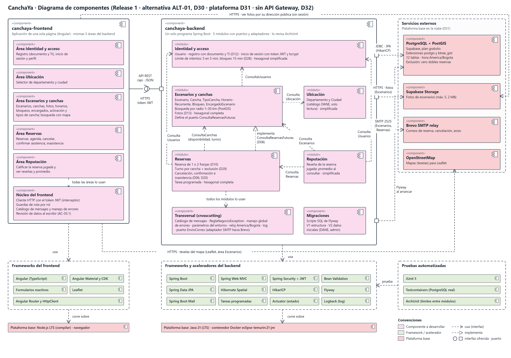

# Diagrama de componentes

> Archivo generado por `scripts/exportar_docs.py` a partir de `1. Artefactos proyecto/1.2. Artefactos técnicos/2. Diseño detallado/2. Diagrama de componentes/Diagrama de componentes - CanchaYa.xlsx`. No lo edites a mano: cambia el Excel y vuelve a ejecutar el script.

## Diagrama Componentes

- Diagrama de componentes de CanchaYa (Release 1): frontend Angular y backend Spring Boot con sus cinco módulos, las interfaces entre módulos, los servicios externos y los frameworks que se adoptan. Colores según el tipo de componente de la hoja Componentes. Fuente editable: Diagrama de componentes - CanchaYa.svg.

## Componentes

- Diagrama · Componentes
- Componente: · Solución CanchaYa (frontend y backend, Release 1)
- Descripción: · Diagrama que muestra el 100% de los componentes que serán construidos o adoptados para proceder con la construcción del componente indicado. Adicionalmente, indica cómo estos componentes están relacionados.
- Componente · Descripción · Motivación · Depende/Usa · Tipo Componente
- canchaya-frontend · Aplicación de una sola página que se abre en el navegador del celular o del computador. Reúne las pantallas de los cinco actores y se organiza en las mismas cinco áreas del backend más un núcleo común. · Separar la interfaz del backend (RT-01) y diseñar primero para el celular (AC-03.2, RNG-08). Organizarla igual que el backend deja cada pantalla junto al módulo que la atiende. · canchaya-backend (API REST) · Componente a desarrollar

**Angular**

**Angular Material y CDK**

**Leaflet**

**Supabase Storage (ver fotos)**

**OpenStreetMap**

**Node.js LTS**

- Núcleo del frontend · Piezas que comparten todas las áreas: cliente HTTP que agrega el token JWT a cada llamada, guardas de ruta por rol, catálogo de mensajes, manejo de errores y revisión de datos al escribir. · Escribir una sola vez lo que usan todas las pantallas. Mostrar el mensaje del catálogo antes de enviar (AC-03.1, RT-07) sin reemplazar la revisión del servidor. · canchaya-backend (API REST) · Componente a desarrollar

**Angular Router y HttpClient**

**Formularios reactivos**

- Área Identidad y acceso (frontend) · Pantallas de registro (documento y TI), inicio de sesión y perfil. La gestión de usuarios y roles es trabajo futuro. · HU de cuentas del Sprint 1. Cumple D12 y muestra el mensaje único de D28 al bloquear intentos. · Núcleo del frontend · Componente a desarrollar

**Área Ubicación (frontend)**

**Angular Material y CDK**

- Área Ubicación (frontend) · Selector de departamento y ciudad que usan el registro de usuarios y de escenarios. · Un solo selector reutilizable sobre el catálogo del DANE (RNG-07). · Núcleo del frontend · Componente a desarrollar

**Angular Material y CDK**

- Área Escenarios y canchas (frontend) · Pantallas para registrar escenarios, canchas, fotos, horarios, bloqueos y encargados; la activación e inactivación de escenarios por el administrador del sistema (HU13); el catálogo de tipos de cancha (HU14 a HU17, Release 2), y la búsqueda por radio con mapa. · Las coordenadas se fijan marcando el punto en el mapa (D14) y la búsqueda es por radio de 1 a 30 km (D11, D26). · Núcleo del frontend · Componente a desarrollar

**Área Ubicación (frontend)**

**Leaflet**

**Angular Material y CDK**

- Área Reservas (frontend) · Pantallas para reservar 1 o 2 franjas, ver la agenda, cancelar, confirmar asistencia y marcar inasistencia. · Es el flujo principal del producto (D06, D10, D20); se diseña con pocos pasos desde el celular (ESC-USA-01). · Núcleo del frontend · Componente a desarrollar

**Angular Material y CDK**

- Área Reputación (frontend) · Pantallas para calificar una reserva jugada y ver las reseñas y el promedio del escenario. · Una reseña por reserva jugada (RN-14) y el promedio calculado al consultar (D05). · Núcleo del frontend · Componente a desarrollar

**Angular Material y CDK**

- canchaya-backend · Programa único Spring Boot que expone la API REST (/api, JSON). Es el único que decide las reglas de negocio, revisa permisos y guarda los datos. Se divide en cinco módulos con puertos y adaptadores, más un componente transversal y las migraciones. · Alternativa ALT-01 (D30): un solo programa con una sola base de datos permite revisar horario, cancha y reservas en la misma transacción (RT-03). Sin API Gateway (D32): Spring Security cumple sus funciones (JWT, rol, CORS). · Spring Boot · Componente a desarrollar

**Spring Web MVC**

**Spring Security + JWT**

**Java 21 (LTS)**

**PostgreSQL + PostGIS (Supabase)**

**Supabase Storage**

**Brevo SMTP relay**

- Identidad y acceso · Módulo de cuentas: registro con documento y TI, inicio de sesión que entrega el token JWT, contraseñas con bcrypt, límite de intentos y consulta de usuarios y roles para los demás módulos (interfaz ConsultaUsuarios). Arquitectura hexagonal simplificada. · RT-06, AC-04.1, AC-04.3 y las decisiones D02, D03, D07, D12, D22 y D28. Los demás módulos lo usan para saber quién hace la operación. · Transversal · Componente a desarrollar

**Spring Security + JWT**

**Bean Validation**

**Spring Data JPA**

**PostgreSQL + PostGIS (Supabase)**

- Ubicación · Módulo de solo lectura con departamentos y ciudades del DANE (interfaz ConsultaUbicacion). Arquitectura hexagonal simplificada. · Catálogo que se carga con los datos iniciales (RNG-07); no tiene reglas que proteger. · Transversal · Componente a desarrollar

**Spring Data JPA**

**PostgreSQL + PostGIS (Supabase)**

- Escenarios y canchas · Módulo core: Escenario, Cancha, TipoCancha, HorarioRecurrente, Bloqueo y EncargadoEscenario; fotos y búsqueda por radio. Ofrece ConsultaCanchas (incluye tomar el turno de la cancha y los bloqueos del día, D36) y ConsultaEscenarios y define el puerto ConsultaReservasFuturas, que implementa Reservas. Arquitectura hexagonal completa. · Reglas de propiedad y encargados (D03, D22), horarios hacia adelante (D09), no inactivar con reservas futuras (D08), fotos (D13), búsqueda por radio (AC-05.1, D11, D26) y correos de activación (D19). Definir el puerto aquí evita la dependencia en círculo con Reservas. · Identidad y acceso (ConsultaUsuarios) · Componente a desarrollar

**Ubicación (ConsultaUbicacion)**

**Reservas (implementa ConsultaReservasFuturas)**

**Transversal**

**Spring Data JPA**

**Hibernate Spatial**

**Spring Boot Mail**

**Supabase Storage**

- Reservas · Módulo core: Reserva de 1 o 2 franjas con turno por cancha, cancelación, confirmación de asistencia, inasistencia y la tarea programada que envía las solicitudes de confirmación y cancela las no confirmadas (adaptador de entrada que activan las tareas programadas de Spring; solo si entran HU26 a HU28, D33). Ofrece ConsultaReservas e implementa ConsultaReservasFuturas. Arquitectura hexagonal completa. · Es el corazón del producto: cero dobles reservas con turno por cancha y restricción de exclusión (D29, RT-03), plazos (D06), inasistencia (D20). La tarea programada no recuerda nada en memoria (AC-02.2) y solo cambia lo que sigue en el estado esperado (AC-01.3). · Identidad y acceso (ConsultaUsuarios) · Componente a desarrollar

**Escenarios y canchas (ConsultaCanchas)**

**Transversal**

**Spring Data JPA**

**Tareas programadas de Spring**

**Spring Boot Mail**

**PostgreSQL + PostGIS (Supabase)**

- Reputación · Módulo de reseñas: una por reserva jugada y promedio al consultar. Arquitectura hexagonal simplificada. · RN-14 y D05; casi todo es guardar y consultar. · Identidad y acceso (ConsultaUsuarios) · Componente a desarrollar

**Reservas (ConsultaReservas)**

**Escenarios y canchas (ConsultaEscenarios)**

**Transversal**

**Spring Data JPA**

- Transversal · Funciones comunes que usan todos los módulos: catálogo de mensajes, ReglaNegocioException, manejo global de errores de la API, parámetros leídos del entorno, reloj en America/Bogota, registro de eventos y el puerto EnvioCorreo, con su adaptador SMTP (Spring Boot Mail hacia Brevo), que usan Escenarios y Reservas para enviar los correos. · Fomentar la reutilización y responder igual en todos los servicios. Configuración por ambiente (AC-07.1, RT-10), zona horaria (D27) y log estructurado sin datos sensibles (AC-06.2, RT-12). · Spring Boot · Componente a desarrollar

**Spring Web MVC**

**Logback**

- Migraciones · Scripts SQL numerados que Flyway aplica al arrancar: V1 estructura (12 tablas, PostGIS, btree_gist, exclusiones) y V2 datos iniciales (DANE Antioquia, tipos de cancha, administrador). · RT-04: desplegar sin pasos manuales ni pérdida de datos (ESC-DIS-04). V1 ya está probado. · Flyway · Componente a desarrollar

**PostgreSQL + PostGIS (Supabase)**

- Pruebas automatizadas · Pruebas del dominio sin base de datos, pruebas de concurrencia contra un PostgreSQL real en contenedor y la prueba de límites entre módulos. · RT-15 y la definición de terminado (DoD). Evidencia de cero dobles reservas (ESC-INT-01 a 03) y protección de la arquitectura hexagonal. · canchaya-backend · Componente a desarrollar

**JUnit 5**

**Testcontainers**

**ArchUnit**

- Angular · Framework de aplicaciones de una sola página con TypeScript. · Stack del Project Canvas confirmado en D30. · Node.js LTS · Frameworks/Aceleradores
- Angular Material y CDK · Piezas de pantalla accesibles y adaptables (botones, tablas, diálogos, selector de fecha). · Ahorra construir cada pieza y trae la accesibilidad (RNG-01, RNG-03). · Angular · Frameworks/Aceleradores
- Formularios reactivos · Formularios de Angular con revisión de cada campo al escribir. · Táctica AC-03.1. · Angular · Frameworks/Aceleradores
- Angular Router y HttpClient · Rutas en el navegador y llamadas HTTP con interceptores. · Incluidos en Angular; permiten las guardas por rol y agregar el token. · Angular · Frameworks/Aceleradores
- Leaflet · Librería de mapas para la búsqueda y para marcar el punto del escenario. · Sin cuenta ni clave (D14, D31, RNG-04). · OpenStreetMap · Frameworks/Aceleradores
- Spring Boot · Base del backend: arranque, configuración externalizada y servidor web incluido. · Acelera todo lo que no es del negocio (D30, AC-07.1). · Java 21 (LTS) · Frameworks/Aceleradores
- Spring Web MVC · Servicios REST en JSON (adaptadores de entrada). · RT-01; devolver solo lo necesario (AC-04.2). · Spring Boot · Frameworks/Aceleradores
- Spring Security + JWT · Autenticación con token JWT, contraseñas bcrypt, revisión del rol y CORS. · RT-06, AC-04.1 y D32. · Spring Boot · Frameworks/Aceleradores
- Bean Validation · Revisión de los datos en el servidor (Hibernate Validator). · RT-07. · Spring Boot · Frameworks/Aceleradores
- Spring Data JPA · Acceso a datos con consultas parametrizadas (adaptadores de salida). · RT-05. · Spring Boot · Frameworks/Aceleradores

**HikariCP**

- Hibernate Spatial · Tipos geográficos de PostGIS en JPA. · Búsqueda por radio (AC-05.1). · Spring Data JPA · Frameworks/Aceleradores
- HikariCP · Grupo de conexiones a la base de datos (máximo 5). · AC-05.3, límite del plan gratuito. · Spring Boot · Frameworks/Aceleradores
- Flyway · Migraciones numeradas al arrancar. · RT-04. · Spring Boot · Frameworks/Aceleradores
- Spring Boot Mail · Envío de correos por SMTP (Jakarta Mail). Lo usa el adaptador del puerto EnvioCorreo. · AC-02.1, RT-11, D15. · Spring Boot · Frameworks/Aceleradores
- Tareas programadas de Spring · Ejecución periódica de la tarea de confirmación y cancelación automática. · D06, AC-02.2. · Spring Boot · Frameworks/Aceleradores
- Spring Boot Actuator · Verificación de estado /actuator/health con la base de datos. · AC-02.3; la consulta el monitor externo. · Spring Boot · Frameworks/Aceleradores
- Logback · Registro de eventos en formato estructurado. · AC-06.2, RT-12. · Spring Boot · Frameworks/Aceleradores
- JUnit 5 · Marco de pruebas automatizadas. · RT-15. · Java 21 (LTS) · Frameworks/Aceleradores
- Testcontainers · Levanta PostgreSQL con PostGIS en un contenedor solo para la prueba. · Pruebas de concurrencia y spike (D29). · JUnit 5 · Frameworks/Aceleradores

**Docker (eclipse-temurin:21-jre)**

- ArchUnit · Prueba que falla si se rompen los límites entre módulos. · Protege la arquitectura hexagonal (RT-02, AC-07.2). · JUnit 5 · Frameworks/Aceleradores
- Java 21 (LTS) · Plataforma de ejecución del backend. · Versión de soporte de largo plazo (D30). · No aplica · Plataforma base
- Node.js LTS · Entorno para compilar el frontend con Angular CLI; no se publica. · Lo exige Angular para compilar; lo publicado es el resultado estático. · No aplica · Plataforma base
- Docker (eclipse-temurin:21-jre) · Imagen en la que corre el backend, igual en local y en Render. · RT-13, ESC-DIS-04. · Java 21 (LTS) · Plataforma base
- PostgreSQL + PostGIS (Supabase) · Base de datos única con las extensiones postgis y btree_gist, en Supabase Free. · Fuente única de información y regla de cero dobles reservas (RT-03, D29, D31). · No aplica · Plataforma base
- Supabase Storage · Almacenamiento de las fotos de los escenarios (1 GB). · El disco del contenedor se borra al reiniciar (D13, D31). · No aplica · Plataforma base
- Brevo SMTP relay · Servidor de correo por el puerto 2525, 300 correos al día. · Render Free bloquea los puertos SMTP habituales (RT-11, D31). · No aplica · Plataforma base
- OpenStreetMap · Servidor de teselas de los mapas. · Gratuito y sin clave (D31). · No aplica · Plataforma base

## Notas

**Notas del diagrama de componentes**

- • Muestra todos los componentes que se construyen (rosado) o se adoptan (verde: frameworks; salmón: plataforma base) para la solución CanchaYa del Release 1, según el arquetipo de solución, la plataforma tecnológica (D31) y D32 (sin API Gateway).
- • Las interfaces entre módulos (ConsultaUsuarios, ConsultaUbicacion, ConsultaCanchas, ConsultaEscenarios, ConsultaReservas) son los puertos de entrada que cada módulo ofrece a los demás; un módulo nunca usa el dominio, los adaptadores ni las tablas de otro (regla que revisa ArchUnit). Los nombres definitivos de clases y paquetes se fijan en 3. Diagrama de paquetes.
- • ConsultaReservasFuturas la define Escenarios y canchas (la necesita para no inactivar con reservas futuras, D08) y la implementa Reservas. Así Reservas depende de Escenarios, y no al revés, sin dependencia en círculo. • ConsultaCanchas también ofrece tomarTurno(canchaId), que bloquea la fila de la cancha hasta que termina la transacción (bloqueo pesimista, D29 punto 2), y bloqueosDelDia(canchaId, fecha). Reservas los llama dentro de la transacción de su caso de uso: hay una sola base de datos, así que el turno se mantiene hasta guardar la reserva sin que Reservas toque las tablas de Escenarios (D36).
- • Los servicios externos (PostgreSQL con PostGIS en Supabase, Supabase Storage, Brevo y OpenStreetMap) se clasifican como plataforma base porque la plantilla solo trae tres tipos de componente. Render, GitHub y UptimeRobot no aparecen porque no los usa el código: son parte del despliegue (5. Diagrama de despliegue).
- • Se agrega Node.js LTS como plataforma base del frontend: Angular CLI lo necesita para compilar. No estaba nombrado en el arquetipo ni en la plataforma tecnológica; no se publica, lo publicado es el resultado estático en Render Static Site.
- • Las versiones siguen el arquetipo: Java 21 (LTS); Spring Boot y Angular en la línea estable vigente al crear el proyecto; las demás librerías, las que traen Spring Boot o Angular.
