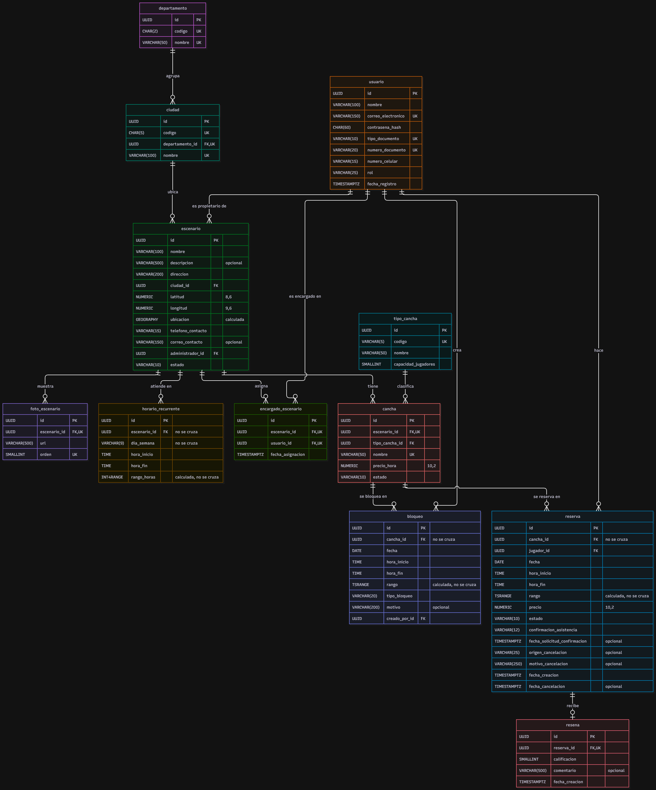

# Modelo entidad relación

> Archivo generado por `scripts/exportar_docs.py` a partir de `1. Artefactos proyecto/1.2. Artefactos técnicos/2. Diseño detallado/6. Modelo entidad relación/Modelo entidad relación - CanchaYa.xlsx`. No lo edites a mano: cambia el Excel y vuelve a ejecutar el script.

## MER

- Diagrama del modelo entidad-relación de CanchaYa (PostgreSQL 16 + PostGIS 3). PK: llave primaria; FK: llave foránea; UK: hace parte de una restricción de unicidad; "no se cruza": restricción de exclusión; "calculada": columna que calcula la base de datos. Fuente editable: Modelo entidad relación - CanchaYa.mmd. Script: V1__estructura_inicial.sql.

## Entidades

- Entidad · Desripción
- departamento · [Ubicación] Departamentos de Colombia (DANE). Se carga una sola vez con Antioquia (RNG-07). Objeto de dominio Departamento.
- ciudad · [Ubicación] Municipios de un departamento (DANE), donde se ubican los escenarios. Objeto de dominio Ciudad.
- usuario · [Identidad y acceso] Personas registradas: jugadores, administradores de cancha (propietarios y encargados) y el administrador del sistema. Objeto de dominio Usuario.
- tipo_cancha · [Escenarios y canchas] Catálogo de modalidades de fútbol (F5, F7, F11). En el Release 1 se carga con datos iniciales y es de solo lectura (D04). Objeto de dominio TipoCancha.
- escenario · [Escenarios y canchas] Complejo deportivo de un propietario, con su ubicación y datos públicos de contacto. Objeto de dominio Escenario.
- foto_escenario · [Escenarios y canchas] Fotos de un escenario. Sale del atributo fotos (lista de URL) de Escenario: una lista se guarda en una tabla aparte. Máximo 5 por escenario (D13).
- cancha · [Escenarios y canchas] Cada cancha de un escenario que se puede reservar. Objeto de dominio Cancha.
- horario_recurrente · [Escenarios y canchas] Horario semanal de atención de un escenario (rige para todas sus canchas). Las franjas no se guardan: se calculan al consultar. Objeto de dominio HorarioRecurrente.
- bloqueo · [Escenarios y canchas] Horas de una cancha que el propietario o un encargado inhabilita para reservas, en un solo día (D23). Objeto de dominio Bloqueo.
- encargado_escenario · [Escenarios y canchas] Asignación de un usuario como encargado de sede de un escenario (D03, D07). Objeto de dominio EncargadoEscenario.
- reserva · [Reservas] Reserva de 1 o 2 franjas seguidas de una cancha hecha por un jugador (D10). Objeto de dominio Reserva.
- resena · [Reputación] Calificación y comentario de un jugador sobre un escenario, a partir de una reserva ya jugada. El promedio no se guarda: se calcula al consultar (D05). Objeto de dominio Reseña.

## departamento

- Entidad · departamento
- Desripción · Departamentos de Colombia (DANE). Se carga una sola vez con Antioquia (RNG-07). Objeto de dominio Departamento.

**Atributos**

- Nombre · Tipo de dato · Longitud · Cantidad dígitos parte entera · Cantidad dígitos parte decimal (Precisión) · ¿Es autoincremento? · ¿Es obligatorio? · ¿Es llave primeria o es parte de ella? · Llave Foránea · Restricciones de unicidad · Restricciones de chequeo · Restricciones de índice · Alias · Descripción del campo
- ¿Es llave foránea? · Entidad · Columna(s) · ¿Posee restricción de unicidad o es parte de ella? · Nombre restricción unicidad a la que pertenece · ¿Posee restricción de chequeo o es parte de ella? · Nombre restricción chequeo a la que pertenece · ¿Posee restricción de índice o es parte de ella? · Tipo · Nombre restricción índice a la que pertenece
- id · UUID · NO · SI · SI · NO · NO · NO · NO · id · Identificador único del departamento. Lo genera el backend (RT-09). Restricción pk_departamento.
- codigo · CHAR · 2 · NO · SI · NO · NO · SI · uq_departamento_codigo · SI · ck_departamento_codigo · NO · codigo · Código DANE de 2 dígitos.
- nombre · VARCHAR · 50 · NO · SI · NO · NO · SI · uq_departamento_nombre · NO · NO · nombre · Nombre del departamento.

## ciudad

- Entidad · ciudad
- Desripción · Municipios de un departamento (DANE), donde se ubican los escenarios. Objeto de dominio Ciudad.

**Atributos**

- Nombre · Tipo de dato · Longitud · Cantidad dígitos parte entera · Cantidad dígitos parte decimal (Precisión) · ¿Es autoincremento? · ¿Es obligatorio? · ¿Es llave primeria o es parte de ella? · Llave Foránea · Restricciones de unicidad · Restricciones de chequeo · Restricciones de índice · Alias · Descripción del campo
- ¿Es llave foránea? · Entidad · Columna(s) · ¿Posee restricción de unicidad o es parte de ella? · Nombre restricción unicidad a la que pertenece · ¿Posee restricción de chequeo o es parte de ella? · Nombre restricción chequeo a la que pertenece · ¿Posee restricción de índice o es parte de ella? · Tipo · Nombre restricción índice a la que pertenece
- id · UUID · NO · SI · SI · NO · NO · NO · NO · id · Identificador único de la ciudad. Lo genera el backend (RT-09). Restricción pk_ciudad.
- codigo · CHAR · 5 · NO · SI · NO · NO · SI · uq_ciudad_codigo · SI · ck_ciudad_codigo · NO · codigo · Código DANE de 5 dígitos del municipio.
- departamento_id · UUID · NO · SI · NO · SI · departamento · id · SI · uq_ciudad_departamento_nombre · NO · NO · departamento · Departamento al que pertenece la ciudad (fk_ciudad_departamento).
- nombre · VARCHAR · 100 · NO · SI · NO · NO · SI · uq_ciudad_departamento_nombre · NO · NO · nombre · Nombre del municipio. No se repite dentro del mismo departamento.

## usuario

- Entidad · usuario
- Desripción · Personas registradas: jugadores, administradores de cancha (propietarios y encargados) y el administrador del sistema. Objeto de dominio Usuario.

**Atributos**

- Nombre · Tipo de dato · Longitud · Cantidad dígitos parte entera · Cantidad dígitos parte decimal (Precisión) · ¿Es autoincremento? · ¿Es obligatorio? · ¿Es llave primeria o es parte de ella? · Llave Foránea · Restricciones de unicidad · Restricciones de chequeo · Restricciones de índice · Alias · Descripción del campo
- ¿Es llave foránea? · Entidad · Columna(s) · ¿Posee restricción de unicidad o es parte de ella? · Nombre restricción unicidad a la que pertenece · ¿Posee restricción de chequeo o es parte de ella? · Nombre restricción chequeo a la que pertenece · ¿Posee restricción de índice o es parte de ella? · Tipo · Nombre restricción índice a la que pertenece
- id · UUID · NO · SI · SI · NO · NO · NO · NO · id · Identificador único del usuario. Lo genera el backend (RT-09). Restricción pk_usuario.
- nombre · VARCHAR · 100 · NO · SI · NO · NO · NO · NO · NO · nombre · Nombre completo del usuario.
- correo_electronico · VARCHAR · 150 · NO · SI · NO · NO · SI · uq_usuario_correo · SI · ck_usuario_correo · NO · correoElectronico · Correo de inicio de sesión y notificaciones. Se guarda en minúsculas para que la unicidad no dependa de mayúsculas.
- contrasena_hash · CHAR · 60 · NO · SI · NO · NO · NO · NO · NO · contrasenaHash · Hash bcrypt de la contraseña; nunca se guarda en texto plano (RT-06).
- tipo_documento · VARCHAR · 10 · NO · SI · NO · NO · SI · uq_usuario_documento · SI · ck_usuario_tipo_documento, ck_usuario_numero_documento, ck_usuario_ti_solo_jugador · NO · tipoDocumento · CC, CE, TI, PASAPORTE o NIT (D12).
- numero_documento · VARCHAR · 20 · NO · SI · NO · NO · SI · uq_usuario_documento · SI · ck_usuario_numero_documento · NO · numeroDocumento · Número de documento con el formato de su tipo (D12). Dato sensible: no se registra en el log (RT-12).
- numero_celular · VARCHAR · 15 · NO · SI · NO · NO · NO · NO · NO · numeroCelular · Celular de contacto. Dato sensible (AG-15).
- rol · VARCHAR · 25 · NO · SI · NO · NO · NO · SI · ck_usuario_rol, ck_usuario_ti_solo_jugador · NO · rol · JUGADOR, ADMINISTRADOR_CANCHA o ADMINISTRADOR_SISTEMA. La TI solo se admite con JUGADOR.
- fecha_registro · TIMESTAMPTZ · NO · SI · NO · NO · NO · NO · NO · fechaRegistro · Fecha y hora del registro.

## tipo_cancha

- Entidad · tipo_cancha
- Desripción · Catálogo de modalidades de fútbol (F5, F7, F11). En el Release 1 se carga con datos iniciales y es de solo lectura (D04). Objeto de dominio TipoCancha.

**Atributos**

- Nombre · Tipo de dato · Longitud · Cantidad dígitos parte entera · Cantidad dígitos parte decimal (Precisión) · ¿Es autoincremento? · ¿Es obligatorio? · ¿Es llave primeria o es parte de ella? · Llave Foránea · Restricciones de unicidad · Restricciones de chequeo · Restricciones de índice · Alias · Descripción del campo
- ¿Es llave foránea? · Entidad · Columna(s) · ¿Posee restricción de unicidad o es parte de ella? · Nombre restricción unicidad a la que pertenece · ¿Posee restricción de chequeo o es parte de ella? · Nombre restricción chequeo a la que pertenece · ¿Posee restricción de índice o es parte de ella? · Tipo · Nombre restricción índice a la que pertenece
- id · UUID · NO · SI · SI · NO · NO · NO · NO · id · Identificador único del tipo de cancha. Lo genera el backend (RT-09). Restricción pk_tipo_cancha.
- codigo · VARCHAR · 5 · NO · SI · NO · NO · SI · uq_tipo_cancha_codigo · SI · ck_tipo_cancha_codigo · NO · codigo · Código corto: letras mayúsculas y dígitos (F5, F7, F11).
- nombre · VARCHAR · 50 · NO · SI · NO · NO · NO · NO · NO · nombre · Nombre legible (por ejemplo, Fútbol 5).
- capacidad_jugadores · SMALLINT · 2 · NO · SI · NO · NO · NO · SI · ck_tipo_cancha_capacidad · NO · capacidadJugadores · Máximo de jugadores de ambos equipos, de 2 a 22.

## escenario

- Entidad · escenario
- Desripción · Complejo deportivo de un propietario, con su ubicación y datos públicos de contacto. Objeto de dominio Escenario.

**Atributos**

- Nombre · Tipo de dato · Longitud · Cantidad dígitos parte entera · Cantidad dígitos parte decimal (Precisión) · ¿Es autoincremento? · ¿Es obligatorio? · ¿Es llave primeria o es parte de ella? · Llave Foránea · Restricciones de unicidad · Restricciones de chequeo · Restricciones de índice · Alias · Descripción del campo
- ¿Es llave foránea? · Entidad · Columna(s) · ¿Posee restricción de unicidad o es parte de ella? · Nombre restricción unicidad a la que pertenece · ¿Posee restricción de chequeo o es parte de ella? · Nombre restricción chequeo a la que pertenece · ¿Posee restricción de índice o es parte de ella? · Tipo · Nombre restricción índice a la que pertenece
- id · UUID · NO · SI · SI · NO · NO · NO · NO · id · Identificador único del escenario. Lo genera el backend (RT-09). Restricción pk_escenario.
- nombre · VARCHAR · 100 · NO · SI · NO · NO · NO · NO · NO · nombre · Nombre comercial del escenario.
- descripcion · VARCHAR · 500 · NO · NO · NO · NO · NO · NO · NO · descripcion · Presentación del escenario en su ficha pública (opcional).
- direccion · VARCHAR · 200 · NO · SI · NO · NO · NO · NO · NO · direccion · Dirección física.
- ciudad_id · UUID · NO · SI · NO · SI · ciudad · id · NO · NO · SI · ASC · ix_escenario_ciudad · ciudad · Ciudad del escenario; permite buscar por ciudad sin permiso de ubicación (D11).
- latitud · NUMERIC · 2 · 6 · NO · SI · NO · NO · NO · SI · ck_escenario_latitud · NO · latitud · Latitud del punto marcado en el mapa (D14), de -90 a 90.
- longitud · NUMERIC · 3 · 6 · NO · SI · NO · NO · NO · SI · ck_escenario_longitud · NO · longitud · Longitud del punto marcado en el mapa (D14), de -180 a 180.
- ubicacion · GEOGRAPHY(POINT, 4326) · NO · SI · NO · NO · NO · NO · SI · GIST · ix_escenario_ubicacion · (se calcula de latitud y longitud) · Punto geográfico que la base de datos calcula sola a partir de latitud y longitud (columna generada). Su índice espacial permite buscar en un radio de 1 a 30 km ordenado por distancia (AC-05.1, D26).
- telefono_contacto · VARCHAR · 15 · NO · SI · NO · NO · NO · NO · NO · telefonoContacto · Teléfono público del escenario.
- correo_contacto · VARCHAR · 150 · NO · NO · NO · NO · NO · SI · ck_escenario_correo · NO · correoContacto · Correo público del escenario (opcional).
- administrador_id · UUID · NO · SI · NO · SI · usuario · id · NO · NO · SI · ASC · ix_escenario_administrador · administrador · Propietario del escenario (rol ADMINISTRADOR_CANCHA; lo revisa el backend).
- estado · VARCHAR · 10 · NO · SI · NO · NO · NO · SI · ck_escenario_estado · NO · estado · ACTIVO o INACTIVO. Valor por defecto INACTIVO: lo activa el administrador del sistema.

## foto_escenario

- Entidad · foto_escenario
- Desripción · Fotos de un escenario. Sale del atributo fotos (lista de URL) de Escenario: una lista se guarda en una tabla aparte. Máximo 5 por escenario (D13).

**Atributos**

- Nombre · Tipo de dato · Longitud · Cantidad dígitos parte entera · Cantidad dígitos parte decimal (Precisión) · ¿Es autoincremento? · ¿Es obligatorio? · ¿Es llave primeria o es parte de ella? · Llave Foránea · Restricciones de unicidad · Restricciones de chequeo · Restricciones de índice · Alias · Descripción del campo
- ¿Es llave foránea? · Entidad · Columna(s) · ¿Posee restricción de unicidad o es parte de ella? · Nombre restricción unicidad a la que pertenece · ¿Posee restricción de chequeo o es parte de ella? · Nombre restricción chequeo a la que pertenece · ¿Posee restricción de índice o es parte de ella? · Tipo · Nombre restricción índice a la que pertenece
- id · UUID · NO · SI · SI · NO · NO · NO · NO · id · Identificador único de la foto. Lo genera el backend (RT-09). Restricción pk_foto_escenario.
- escenario_id · UUID · NO · SI · NO · SI · escenario · id · SI · uq_foto_escenario_orden · NO · NO · (escenario dueño de fotos) · Escenario al que pertenece la foto (fk_foto_escenario_escenario).
- url · VARCHAR · 500 · NO · SI · NO · NO · NO · NO · NO · fotos[i] · Dirección de la foto en Supabase Storage (D31).
- orden · SMALLINT · 1 · NO · SI · NO · NO · SI · uq_foto_escenario_orden · SI · ck_foto_escenario_orden · NO · (posición en fotos) · Posición de la foto, de 1 a 5. Como no se repite dentro del escenario, la base de datos impide una sexta foto.

## cancha

- Entidad · cancha
- Desripción · Cada cancha de un escenario que se puede reservar. Objeto de dominio Cancha.

**Atributos**

- Nombre · Tipo de dato · Longitud · Cantidad dígitos parte entera · Cantidad dígitos parte decimal (Precisión) · ¿Es autoincremento? · ¿Es obligatorio? · ¿Es llave primeria o es parte de ella? · Llave Foránea · Restricciones de unicidad · Restricciones de chequeo · Restricciones de índice · Alias · Descripción del campo
- ¿Es llave foránea? · Entidad · Columna(s) · ¿Posee restricción de unicidad o es parte de ella? · Nombre restricción unicidad a la que pertenece · ¿Posee restricción de chequeo o es parte de ella? · Nombre restricción chequeo a la que pertenece · ¿Posee restricción de índice o es parte de ella? · Tipo · Nombre restricción índice a la que pertenece
- id · UUID · NO · SI · SI · NO · NO · NO · NO · id · Identificador único de la cancha. Lo genera el backend (RT-09). Restricción pk_cancha.
- escenario_id · UUID · NO · SI · NO · SI · escenario · id · SI · uq_cancha_escenario_nombre · NO · NO · escenario · Escenario al que pertenece la cancha (fk_cancha_escenario).
- tipo_cancha_id · UUID · NO · SI · NO · SI · tipo_cancha · id · NO · NO · SI · ASC · ix_cancha_tipo_cancha · tipoCancha · Modalidad de la cancha; sirve para el filtro de búsqueda (fk_cancha_tipo_cancha).
- nombre · VARCHAR · 50 · NO · SI · NO · NO · SI · uq_cancha_escenario_nombre · NO · NO · nombre · Nombre o número de la cancha (por ejemplo, Cancha 1). No se repite en el escenario.
- precio_hora · NUMERIC · 8 · 2 · NO · SI · NO · NO · NO · SI · ck_cancha_precio_hora · NO · precioHora · Precio por hora, mayor que cero.
- estado · VARCHAR · 10 · NO · SI · NO · NO · NO · SI · ck_cancha_estado · NO · estado · DISPONIBLE o INACTIVA. Valor por defecto DISPONIBLE.

## horario_recurrente

- Entidad · horario_recurrente
- Desripción · Horario semanal de atención de un escenario (rige para todas sus canchas). Las franjas no se guardan: se calculan al consultar. Objeto de dominio HorarioRecurrente.

**Atributos**

- Nombre · Tipo de dato · Longitud · Cantidad dígitos parte entera · Cantidad dígitos parte decimal (Precisión) · ¿Es autoincremento? · ¿Es obligatorio? · ¿Es llave primeria o es parte de ella? · Llave Foránea · Restricciones de unicidad · Restricciones de chequeo · Restricciones de índice · Alias · Descripción del campo
- ¿Es llave foránea? · Entidad · Columna(s) · ¿Posee restricción de unicidad o es parte de ella? · Nombre restricción unicidad a la que pertenece · ¿Posee restricción de chequeo o es parte de ella? · Nombre restricción chequeo a la que pertenece · ¿Posee restricción de índice o es parte de ella? · Tipo · Nombre restricción índice a la que pertenece
- id · UUID · NO · SI · SI · NO · NO · NO · NO · id · Identificador único del horario. Lo genera el backend (RT-09). Restricción pk_horario_recurrente.
- escenario_id · UUID · NO · SI · NO · SI · escenario · id · SI · ex_horario_recurrente_sin_cruce (exclusión) · NO · SI · GIST · ex_horario_recurrente_sin_cruce · escenario · Escenario al que aplica el horario.
- dia_semana · VARCHAR · 9 · NO · SI · NO · NO · SI · ex_horario_recurrente_sin_cruce (exclusión) · SI · ck_horario_recurrente_dia_semana · SI · GIST · ex_horario_recurrente_sin_cruce · diaSemana · LUNES a DOMINGO.
- hora_inicio · TIME · NO · SI · NO · NO · NO · SI · ck_horario_recurrente_en_punto, ck_horario_recurrente_orden · NO · horaInicio · Hora de inicio, en punto (D10).
- hora_fin · TIME · NO · SI · NO · NO · NO · SI · ck_horario_recurrente_en_punto, ck_horario_recurrente_orden · NO · horaFin · Hora de fin, en punto y mayor que la de inicio.
- rango_horas · INT4RANGE · NO · SI · NO · NO · SI · ex_horario_recurrente_sin_cruce (exclusión) · NO · SI · GIST · ex_horario_recurrente_sin_cruce · (se calcula de las horas) · Rango de horas [inicio, fin) que la base de datos calcula sola. Con él, dos horarios del mismo escenario y día no se pueden cruzar.

## bloqueo

- Entidad · bloqueo
- Desripción · Horas de una cancha que el propietario o un encargado inhabilita para reservas, en un solo día (D23). Objeto de dominio Bloqueo.

**Atributos**

- Nombre · Tipo de dato · Longitud · Cantidad dígitos parte entera · Cantidad dígitos parte decimal (Precisión) · ¿Es autoincremento? · ¿Es obligatorio? · ¿Es llave primeria o es parte de ella? · Llave Foránea · Restricciones de unicidad · Restricciones de chequeo · Restricciones de índice · Alias · Descripción del campo
- ¿Es llave foránea? · Entidad · Columna(s) · ¿Posee restricción de unicidad o es parte de ella? · Nombre restricción unicidad a la que pertenece · ¿Posee restricción de chequeo o es parte de ella? · Nombre restricción chequeo a la que pertenece · ¿Posee restricción de índice o es parte de ella? · Tipo · Nombre restricción índice a la que pertenece
- id · UUID · NO · SI · SI · NO · NO · NO · NO · id · Identificador único del bloqueo. Lo genera el backend (RT-09). Restricción pk_bloqueo.
- cancha_id · UUID · NO · SI · NO · SI · cancha · id · SI · ex_bloqueo_sin_cruce (exclusión) · NO · SI · GIST · ex_bloqueo_sin_cruce · cancha · Cancha bloqueada (fk_bloqueo_cancha).
- fecha · DATE · NO · SI · NO · NO · NO · NO · NO · fecha · Día del bloqueo.
- hora_inicio · TIME · NO · SI · NO · NO · NO · SI · ck_bloqueo_en_punto, ck_bloqueo_orden · NO · horaInicio · Hora de inicio, en punto (D18).
- hora_fin · TIME · NO · SI · NO · NO · NO · SI · ck_bloqueo_en_punto, ck_bloqueo_orden · NO · horaFin · Hora de fin, en punto y mayor que la de inicio.
- rango · TSRANGE · NO · SI · NO · NO · SI · ex_bloqueo_sin_cruce (exclusión) · NO · SI · GIST · ex_bloqueo_sin_cruce · (se calcula de fecha y horas) · Rango de fecha y hora que la base de datos calcula sola. Con él, dos bloqueos de la misma cancha no se pueden cruzar.
- tipo_bloqueo · VARCHAR · 20 · NO · SI · NO · NO · NO · SI · ck_bloqueo_tipo · NO · tipoBloqueo · MANTENIMIENTO, TORNEO, USO_PROPIO o RESERVA_PRESENCIAL.
- motivo · VARCHAR · 200 · NO · NO · NO · NO · NO · NO · NO · motivo · Detalle opcional del bloqueo.
- creado_por_id · UUID · NO · SI · NO · SI · usuario · id · NO · NO · NO · creadoPor · Propietario o encargado que creó el bloqueo (fk_bloqueo_creado_por).

## encargado_escenario

- Entidad · encargado_escenario
- Desripción · Asignación de un usuario como encargado de sede de un escenario (D03, D07). Objeto de dominio EncargadoEscenario.

**Atributos**

- Nombre · Tipo de dato · Longitud · Cantidad dígitos parte entera · Cantidad dígitos parte decimal (Precisión) · ¿Es autoincremento? · ¿Es obligatorio? · ¿Es llave primeria o es parte de ella? · Llave Foránea · Restricciones de unicidad · Restricciones de chequeo · Restricciones de índice · Alias · Descripción del campo
- ¿Es llave foránea? · Entidad · Columna(s) · ¿Posee restricción de unicidad o es parte de ella? · Nombre restricción unicidad a la que pertenece · ¿Posee restricción de chequeo o es parte de ella? · Nombre restricción chequeo a la que pertenece · ¿Posee restricción de índice o es parte de ella? · Tipo · Nombre restricción índice a la que pertenece
- id · UUID · NO · SI · SI · NO · NO · NO · NO · id · Identificador único de la asignación. Lo genera el backend (RT-09). Restricción pk_encargado_escenario.
- escenario_id · UUID · NO · SI · NO · SI · escenario · id · SI · uq_encargado_escenario_usuario · NO · NO · escenario · Escenario asignado.
- usuario_id · UUID · NO · SI · NO · SI · usuario · id · SI · uq_encargado_escenario_usuario · NO · SI · ASC · ix_encargado_escenario_usuario · usuario · Encargado asignado (rol ADMINISTRADOR_CANCHA, distinto del propietario, D22; lo revisa el backend).
- fecha_asignacion · TIMESTAMPTZ · NO · SI · NO · NO · NO · NO · NO · fechaAsignacion · Fecha y hora de la asignación.

## reserva

- Entidad · reserva
- Desripción · [Reservas] Reserva de 1 o 2 franjas seguidas de una cancha hecha por un jugador (D10). Objeto de dominio Reserva.

**Atributos**

- Nombre · Tipo de dato · Longitud · Cantidad dígitos parte entera · Cantidad dígitos parte decimal (Precisión) · ¿Es autoincremento? · ¿Es obligatorio? · ¿Es llave primeria o es parte de ella? · Llave Foránea · Restricciones de unicidad · Restricciones de chequeo · Restricciones de índice · Alias · Descripción del campo
- ¿Es llave foránea? · Entidad · Columna(s) · ¿Posee restricción de unicidad o es parte de ella? · Nombre restricción unicidad a la que pertenece · ¿Posee restricción de chequeo o es parte de ella? · Nombre restricción chequeo a la que pertenece · ¿Posee restricción de índice o es parte de ella? · Tipo · Nombre restricción índice a la que pertenece
- id · UUID · NO · SI · SI · NO · NO · NO · NO · id · Identificador único de la reserva. Lo genera el backend (RT-09). Restricción pk_reserva.
- cancha_id · UUID · NO · SI · NO · SI · cancha · id · SI · ex_reserva_sin_cruce (exclusión) · NO · SI · ASC, GIST · ix_reserva_cancha_fecha, ex_reserva_sin_cruce · cancha · Cancha reservada (fk_reserva_cancha).
- jugador_id · UUID · NO · SI · NO · SI · usuario · id · NO · NO · SI · ASC · ix_reserva_jugador_fecha · jugador · Jugador que reserva (fk_reserva_jugador). El índice sirve para "mis reservas" y el límite diario de 2 horas.
- fecha · DATE · NO · SI · NO · NO · NO · NO · SI · ASC · ix_reserva_cancha_fecha, ix_reserva_jugador_fecha, ix_reserva_pendientes · fecha · Día de la reserva, dentro de los 30 días siguientes (lo revisa el backend).
- hora_inicio · TIME · NO · SI · NO · NO · NO · SI · ck_reserva_en_punto, ck_reserva_duracion · SI · ASC · ix_reserva_pendientes · horaInicio · Hora de inicio, en punto.
- hora_fin · TIME · NO · SI · NO · NO · NO · SI · ck_reserva_en_punto, ck_reserva_duracion · NO · horaFin · Hora de fin: 1 o 2 horas después del inicio (D10).
- rango · TSRANGE · NO · SI · NO · NO · SI · ex_reserva_sin_cruce (exclusión) · NO · SI · GIST · ex_reserva_sin_cruce · (se calcula de fecha y horas) · La reserva completa como un solo rango de tiempo, que la base de datos calcula sola (D29). Con él, dos reservas CONFIRMADAS de la misma cancha no se pueden cruzar: es la regla de cero dobles reservas (RT-03).
- precio · NUMERIC · 8 · 2 · NO · SI · NO · NO · NO · SI · ck_reserva_precio · NO · precio · Precio al momento de reservar: precio por hora × horas. No cambia si después cambia la tarifa.
- estado · VARCHAR · 10 · NO · SI · NO · NO · NO · SI · ck_reserva_estado, ck_reserva_cancelacion · NO · estado · CONFIRMADA, CANCELADA o NO_ASISTIO. Valor por defecto CONFIRMADA.
- confirmacion_asistencia · VARCHAR · 12 · NO · SI · NO · NO · NO · SI · ck_reserva_confirmacion · SI · ASC · ix_reserva_pendientes (parcial) · confirmacionAsistencia · PENDIENTE, CONFIRMADA o NO_REQUERIDA. Valor por defecto PENDIENTE. El índice parcial ayuda a la tarea programada (D06).
- fecha_solicitud_confirmacion · TIMESTAMPTZ · NO · NO · NO · NO · NO · SI · NO · fechaSolicitudConfirmacion · Fecha y hora en que se envió la solicitud de confirmación de asistencia (HU26). Vacía mientras no se envíe. Evita reenviar el correo y la tarea solo cancela si existe (D34).
- origen_cancelacion · VARCHAR · 25 · NO · NO · NO · NO · NO · SI · ck_reserva_origen, ck_reserva_cancelacion, ck_reserva_motivo_admin · NO · origenCancelacion · JUGADOR, ADMINISTRADOR o SISTEMA_SIN_CONFIRMACION. Existe solo si la reserva está cancelada.
- motivo_cancelacion · VARCHAR · 250 · NO · NO · NO · NO · NO · SI · ck_reserva_motivo_admin · NO · motivoCancelacion · Justificación; obligatoria cuando cancela el propietario por fuerza mayor (RN-07).
- fecha_creacion · TIMESTAMPTZ · NO · SI · NO · NO · NO · NO · NO · fechaCreacion · Fecha y hora en que se creó la reserva.
- fecha_cancelacion · TIMESTAMPTZ · NO · NO · NO · NO · NO · SI · ck_reserva_cancelacion · NO · fechaCancelacion · Fecha y hora de la cancelación; existe solo si la reserva está cancelada.

## resena

- Entidad · resena
- Desripción · Calificación y comentario de un jugador sobre un escenario, a partir de una reserva ya jugada. El promedio no se guarda: se calcula al consultar (D05). Objeto de dominio Reseña.

**Atributos**

- Nombre · Tipo de dato · Longitud · Cantidad dígitos parte entera · Cantidad dígitos parte decimal (Precisión) · ¿Es autoincremento? · ¿Es obligatorio? · ¿Es llave primeria o es parte de ella? · Llave Foránea · Restricciones de unicidad · Restricciones de chequeo · Restricciones de índice · Alias · Descripción del campo
- ¿Es llave foránea? · Entidad · Columna(s) · ¿Posee restricción de unicidad o es parte de ella? · Nombre restricción unicidad a la que pertenece · ¿Posee restricción de chequeo o es parte de ella? · Nombre restricción chequeo a la que pertenece · ¿Posee restricción de índice o es parte de ella? · Tipo · Nombre restricción índice a la que pertenece
- id · UUID · NO · SI · SI · NO · NO · NO · NO · id · Identificador único de la reseña. Lo genera el backend (RT-09). Restricción pk_resena.
- reserva_id · UUID · NO · SI · NO · SI · reserva · id · SI · uq_resena_reserva · NO · NO · reserva · Reserva jugada que origina la reseña; solo una reseña por reserva (fk_resena_reserva).
- calificacion · SMALLINT · 1 · NO · SI · NO · NO · NO · SI · ck_resena_calificacion · NO · calificacion · Calificación de 1 a 5.
- comentario · VARCHAR · 500 · NO · NO · NO · NO · NO · NO · NO · comentario · Comentario opcional.
- fecha_creacion · TIMESTAMPTZ · NO · SI · NO · NO · NO · NO · NO · fechaCreacion · Fecha y hora de publicación.

## Notas

**Notas sobre el modelo entidad-relación**

- • Es la estructura de la base de datos que se crea en Supabase (PostgreSQL con PostGIS, D31). Sale del modelo de dominio enriquecido: 11 objetos de dominio se vuelven 12 tablas, porque la lista de fotos de Escenario se guarda en una tabla aparte (foto_escenario).
- • No se incluyen Sancion ni SerieReserva, ni la columna serieReserva de Reserva: son trabajo futuro (D24) y se agregarán con una migración nueva cuando se implementen.
- • Nombres: tablas y columnas en minúscula con guion bajo (snake_case), porque PostgreSQL pasa a minúscula los nombres escritos sin comillas. La columna Alias da el nombre del atributo en el modelo de dominio (camelCase), que es el que usa el código Java. Las restricciones empiezan por pk_ (llave primaria), fk_ (llave foránea), uq_ (unicidad), ck_ (chequeo), ix_ (índice) y ex_ (exclusión).
- • Todo registro se identifica con un UUID que genera el backend (RT-09). Ninguna columna es autoincremental.
- • Fechas y horas: el día y las horas de reservas, bloqueos y horarios se guardan como hora de Colombia (tipos DATE y TIME, D27). Los momentos en que algo pasó (registro, creación, cancelación, asignación) se guardan como instante exacto (TIMESTAMPTZ). La aplicación trabaja en la zona America/Bogota.
- • Cero dobles reservas (RT-03, D29 punto 1): la restricción de exclusión ex_reserva_sin_cruce impide que dos reservas CONFIRMADAS de la misma cancha se crucen en el tiempo. Una reserva de 2 franjas se guarda como un solo rango (columna rango). Una reserva cancelada deja libre su franja. Los puntos 2 y 3 de D29 (turnos por cancha y actualización condicional) los hace el backend y no necesitan columnas extra.
- • Columnas calculadas (ubicacion, rango y rango_horas): la base de datos las calcula sola a partir de otras columnas. El backend nunca las escribe (en JPA se marcan como insertable = false y updatable = false).
- • Reglas que la base de datos no puede revisar y quedan en el backend: el rol de cada usuario referenciado (propietario y encargado con ADMINISTRADOR_CANCHA, jugador con JUGADOR), que el propietario no sea encargado de su escenario (D22), la ventana de 30 días, el límite diario de 2 horas por jugador, que la reserva caiga dentro del horario y no choque con un bloqueo (por eso reservar y bloquear se hacen por turnos, D29 punto 2), y que solo se reseñe una reserva ya jugada.
- • Valores por defecto: escenario INACTIVO, cancha DISPONIBLE, reserva CONFIRMADA y confirmación de asistencia PENDIENTE.
- • Ninguna llave foránea borra en cascada: escenarios y canchas no se borran, se inactivan (D08). Horarios y bloqueos sí se pueden eliminar porque ninguna tabla depende de ellos.
- • Prueba: el 2-nov-2026 el script se ejecutó en PostgreSQL 16.4 con PostGIS 3.4 (contenedor Docker). Se crearon las 12 tablas y la base de datos rechazó los 11 casos prohibidos que se probaron: doble reserva, reserva de 3 horas, hora que no es en punto, cancelación sin origen, fuerza mayor sin justificación, TI con rol de administrador, correo con mayúsculas, CC mal formada, horarios cruzados, sexta foto y bloqueos cruzados. Los casos válidos (reserva seguida, franja liberada que se vuelve a reservar) sí pasaron.
- • Los datos iniciales (departamento de Antioquia y sus municipios con códigos del DANE, tipos de cancha F5, F7 y F11, y el usuario administrador del sistema) van en una segunda migración (V2) durante el Sprint 1, tomados del archivo oficial del DANE.
- • Archivos de esta carpeta: este Excel (documentación por tabla), V1__estructura_inicial.sql (script de creación, que será la primera migración de Flyway, RT-04), Modelo entidad relación - CanchaYa.mmd (fuente editable del diagrama en Mermaid; se abre en mermaid.live) y su imagen PNG.
