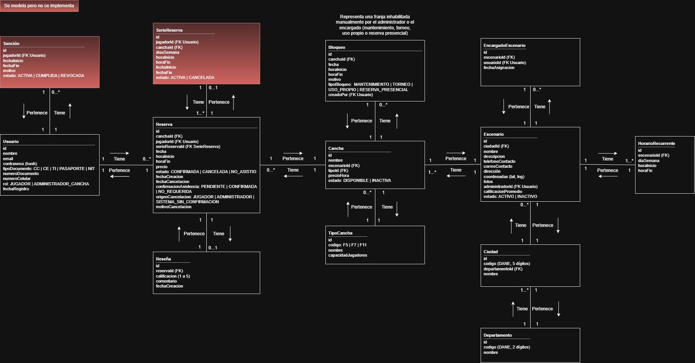

# Modelo de dominio enriquecido

> Archivo generado por `scripts/exportar_docs.py` a partir de `1. Artefactos proyecto/1.1. Artefactos estratégicos/1.1.4. Modelo de dominio/1.1.3.2. Modelo de dominio enriquecido/Modelo_de_dominio_enriquecido_CanchaYa.xlsx`. No lo edites a mano: cambia el Excel y vuelve a ejecutar el script.

Referencia oficial del dominio: atributos, combinaciones únicas, responsabilidades y políticas (reglas de negocio) de cada objeto. Toda entidad lleva `id` UUID generado en el servidor y los atributos van en camelCase.

_Imagen: `1. Artefactos proyecto/1.1. Artefactos estratégicos/1.1.4. Modelo de dominio/Modelo de dominio Ampliado.drawio.png`._

| Objeto | Descripción |
|---|---|
| [Usuario](usuario.md) | Objeto de dominio que representa a las personas registradas en la plataforma: jugadores que reservan canchas, administradores de cancha que gestionan escenarios deportivos (el propietario y los encargados de sede, que son actores de negocio distintos con el mismo rol técnico ADMINISTRADOR_CANCHA, limitado por EncargadoEscenario) y el administrador del sistema, que activa los escenarios y gestiona los catálogos. |
| [Sancion](sancion.md) | Objeto de dominio que representa una suspensión temporal impuesta a un jugador para reservar canchas, derivada de inasistencias reiteradas. TRABAJO FUTURO: se modela, pero no se implementa en el alcance actual. |
| [Escenario](escenario.md) | Objeto de dominio que representa el complejo deportivo (conjunto de canchas) registrado y administrado por un administrador dentro de la plataforma, con su ubicación y datos públicos de contacto. |
| [Cancha](cancha.md) | Objeto de dominio que representa cada cancha sintética individual, perteneciente a un escenario, que puede ser reservada por los jugadores. |
| [TipoCancha](tipocancha.md) | Objeto de dominio que representa la modalidad de fútbol para la que está configurada una cancha (por ejemplo F5, F7 o F11), junto con sus características propias. En el Release 1 el catálogo se carga con datos iniciales (F5, F7 y F11) y se usa como lista de solo lectura; su gestión es del Release 2. |
| [HorarioRecurrente](horariorecurrente.md) | Objeto de dominio que define la disponibilidad semanal recurrente de un escenario (aplica a todas sus canchas). A partir de él se calculan, en cada consulta, las franjas de una hora reservables, descontando reservas y bloqueos; las franjas no se almacenan como entidad. |
| [Bloqueo](bloqueo.md) | Objeto de dominio que representa un bloque de tiempo de una cancha inhabilitado manualmente por el administrador o un encargado (mantenimiento, torneo, uso propio o reserva presencial), no disponible para reservas de jugadores. |
| [EncargadoEscenario](encargadoescenario.md) | Objeto de dominio que representa la asignación de un usuario como encargado de un escenario, con permisos limitados a la operación diaria de esa sede. El propietario del escenario no se registra aquí: está en el atributo administrador de Escenario. |
| [Reserva](reserva.md) | Objeto de dominio que contiene la información de una reserva realizada por un jugador sobre una cancha, para una fecha y horario determinados. |
| [SerieReserva](seriereserva.md) | Objeto de dominio que representa un conjunto de reservas recurrentes (por ejemplo, de lunes a viernes, o el mismo día durante varias semanas) creadas por un jugador en una sola operación. TRABAJO FUTURO: se modela, pero no se implementa en el alcance actual. |
| [Reseña](resena.md) | Objeto de dominio que representa la calificación y el comentario de un jugador sobre un escenario, a partir de una reserva que ya jugó. |
| [Departamento](departamento.md) | Objeto de dominio de referencia que representa un departamento de Colombia. Agrupa ciudades y permite filtrar la búsqueda de escenarios. Se carga inicialmente con los datos de Antioquia. |
| [Ciudad](ciudad.md) | Objeto de dominio de referencia que representa un municipio o ciudad de un departamento, donde se ubican los escenarios. Se carga inicialmente con los municipios de Antioquia. |
